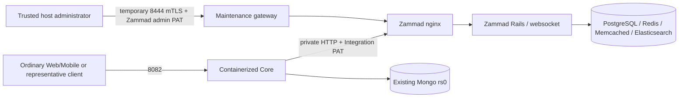

# Flow 04 local private deployment

Verified 2026-11-20 on Docker Desktop / Compose v5.7.0. Applies only to
`core-backend` and `zammad-docker-compose`; never to the separate `compose` Zammad
project on port 8080. These files preserve existing named volumes and rs0.

## Topology and trust



- `arimms-p0-zammad-private-v1`: internal Docker network; Zammad has **no host port**.
- `arimms-p0-core-data-v1`: internal network; the existing Core Mongo has **no host port**.
- Core also joins `arimms-p0-core-edge-v1` to publish 8082. It is not a generic proxy.
- The maintenance gateway joins a separate edge and the Zammad private network.
  It is **stopped by default**, requires a trusted client certificate with
  `CN=arimms-maintenance`, and permits only `/api/v1/` paths. Zammad separately
  authenticates the admin PAT. Normal clients receive neither credential.
- Host/Docker administrators are trusted and can bypass container boundaries by
  definition. Normal users must have no shell, Docker socket or backend membership.
- The selected Core uses `mongodb://mongodb:27017/ar_imms_core?replicaSet=rs0&directConnection=true`.
  Direct connection preserves the existing replica-set member `localhost:27017`;
  there is no rs.reconfig or database rebuild.
- Private Zammad origin is `http://zammad-nginx:8080`, explicitly approved by
  `ZAMMAD_PRIVATE_HTTP_ORIGIN`. This opt-in is safe only with the enforced network;
  it is not a general permission to use untrusted plaintext endpoints.

The new route was checked against the same version, service ID 6, AR-IMMS-P0 group
2, attribute 60, Tickets 3/9/10 and both identity mappings. It is the same logical
instance `arimms-p0-generation-1`, not a recreated integration.

## Start / update

From `core-backend` PowerShell, with Docker Desktop running:

```powershell
# First start or after changing Core source:
powershell -NoProfile -ExecutionPolicy Bypass -File deploy/flow04/manage.ps1 -Action Start -Build
# After Windows or Docker Desktop restarts, reuse the existing image:
powershell -NoProfile -ExecutionPolicy Bypass -File deploy/flow04/manage.ps1 -Action Start
```

The secure overlay enables the Ticket APIs in the local PoC and supplies the
verified customer fixture ID. Standard host Core startup leaves Ticket APIs off
unless `TICKET_API_ENABLED=true` is explicitly configured. To pause the public
Ticket module while keeping the rest of Core running, set
`$env:FLOW04_TICKET_API_ENABLED='false'` in the secure startup shell and rerun
the startup script. Keep both private adapters and credentials on the backend
network. See the [API guide](../../docs/local/integration/flow04-ticket-api-guide.md)
and [completion evidence](../../docs/local/integration/flow04-backend-completion.md).

`build.ps1` stages only source and lockfile/compiler manifests under the host TEMP
directory. It never sends `.env.local`, `.tmp`, credentials or node_modules to
Docker. Root-directory builds hit a protected credential-directory traversal
error on this Windows checkout; use the staging script. No ACL was weakened to
work around that error. The image uses pinned Node 22.22.3 and pnpm 11.9.0,
frozen-lockfile installation, non-root execution, dropped capabilities and no
new privileges. Dependencies were not changed.

The existing ignored `.env.local` supplies runtime secrets through Compose.
Do not print expanded `docker compose config` or `docker inspect` environments.
`config --quiet` validates safely. The overlay overrides database and Zammad
origins; a host-only `pnpm start` no longer reaches the private database.
The base `compose.yaml` now puts MongoDB on the named internal network with
the `mongodb` alias and no host port. Starting it without the secure Core
overlay therefore keeps Mongo private and discoverable by Core. The separate
`compose.host-dev.yaml` uses a different project and database volume for
host-only development. The startup script checks the actual DNS aliases,
network membership and absence of host bindings, waits for Mongo and Core
readiness, then checks authenticated service identity through private Zammad.
Before first migration, stop only the verified old Core listener/watcher on
8082; do not kill arbitrary processes occupying the port. The initial watcher
was identified and stopped during this execution.

Do not run the original Zammad Compose file alone: it republishes the old port.
Use the supplied overlay every time. No `down -v`, volume removal or db reset is
part of this procedure.

## Maintenance certificates and access

The current certificates are in ignored `.tmp/flow04-admin-tls`, ACL-restricted to
the current host administrator and SYSTEM. Only the public CA and server cert/key
are mounted read-only into the gateway; the CA private key and client private key
stay on the trusted host. Client validity is 30 days, server validity 90 days.
Track expiry and rotate explicitly; do not silently regenerate the CA.

For first-time generation only (refuses an existing CA):

```powershell
$repoRoot=(Get-Location).Path
New-Item -ItemType Directory -Force .tmp/flow04-admin-tls | Out-Null
docker run --rm --user 1000:1000 --entrypoint sh --mount "type=bind,source=$repoRoot/deploy/flow04/generate-admin-tls.sh,target=/generate.sh,readonly" --mount "type=bind,source=$repoRoot/.tmp/flow04-admin-tls,target=/certs" ghcr.io/zammad/zammad:7.2.2-0048 /generate.sh
$identity=[System.Security.Principal.WindowsIdentity]::GetCurrent().Name
icacls .tmp/flow04-admin-tls /inheritance:r /grant:r "${identity}:(OI)(CI)F" 'SYSTEM:(OI)(CI)F'
```

```powershell
powershell -NoProfile -ExecutionPolicy Bypass -File deploy/flow04/manage.ps1 -Action OpenMaintenance
# Core is stopped before opening the mTLS gateway.
# Use an HTTPS client with ca.crt, admin.crt, admin.key and an ignored admin PAT.
# Capture the approved operation, before/after user/group/Owner/Assignee and history.
# Verify no unrelated object migrations, validate identity eligibility, and finish changes.
powershell -NoProfile -ExecutionPolicy Bypass -File deploy/flow04/manage.ps1 -Action CloseMaintenance
# Gateway closes before Core resumes.
```

The execution's ignored `.tmp/flow04-admin-api.cjs` is a Node HTTPS evidence helper
that validates the server certificate and supplies the maintenance certificate.
It does not change Integration Account privileges. During this initial verification
Core was kept running only to test live revocation; no public Ticket capability
exists. Future authorization-affecting maintenance must pause Core using the
procedure above, verify changes, close maintenance, then perform fresh reads.
Emergency maintenance follows the same ordering and requires a named actor,
reason, affected resources and before/history/after evidence. An administrator's
Zammad change is a trusted operational exception, not Ticket business authority.

## Rollback without data loss

Preferred rollback preserves private networks: stop Core and redeploy the last
reviewed Core image on these same overlays. Tag/save a reviewed image before each
future update. Restore the previous image tag and run `manage.ps1 -Action Start`.
Do not expose a backend port merely to repair the application.

If reverting the network architecture is explicitly necessary, first stop Core,
open restricted maintenance, disable attribute 60 without deleting it, apply only
its configuration and restart the selected Zammad application services. Confirm
that rollback and close the gateway. Then use the original project files:

```powershell
# SECURITY ROLLBACK ONLY: ordinary clients must be disconnected before these commands.
$repoRoot=(Get-Location).Path
$env:FLOW04_REPO_ROOT=$repoRoot
docker compose -p core-backend -f compose.yaml -f deploy/flow04/core.private.yaml stop core
docker compose -f deploy/flow04/admin.private.yaml --profile maintenance stop admin-gateway
docker compose -p zammad-docker-compose --project-directory C:/ARIMMS-Services/zammad-docker-compose -f C:/ARIMMS-Services/zammad-docker-compose/docker-compose.yml up -d zammad-postgresql zammad-redis zammad-memcached zammad-elasticsearch zammad-railsserver zammad-scheduler zammad-websocket zammad-nginx zammad-backup
# Keep secured Mongo private. Restoring a host connection to its existing data requires a separate decision.
```

These inverse commands preserve the same project names/volumes and rs0, but
reopen the formerly bypassable routes. They are documented, **not executed** as
part of acceptance. Revoke writer-isolation acceptance and keep Ticket access
paused after such a rollback. Never automatically run a destructive DB restore.

## Opt-in integration verification

The [CI and real verification runbook](../../docs/local/testing/flow04-ci-runbook.md)
describes the separate PR, secured PoC and staging paths. For authorized PoC
verification, use `verify-real.ps1` with explicit environment and mode. Start
with Read on a dedicated fixture. Workflow and Recovery create new disposable
Tickets and preserve unresolved operation keys. PR jobs never invoke the
wrapper and staging execution remains pending.

## Fresh verification and limits

[Gate report section 9](../../docs/local/integration/flow04-p1b-gate-resolution.md)
records exact results, query behavior and commands. The representative default
Docker bridge client reached Core and failed to reach Zammad's old port or any
selected private upstream. While maintenance was open, Technician PUT requests
without a maintenance client certificate returned 400 and canonical values stayed
unchanged. After closing maintenance its port was unreachable. Admin mTLS and
Core service-path reads succeeded independently.

Actual Web/Mobile and a separate physical client were **NOT RUN**, per user
confirmation; these remain mandatory before release. A separate native host Mongo
listener is reachable on host port 27017 (hello has no replica set, wire version
28). It is distinct from the selected private Mongo rs0 (wire version 25), and
was not modified under the prohibition on unrelated infrastructure changes.
Do not claim the whole host is hardened; request separate owner review of that
listener before deployment release. The unrelated port-8080 Zammad stack is also
outside this scope and unchanged.
