# Core Backend ↔ Fleet Manager Integration Design

**Status:** Core implementation baseline approved for this slice; Fleet wire behavior remains unapproved.
**Scope:** Core side of Fleet Manager integration for the B+ architecture.  
**Contract baseline:** The preceding version references `docs/shared/contracts/fleet-management/`; that submodule is unavailable in this worktree, so the C01/C04 statements were not independently revalidated for this revision. Treat them as prior-document citations and review drafts, not wire contracts.

## 1. Current-state findings

### Core Agent Management

- Core currently owns the full enrollment credential path. `BootstrapTokenController` exposes the human-facing `POST /nodes/:nodeId/agent-bootstrap-tokens`, requires `agent:manage`, obtains the verified principal from `CurrentHumanPrincipal`, and passes its user ID into `IssueBootstrapTokenUseCase` ([controller](../../../src/modules/agent-management/presentation/registration/bootstrap-token.controller.ts), [use case](../../../src/modules/agent-management/application/registration/use-cases/issue-bootstrap-token.use-case.ts)). It returns a one-time token with `Cache-Control: no-store`.
- `IssueBootstrapTokenUseCase` checks Node eligibility, prevents an active binding, stores a token verifier and 10-minute expiry, and appends a secret-free Audit Fact v2 in the same Core transaction. The `NODE_ELIGIBILITY_PORT` adapter is composed from Asset & Topology public contracts in [agent-management.module.ts](../../../src/modules/agent-management/agent-management.module.ts).
- Agent-side enrollment is currently accepted by Core. `EnrollAgentUseCase` validates and consumes the Core bootstrap token, checks Node eligibility and binding uniqueness, creates Core-owned installation/binding/credential records, stores encrypted retry recovery for 24 hours, serializes eligibility with Asset retirement, and writes an Audit Fact v2 in the same transaction ([use case](../../../src/modules/agent-management/application/registration/use-cases/enroll-agent.use-case.ts)). This is implemented behavior, not merely a plan.
- Core also owns Agent authentication/revocation and registry queries today. The human revoke endpoint requires `agent:manage`; registry endpoints use the same capability ([revocation controller](../../../src/modules/agent-management/presentation/access-lifecycle/agent-binding-revocation.controller.ts), [registry controller](../../../src/modules/agent-management/presentation/agent-registry/agent-registry.controller.ts)). `AgentBindingQueries` is an explicit cross-module contract consumed by Asset retirement. `RetireAssetUseCase` rejects retirement if the Node is placed or has an active binding ([contract](../../../src/modules/agent-management/contracts/agent-binding.contract.ts), [retirement use case](../../../src/modules/asset-topology/application/assets/retire-asset.use-case.ts)).
- Current Node enrollment eligibility means the Asset exists, is `ACTIVE`, has an active placement, and has no active binding. Asset exposes a read query and a transaction-bound `serializeAgentEnrollment` command in [asset-topology.contract.ts](../../../src/modules/asset-topology/contracts/asset-topology.contract.ts); `AgentEnrollmentEligibilityUseCase` checks placement and serializes against retirement ([use case](../../../src/modules/asset-topology/application/assets/agent-enrollment-eligibility.use-case.ts)). The transaction serialization is local to Core/Mongo and cannot encompass a Fleet request.

### IAM, audit, shared contracts

- IAM verifies an active human principal and checks every required permission against its effective permissions in `HumanPermissionGuard`; `@RequirePermissions('agent:manage')` is the established policy ([guard](../../../src/modules/iam/presentation/human-permission.guard.ts), [decorators](../../../src/modules/iam/presentation/authorization.decorators.ts)). Request JSON must not supply the authoritative actor.
- Current Agent routes enforce the catalog capability `agent:manage`; their implementation does not show an additional per-Node/site authorization check. The baseline retains that existing policy. If product requires scoped Node access, that is a separate IAM/resource-authorization decision and must be checked in Core before the Fleet call.
- Core audit uses Audit Fact v2 through the platform event outbox. `AuditFactV2` accepts actor/action/flat changes, while its parser rejects field names containing secret/token/credential and snapshots ([contract](../../../src/platform/events/contracts/audit-fact.v2.ts)). Existing Agent issuance and enrollment append audit in the same local unit of work. No transaction spans Core and Fleet. Audit consumer persists deduplicated facts ([consumer](../../../src/modules/audit/application/audit-event.consumer.ts)).
- C01 states the ownership split: Core owns IAM, Node authorization and Node registry; Fleet owns invitations, registration, installation credentials/revocation, and OpAMP session authorization. Invitation creation is the approval. Yet endpoint, payload, authentication and errors remain PROPOSED/OPEN ([C01](../../shared/contracts/fleet-management/enrollment-identity-v1.md)).
- C01 requires actor identity to come from authenticated Core service context or a verified delegated actor assertion; a caller-supplied `requested_by` string is not authority. Its example `POST /internal/v1/enrollment-invitations`, response status/shape, and operation fields are illustrative only. Idempotency retention, TTL, Node authorization freshness/retirement race, and existing Core-enrolled installation migration are explicitly open.
- C04 is the Fleet ↔ official OpAMP Supervisor profile. It assigns OpAMP authentication/session authorization to Fleet, but marks the exact credential/session persistence and cross-system API credentials as open ([C04](../../shared/contracts/fleet-management/opamp-integration-v1.md)). Core should not authorize OpAMP sessions or implement an OpAMP listener as part of this integration.
- Shared contract README accepts high-level ownership, pre-approved invitation, and stable `agent_id` reuse; it labels exact paths, schemas, auth, errors, and migration as proposed/open ([contract README](../../shared/contracts/fleet-management/README.md)). The Fleet implementation notes in C01/C04 are implementation evidence for that separate service, not approved wire semantics.
- Shared AI policy requires owner approval for architecture, business rules, contracts, authentication/authorization, and schema changes, and requires asking when sources conflict ([AI coding policy](../../shared/engineering/AI_CODING_POLICY.md)). This design records proposals and decision gates only.

### Business and migration context

The shared business Flow 02 currently describes Core token issuance, Core enrollment, 10-minute bootstrap tokens, 24-hour recovery, Core binding/credential revocation, and registry ownership. The B+ contract changes those Fleet-owned responsibilities. Core cannot switch Agent enrollment independently without a cutover and compatibility decision. The shared roadmap orders the first enrollment/authenticated-session vertical slice behind C01 recovery proof, Core service authentication and UID-binding decisions; production cutover is a later checkpoint requiring explicit identity/configuration migration and rollback ([roadmap](../../shared/integration/fleet-management/implementation-roadmap.md)).

## 2. Proposed boundary and responsibilities

### Responsibilities

**Core remains authoritative for:** human authentication; permission checks; whether the Node exists and is eligible; the authorized actor and request context; Node ↔ installation business association as far as confirmed by Core; user-facing API shape; business audit.

**Fleet becomes authoritative for:** invitation lifecycle and secret; Agent registration exchange/recovery; installation credential issuance, validation, revocation and rotation; registry data about Fleet installations; authenticated OpAMP sessions and `instance_uid` binding. Core must not read or write Fleet persistence directly.

After cutover, Core's local binding may lag Fleet, so it cannot be the only duplicate-registration guard. Fleet's invitation-create transaction should reject a second pending invitation or active installation for the same Node if the current one-active-binding business rule is retained. Core may use its local binding for a fast response, but Fleet must enforce the final uniqueness condition atomically; confirm that rule with Core/Agent/Fleet owners because it is not a finalized C01 wire rule.

**Core-facing Agent Management operations (proposed):**

1. Create an invitation for an eligible Node. Core checks `agent:manage` and Node eligibility. The request includes a caller-generated `Idempotency-Key`; the same verified human and identical command may replay the same Fleet invitation result. Return the secret with `Cache-Control: no-store`.
2. Synchronize enrollment after Fleet exchange through an explicit Core operation. An authorized user or UI refresh invokes Core by invitation ID; Core queries Fleet and upserts the Node ↔ installation binding when Fleet reports `REDEEMED`. A failed Core write remains `SYNC_PENDING` and retries with the same operation ID.
3. Close Fleet's per-Node gate before unassign/retire. The gate atomically blocks invitation creation and exchange. Propose cancelling outstanding pending invitations in the same Fleet close operation; this is a Fleet/Agent contract decision and is not implemented or verified by the current Fleet service.
4. Revoke a Fleet installation through the existing user-facing Agent binding revoke operation after cutover. Core treats remote revocation and local unlink as a retryable two-step workflow; it does not claim distributed atomicity.
5. List/get Fleet installation and invitation projections through Fleet APIs, optionally enriched with Core-owned Node details. Do not persist a second authoritative Fleet registry in Core.

The current Core `/agents` registry, bootstrap-token, and `/agent-bindings/:id/revoke` endpoints remain unchanged for legacy enrollments until a controlled cutover. After cutover, routes may keep their public shape only where semantics match; local Core binding revocation must not be silently treated as Fleet credential revocation.

### Proposed internal HTTP boundary

Add a Fleet integration adapter under Agent Management infrastructure, behind a capability-specific application port. Only application services depend on the port; controllers do not call HTTP directly. The adapter owns URL construction, transport, service authentication, response validation, timeout, and safe error mapping.

**Service authentication baseline for the PoC:** HTTPS with mTLS using a managed Core workload certificate. Core derives the human user ID from `AuthenticatedHumanContext` and sends it as a delegated audit field over the authenticated Core connection. Fleet attributes it to the trusted Core service and does not accept unauthenticated callers or let the field authorize a command. This is simpler to operate than both mTLS and a second signing key; Fleet relies on Core to have authenticated the human and checked permissions. Add a signed actor assertion only if Fleet or audit policy requires independent verification of delegation. Core operations and Fleet must agree certificate provisioning/rotation and the delegated actor field before coding. Permission decisions remain Core's.

**Request context baseline:**

- `request_id`: the incoming Core request ID (trace/correlation); forward via header or approved envelope, and return it in safe errors.
- `operation_id`: use the public caller's `Idempotency-Key` as the stable operation ID. Fleet scopes the key to authenticated Core service identity alone, then stores a fingerprint covering delegated actor ID, action, Node/installation target, and normalized payload. Same key/same fingerprint replays; same key with another actor or payload conflicts. Do not scope the key by actor, since that would allow the same key under another actor to create a second operation. Core never generates a fresh key on retry.
- Core also records the operation ID, verified actor, Node, fingerprint, and Fleet invitation reference in a small local operation journal before/after the HTTP call. Its unique key is `(Fleet integration, operation_id)` and it applies the same actor+payload fingerprint rule before forwarding. This record lets Core recover the Node authorization mapping and report `REQUEST_PENDING`/`INVITATION_ISSUED`/`SYNC_PENDING`; it contains no secret and is not a second Fleet registry.
- **Invitation secret recovery:** Fleet retains the invitation secret encrypted (or an equivalent protected result) only while the invitation is pending and before its expiry. A same-key replay while pending returns the same secret; it never creates another invitation. After redemption, cancellation, or expiry, a same-key replay returns status only and never returns a secret: `REDEEMED` (with nonsecret installation reference if approved), `CANCELLED`, or `EXPIRED`. The human-facing retry response must not make these terminal states look usable. “One-time” means one successful redemption; the secret may be redelivered while pending only to the same actor/fingerprint. Core does not persist a second copy and never writes it to Audit/logs/traces. Fleet purges protected replay material at terminal state/expiry. This requires C01 agreement; if Fleet cannot replay a pending result, return an explicit unknown outcome and require cancellation/new invitation.
- The actor identity comes from the verified Core principal and authenticated delegation, never from arbitrary caller JSON. Include Node ID and operation ID in audit context. Do not include invitation/credential values in ordinary logs, audit facts, tracing attributes, URLs, or error details.

**Timeout and retry baseline:** use a short bounded connect timeout and an overall synchronous-command timeout (initial Core setting: 3 seconds; configurable). A client may retry connection failures, `429`, and selected `5xx` only with the identical key and payload. For `429`, honor `Retry-After`; if absent, use bounded backoff and stop after the request budget. Do not retry other `4xx`. On timeout after transmission or exhausted retry budget, return a safe `503` with `operation_id` and `request_id`; outcome is unknown and the caller may repeat the same request/key. No automatic retry may mint an invitation. Fleet idempotency and secret replay are required for this behavior. Avoid redirects for credential-bearing calls. Retry count/backoff caps remain a deployment tuning choice.

**Safe errors baseline:** map Fleet stable business errors to Core problem details without leaking existence-sensitive details or upstream payloads. Distinguish Core Node ineligibility, Fleet conflict, Fleet unavailable, invalid upstream response, and unknown outcome. Preserve only approved safe error code, request ID, and `Retry-After`; never expose raw bodies, stack traces, secrets, service tokens, or database details. Wire codes/statuses still require Fleet agreement.

## 3. Proposed Core file/module structure

Keep Core business orchestration and outbound port contracts with Agent Management. Extract the Fleet HTTP transport/adapters into a narrowly named `FleetManagerAdapterModule`; do not add Fleet business logic to `platform` or shared primitives. Keep `AgentManagementModule` named for the Core capability it composes; it owns human APIs, Node policy, business association, audit and legacy compatibility, so renaming the whole module as an adapter would misstate its responsibility.

```text
src/modules/agent-management/
  application/
    fleet-enrollment/
      ports/fleet-invitation.port.ts             # create/cancel/status
      ports/fleet-installation.port.ts           # installation reads
      ports/fleet-node-enrollment-gate.port.ts   # close/complete lifecycle gate
      use-cases/create-agent-invitation.use-case.ts
      use-cases/synchronize-fleet-enrollment.use-case.ts
      use-cases/list-fleet-installations.use-case.ts
      ports/fleet-operation-store.port.ts        # Core retry/sync progress; no Fleet secret/state copy
      errors/fleet-management.errors.ts
      use-cases/coordinate-fleet-node-gate.use-case.ts # implements public gate contract
  presentation/
    fleet-enrollment/fleet-invitation.controller.ts # proposed Core user API
    fleet-enrollment/fleet-enrollment-sync.controller.ts
    fleet-enrollment/fleet-invitation.schemas.ts
    fleet-registry/fleet-registry.controller.ts    # proposed facade/projection
  infrastructure/
    mongodb/mongo-fleet-operation.store.ts          # invitation and binding projection state
    mongodb/mongo-node-lifecycle-operation.store.ts # proposed; Asset lifecycle owner
  contracts/
    node-lifecycle.contract.ts                     # public Asset-facing Core boundary
  agent-management.module.ts                       # Core APIs/use cases and port contracts

src/modules/agent-management/infrastructure/fleet/
  fleet-manager-adapter.module.ts                  # proposed outbound adapter Nest module
  fleet-http-client.ts                              # existing HTTPS, mTLS, retry, safe errors
  fleet-invitation.http-adapter.ts                  # existing Core invitation adapter
  fleet-installation.http-adapter.ts                # existing; split reads from gate methods
  fleet-node-gate.http-adapter.ts                   # proposed dedicated gate adapter

src/modules/asset-topology/
  application/assets/node-lifecycle-operation.port.ts # durable Asset lifecycle recovery state
  infrastructure/mongodb/mongo-node-lifecycle-operation.store.ts
```

Use `@RequirePermissions('agent:manage')`, `@CurrentHumanPrincipal()`, existing request context, HTTP problem-details, and Audit Fact v2 conventions. Each controller depends only on its use cases. Each use case depends on narrow ports. The adapters depend inward on intentionally exported Agent Management port contracts; the HTTP adapter module contains no human authorization, Node policy, or business audit logic. No controller calls an HTTP adapter or application port directly. Node lookups continue through `AssetTopologyAssetQueries`; no transaction-bound Asset port is passed to Fleet.

## 4. Detailed class diagram

Solid labels marked **existing** represent checked-in components. Dashed classes and edges are **proposed**. Arrow direction is dependency/call direction.

```mermaid
classDiagram
direction LR
class HumanPermissionGuard {
  <<existing>>
  +canActivate(context)
}
class BootstrapTokenController {
  <<existing legacy>>
  +issue(nodeId, principal)
}
class AgentRegistryController {
  <<existing legacy>>
  +list/get/bindings()
}
class AgentBindingRevocationController {
  <<existing legacy route; post-cutover flow uses this API>>
  +revoke(bindingId, principal)
}
class FleetInvitationController {
  <<implemented Core>>
  +create(nodeId, principal, requestId, operationId)
}
class FleetRegistryController {
  <<proposed>>
  +list/get(query)
}
class FleetEnrollmentSyncController {
  <<implemented Core>>
  +synchronize(invitationId, operationId)
}
class RequestFleetInvitationUseCase {
  <<implemented Core>>
  +execute(nodeId, actor, requestId, operationId)
}
class SynchronizeFleetEnrollmentUseCase {
  <<implemented Core>>
  +execute(invitationId, operationId, actor)
}
class ListFleetInstallationsUseCase {
  <<proposed>>
  +execute(query)
}
class RevokeAgentBindingUseCase {
  <<proposed post-cutover>>
  +execute(bindingId, actor, operationId)
}
class BindingRevocationPort {
  <<existing Core persistence port>>
  +revokeBinding(bindingId, actorId, revokedAt)
}
class AgentNodeLifecycleCoordinationContract {
  <<proposed public Core module contract>>
  +closeEnrollmentGate(nodeId, operationId, action, actor)
  +completeEnrollmentGate(nodeId, operationId, version, outcome)
}
class CoordinateFleetNodeLifecycleUseCase {
  <<proposed>>
  +close(nodeId, operationId, action, actor)
  +complete(gate, outcome, actor)
}
class CoreNodeLifecycleOperationPort {
  <<proposed Asset Topology persistence port>>
  +begin(key, actor, nodeId, action)
  +advance(operationId, stage, gateVersion)
  +find(operationId)
}
class FleetInvitationPort {
  <<implemented Core; wire provisional>>
  +create(command)
  +getByOperation(operationId, actor)
  +cancel(invitationId, operationId, actor)
}
class FleetBindingProjectionPort {
  <<implemented Core-owned binding projection>>
  +hasActiveForNode(nodeId)
  +upsert(invitation, installation, node)
}
class FleetEnrollmentOperationPort {
  <<implemented Core>>
  +begin(operationId, keyHash, actorNodeFingerprint)
  +findByIdempotencyHash(keyHash)
  +findByInvitationId(invitationId)
  +recordInvitation(nonsecretState)
  +markBound(installationId)
}
class FleetInstallationPort {
  <<implemented Core; wire provisional; mixed concerns>>
  +findById(installationId, actor)
  +findActiveByNode(nodeId, actor)
  +closeEnrollmentGate(nodeId, operationId, actor)
  +completeEnrollmentGate(gate, state, actor)
  +revoke(installationId, operationId)
}
class FleetNodeEnrollmentGatePort {
  <<proposed split from FleetInstallationPort>>
  +close(nodeId, operationId, action, actor)
  +complete(gate, outcome, actor)
}
class FleetInvitationHttpAdapter {
  <<implemented Core; wire provisional>>
  +create/getByOperation/cancel(command)
}
class FleetInstallationHttpAdapter {
  <<implemented Core; wire provisional>>
  +findById/findActiveByNode/revoke(command)
}
class FleetNodeEnrollmentGateHttpAdapter {
  <<proposed thin HTTP adapter>>
  +close/complete(command)
}
class FleetRevocationPort {
  <<proposed only with concrete revoke use case>>
  +revoke(installationId, operationId, actor)
}
class FleetHttpClient {
  <<implemented Core; wire provisional>>
  +send(request, timeout)
}
class FleetServiceAuthenticator {
  <<proposed abstraction; no separate Core class>>
  +managedCertificateAndVerifiedActorContext()
}
class FleetHttpsAgentFactory {
  <<implemented helper>>
  +createFleetHttpsAgent(mTLSConfig)
}
class MongoFleetEnrollmentOperationStore {
  <<implemented Mongo adapter>>
  +implements FleetEnrollmentOperationPort
}
class MongoFleetBindingProjectionStore {
  <<implemented Mongo adapter>>
  +implements FleetBindingProjectionPort
}
class AgentBindingQueries {
  <<existing public Core contract; extended for Fleet>>
  +hasActiveBindingForNode(nodeId)
  +hasActiveFleetBindingForNode(nodeId, actor, requestId)
}
class RetireAssetUseCase {
  <<existing; Fleet live guard implemented>>
  +execute(assetId, actor)
}
class NodeEligibilityPort {
  <<existing port; proposed use for invitation>>
  +getEligibility(nodeId)
}
class NodeEligibilityAdapter {
  <<existing inline AgentManagementModule provider>>
  +getEligibility(nodeId)
}
class AssetTopologyQueries {
  <<existing public module contract>>
  +getAgentEnrollmentNodeEligibility(nodeId)
}
class AuditOutboxPorts {
  <<existing platform outbox ports>>
  +append(auditFact, unitOfWork)
}
class RequestContext {
  <<existing platform HTTP context>>
  +requestId
  +traceId
}
class AgentManagementModule {
  <<existing Core business composition; keep name>>
  +compose controllers and use cases
}
class FleetManagerAdapterModule {
  <<proposed NestJS outbound adapter module>>
  +compose Fleet HTTP adapters and mTLS client
}
class AssetTopologyModule {
  <<existing business module>>
  +compose Node lifecycle use cases
}
class AssetPlacementManagementUseCases {
  <<existing; Fleet lifecycle hook proposed>>
  +unmap(assetId, actor)
}
class RetireAssetUseCase {
  <<existing; Fleet lifecycle hook proposed>>
  +execute(assetId, actor)
}

HumanPermissionGuard ..> FleetInvitationController : guards permission
FleetInvitationController ..> RequestFleetInvitationUseCase : invokes
FleetRegistryController ..> ListFleetInstallationsUseCase : invokes
FleetEnrollmentSyncController ..> SynchronizeFleetEnrollmentUseCase : invokes
ListFleetInstallationsUseCase ..> FleetInstallationPort : reads Fleet projection
RequestFleetInvitationUseCase ..> NodeEligibilityPort : checks Node
RequestFleetInvitationUseCase ..> FleetInstallationPort : checks live Node binding
RequestFleetInvitationUseCase ..> FleetInvitationPort : creates or replays invitation
RequestFleetInvitationUseCase ..> FleetEnrollmentOperationPort : persists authorization and retry state
RequestFleetInvitationUseCase ..> AuditOutboxPorts : records secret-free Core decision
RequestFleetInvitationUseCase ..> RequestContext : correlates request
SynchronizeFleetEnrollmentUseCase ..> FleetInvitationPort : queries authoritative invitation status
SynchronizeFleetEnrollmentUseCase ..> FleetBindingProjectionPort : creates/updates Core Node binding
SynchronizeFleetEnrollmentUseCase ..> FleetEnrollmentOperationPort : records retryable sync state
SynchronizeFleetEnrollmentUseCase ..> FleetInstallationPort : verifies active installation
SynchronizeFleetEnrollmentUseCase ..> AuditOutboxPorts : audits confirmed binding
AgentBindingRevocationController ..> RevokeAgentBindingUseCase : invokes after cutover
RevokeAgentBindingUseCase ..> FleetRevocationPort : proposed Fleet credential revocation
RevokeAgentBindingUseCase ..> BindingRevocationPort : unlinks Core association after Fleet success
RevokeAgentBindingUseCase ..> AuditOutboxPorts : records Core unlink result
RetireAssetUseCase ..> CoreNodeLifecycleOperationPort : proposed durable lifecycle operation
AssetPlacementManagementUseCases ..> CoreNodeLifecycleOperationPort : proposed durable lifecycle operation
RetireAssetUseCase ..> AgentNodeLifecycleCoordinationContract : proposed gate around local transaction
AssetPlacementManagementUseCases ..> AgentNodeLifecycleCoordinationContract : proposed gate around local transaction
AgentNodeLifecycleCoordinationContract <|.. CoordinateFleetNodeLifecycleUseCase : implemented by
CoordinateFleetNodeLifecycleUseCase ..> FleetNodeEnrollmentGatePort : closes/finalizes Fleet gate
CoordinateFleetNodeLifecycleUseCase ..> FleetBindingProjectionPort : consumes returned binding when required
FleetNodeEnrollmentGatePort <|.. FleetNodeEnrollmentGateHttpAdapter : implements
FleetEnrollmentOperationPort <|.. MongoFleetEnrollmentOperationStore : implements
FleetBindingProjectionPort <|.. MongoFleetBindingProjectionStore : implements
AgentManagementModule ..> MongoFleetEnrollmentOperationStore : composes
AgentManagementModule ..> MongoFleetBindingProjectionStore : composes
FleetInvitationPort <|.. FleetInvitationHttpAdapter : implements
FleetInstallationPort <|.. FleetInstallationHttpAdapter : implements current combined surface
FleetManagerAdapterModule ..> FleetInvitationHttpAdapter : composes
FleetManagerAdapterModule ..> FleetInstallationHttpAdapter : composes
FleetManagerAdapterModule ..> FleetNodeEnrollmentGateHttpAdapter : composes
FleetInvitationHttpAdapter ..> FleetHttpClient : uses
FleetInstallationHttpAdapter ..> FleetHttpClient : uses
FleetHttpClient ..> FleetHttpsAgentFactory : creates TLS client with Core certificate
FleetHttpClient ..> RequestContext : forwards correlation IDs
AgentManagementModule ..> FleetManagerAdapterModule : imports outbound adapters
AgentManagementModule ..> RequestFleetInvitationUseCase : composes
AgentManagementModule ..> SynchronizeFleetEnrollmentUseCase : composes
AgentManagementModule ..> FleetInvitationController : composes invitation controller
AgentManagementModule ..> FleetEnrollmentSyncController : composes sync controller
AgentManagementModule ..> AgentBindingRevocationController : existing controller
AgentManagementModule ..> AgentRegistryController : existing controller
NodeEligibilityPort <|.. NodeEligibilityAdapter : implemented by current module factory
NodeEligibilityAdapter ..> AssetTopologyQueries : calls public module contract
RetireAssetUseCase ..> AgentBindingQueries : existing point-in-time check until gate cutover
BootstrapTokenController ..> HumanPermissionGuard : existing route policy
```



The `<<implemented Core>>` classes above are present in this repository. The HTTP adapter currently has close/complete gate methods, but no Asset lifecycle use case calls them. The lifecycle operation journal, public Agent Management lifecycle contract, split gate port/adapter, Fleet-aware revoke orchestration, and Fleet registry facade remain proposed; their edges are design targets and must not be read as implemented. Fleet HTTP schemas and endpoint paths remain provisional pending C01/C04 approval.

**Dependency rule:** controllers → application use cases → application ports; infrastructure implements ports. The application can consume Asset & Topology's public contract and platform outbox ports; it must not import their Mongo adapters. `FleetInvitationPort` handles invitation create/cancel/status; `FleetInstallationPort` handles installation reads; `FleetNodeEnrollmentGatePort` handles Node gate close/complete. Add a separate revoke port only with the concrete revoke use case. Invitation/binding operation state remains Agent Management-owned; the Node lifecycle recovery journal belongs to Asset & Topology. Neither stores invitation secrets or mirrored Fleet credentials/lifecycle. Core's Fleet binding projection is the Core-owned Node ↔ installation business association. Fleet remains authoritative for whether invitation exchange and installation credentials are active. With `FLEET_MANAGER_BASE_URL` absent, invitation commands remain unavailable and the existing legacy lifecycle path remains active; once Fleet is configured, Fleet transport failure must prevent an uncoordinated lifecycle change.

## 5. Invitation request sequence

This sequence covers only the Core-to-Fleet invitation command (the C01 Agent exchange and C04 OpAMP connection are separate downstream work).

```mermaid

sequenceDiagram
    autonumber
    actor Admin
    participant API as Core Controller
    participant IAM as IAM guard and verified principal
    participant UC as RequestFleetInvitationUseCase
    participant Asset as Asset public contract
    participant Audit as Core Audit Fact outbox
    participant Ops as Core operation journal
    participant Auth as Service authenticator
    participant Client as Fleet HTTPS client + adapter
    participant Fleet as Fleet Manager

    Admin->>API: POST Node invitation with Idempotency-Key
    API->>IAM: Require active principal and agent:manage
    IAM-->>API: Verified user ID and permissions
    API->>UC: Request with verified actor and request ID
    UC->>Asset: Check Node eligibility
    Asset-->>UC: Exists, active, placed

    alt Node absent or ineligible
        UC-->>API: Core business error, no Fleet call
        API-->>Admin: Safe 404 or 409
    else Eligible
        UC->>Ops: Persist operation ID, actor/Node fingerprint and REQUEST_PENDING
        UC->>Auth: Get managed mTLS Core identity
        Auth-->>Client: Managed Core client certificate + actor context
        Client->>Fleet: HTTPS create with key, actor context, Node, and request ID

        alt Created or idempotent replay
            Fleet->>Fleet: Same key and fingerprint return same protected invitation result
            Fleet-->>Client: Invitation ID and same secret
            Client-->>UC: Validated result
            UC->>Ops: Store invitation reference and INVITATION_ISSUED
        UC->>Audit: Append verified-human, secret-free invitation fact in Core transaction
            UC-->>API: Secret result, no-store
            API-->>Admin: Instructions and secret

        else Fleet rejects request, non-retryable 4xx
            Fleet-->>Client: Safe code and request ID
            Client-->>UC: Mapped business error, no retry
            UC-->>API: Safe problem details
            API-->>Admin: Rejection

        else Retryable response, 429 or selected 5xx
            Fleet-->>Client: 429 or 5xx with Retry-After when applicable
            Client->>Fleet: Bounded retry after Retry-After or capped backoff
            Note over Client,Fleet: Same key and payload, stop after configured attempt and time budget

            alt Retry succeeds
                Fleet-->>Client: Same idempotent invitation result
                Client-->>UC: Validated result
                UC->>Ops: Store invitation reference and INVITATION_ISSUED
                UC->>Audit: Append created fact with same operation ID
                UC-->>API: Secret result, no-store
                API-->>Admin: Instructions and same secret

            else Budget exhausted
                Fleet-->>Client: Retryable response continues
                Client-->>UC: Unknown or unavailable with operation ID
                UC-->>API: Safe 503
                API-->>Admin: Repeat same request and key, do not create a new invitation
            end

        else Timeout after send
            Fleet--xClient: Response may be lost after commit
            Client-->>UC: Unknown outcome with operation ID
            UC-->>API: Safe 503, outcome unknown
            API-->>Admin: Retry same request and key
            Note over Admin,Fleet: Pending replay returns same secret; terminal replay returns status/reference only
        end
    end

```

### Fleet registration to Core binding synchronization

The Agent registers with Fleet; Core receives no callback in this baseline. The user-facing Core API/UI explicitly triggers reconciliation by invitation ID (for example, a `POST /agent-invitations/{invitationId}/synchronize` action when the user opens or refreshes the invitation). A bounded UI poll may repeat that Core operation while it returns `PENDING`; there is no NATS event or background poller in the PoC.

Core stores the invitation authorization mapping and its own operation progress (`REQUEST_PENDING`, `INVITATION_ISSUED`, `SYNC_PENDING`, `BOUND`). It does not copy Fleet's invitation lifecycle, credentials, or registry. `SYNC_PENDING` means Fleet reports redeemed but Core has not committed the binding; it can be derived by comparing Fleet status with the Core association if persisting the marker also failed. Retries use a deterministic sync operation ID derived from the invitation ID. Once Core persists the business binding and Audit Fact, the state is `BOUND`. Fleet status remains authoritative; when Fleet is unavailable, Core returns last-known sync progress plus an unavailable indicator, never an invented active status.

If Fleet created an invitation but Core failed to persist the invitation reference or success Audit Fact, Core returns `503` with the operation ID and keeps `REQUEST_PENDING`. Retrying the same create key queries Fleet by operation ID: a found pending/unexpired record returns the same secret, while redeemed/cancelled/expired returns status plus the nonsecret invitation reference. If Fleet authoritatively reports no record, Core repeats create with the same Fleet operation/idempotency ID; Fleet's idempotency record prevents a duplicate if the original request raced query visibility. Core repairs its authorization mapping and directs the user to synchronization; it never creates a replacement operation or requires the secret after a terminal state.

On `REDEEMED`, Core verifies the queried invitation ID matches its locally authorized invitation and Node, then upserts the Core-owned Node ↔ `agent_id` binding and appends a secret-free Audit Fact attributed to the installation/Agent identity returned over authenticated Fleet HTTPS. The local binding write and Audit Fact are one Core transaction. Duplicate synchronization is idempotent. A revoked/tombstoned Core binding is never reactivated by a stale `REDEEMED` observation. On Core transaction failure, mark/retain `SYNC_PENDING`; repeating the same sync queries Fleet again and completes the local write. Retirement checks query Fleet directly as described below, so a missing local binding during this window cannot permit retirement.

```mermaid
sequenceDiagram
    autonumber
    actor Admin
    participant Agent as Telemetry Agent
    participant Fleet as Fleet Manager
    participant UI as Core UI
    participant API as Core sync controller
    participant IAM as IAM guard
    participant UC as SynchronizeFleetEnrollmentUseCase
    participant Query as FleetInvitationPort
    participant Core as Core binding transaction + Audit outbox
    Agent->>Fleet: Redeem invitation and register installation
    Fleet-->>Agent: Registration result; no Core callback in PoC
    Admin->>UI: Refresh invitation status
    UI->>API: POST synchronize(invitation_id, operation_id)
    API->>IAM: Require agent:manage; resolve verified human
    IAM-->>API: Authorized principal
    API->>UC: invitation + stable sync operation ID
    UC->>Query: Query Fleet invitation status
    Query->>Fleet: HTTPS GET invitation status
    alt Still pending
        Fleet-->>Query: PENDING (no secret)
        Query-->>UC: PENDING
        UC-->>API: PENDING; no Core binding created
        API-->>UI: Show awaiting Agent registration
    else Redeemed
        Fleet-->>Query: REDEEMED + agent_id + Node/invitation reference
        Query-->>UC: Authenticated Fleet status
        UC->>UC: Match invitation and Node to Core authorization record
        UC->>Core: Upsert binding + append verified-human audit fact
        alt Core transaction succeeds
            Core-->>UC: BOUND
            UC-->>API: BOUND
            API-->>UI: Show registered Agent
        else Core transaction fails
            Core--xUC: Temporary persistence failure
            UC-->>API: SYNC_PENDING + operation ID
            API-->>UI: Retry same sync operation; Fleet already registered
        end
    else Cancelled or expired
        Fleet-->>Query: CANCELLED/EXPIRED (no secret)
        Query-->>UC: Terminal status
        UC-->>API: Terminal status; no binding
        API-->>UI: Show cancelled/expired
    end
```

### Invitation idempotency replay matrix

This is the proposed minimum behavior for an identical authenticated Core retry. A key reused with a different actor or payload always returns an idempotency conflict before exposing any secret.

| Fleet invitation state | Same key + same actor/payload response                                              | Core behavior                                                                       |
| ---------------------- | ----------------------------------------------------------------------------------- | ----------------------------------------------------------------------------------- |
| Pending and unexpired  | Return same invitation reference and same protected secret                          | Return no-store secret result; never create a second invitation                     |
| Redeemed               | Return `REDEEMED` + stable invitation ID and nonsecret installation reference only  | Return status; do not return secret; run/offer Core binding synchronization         |
| Cancelled              | Return `CANCELLED` + stable invitation ID only                                      | Return terminal status; no new invitation under old key                             |
| Expired                | Return `EXPIRED` + stable invitation ID only; escrow already purged                 | Return terminal status; user must explicitly create a new invitation with a new key |
| Unknown key/outcome    | Return a safe lookup/availability result; never infer that a new invitation is safe | Retry only with the same key or show unknown outcome                                |

Suggested nonsecret terminal error codes are `INVITATION_REDEEMED`, `INVITATION_CANCELLED`, and `INVITATION_EXPIRED`; exact HTTP statuses/codes remain a Fleet contract decision. Fleet must retain the idempotency fingerprint/status beyond secret purge for an agreed finite retention period, so expiry does not turn a retry into a second invitation.

For review, use a 10-minute invitation TTL (matching the current Core bootstrap-token window) and retain the nonsecret idempotency tombstone for 24 hours after terminal state. Both values are proposals, not accepted requirements; shorter TTL reduces the secret exposure window, while longer replay retention costs little and prevents accidental second creation after an ordinary client retry.

The invitation journal is keyed by its stable operation ID and stores invitation progress (`REQUEST_PENDING`, `INVITATION_ISSUED`, `SYNC_PENDING`, terminal status) plus safe error/target metadata. The proposed Asset lifecycle journal is separate and stores `GATE_CLOSE_PENDING`, `CORE_CHANGE_PENDING`, `GATE_FINALIZE_PENDING`, `REOPEN_PENDING`, or `COMPLETE`. Fleet revoke state belongs in a future revoke operation flow, not in either journal until that use case exists. A retry uses the same operation ID; if Fleet cannot be queried, Core reports pending/unknown rather than inferring success. These records coordinate Core recovery and are not duplicated Fleet lifecycle state.

### Lifecycle and unlink coordination sequences

The first sequence is the proposed atomic gate protocol for Node unassignment/retirement. The second sequence is a separate post-cutover revoke/unlink proposal. Existing legacy Core-only endpoints do not use these sequences.

```mermaid
sequenceDiagram
    autonumber
    participant Asset as Core Asset lifecycle use case
    participant AM as Agent Management lifecycle contract
    participant Gate as Fleet gate use case
    participant Fleet as Fleet Manager
    participant DB as Core Asset and Binding transaction
    participant Ops as Core operation journal

    Asset->>Ops: Begin using stable Idempotency-Key + actor/Node/action fingerprint
    Ops-->>Asset: operation_id; changed target conflicts; another active Node op is IN_PROGRESS
    Asset->>AM: closeEnrollmentGate(node_id, operation_id, action)
    AM->>Gate: close(node_id, operation_id, action)
    Gate->>Fleet: Atomically close Node gate against invite create and exchange
    Note over Gate,Fleet: Same operation retry returns same owner/version; other owner cannot replace an in-progress gate

    alt Exchange committed before close
        Fleet-->>Gate: CLOSED + owner/version + existing binding reference
    else No exchange committed
        Fleet-->>Gate: CLOSED + owner/version; later invite/exchange rejected
    end
    Gate-->>AM: Gate token + optional existing binding
    opt Existing Fleet binding returned
        AM->>DB: Upsert Core binding projection + audit from stable Fleet IDs
        DB-->>AM: Projection confirmed
    end
    AM-->>Asset: Gate token + binding result

    alt Retirement and active binding exists
        Asset->>DB: Keep Node lifecycle unchanged
        Asset->>AM: complete(gate token, ABORT)
        AM->>Gate: Reopen only with matching owner/version
        Gate->>Fleet: Compare-and-set OPEN
        Fleet-->>Gate: OPEN or stale-owner conflict
        Asset-->>Ops: Complete or retain REOPEN_PENDING
    else Unassignment with active binding, or unassignment/retirement without binding
        Note over Asset,DB: Unassignment leaves any existing binding intact
        Asset->>DB: Commit Core lifecycle change and audit
        DB-->>Asset: Committed
        Asset->>AM: complete(gate token, COMMIT)
        AM->>Gate: Keep CLOSED and release this operation's lease
        Gate->>Fleet: Compare-and-set owner/version; state remains CLOSED
        Fleet-->>Gate: Finalized or safe stale-owner conflict
        Asset-->>Ops: COMPLETE
    else Core change fails before commit
        Asset->>AM: complete(gate token, ABORT)
        AM->>Gate: Reopen only with matching owner/version
        Gate->>Fleet: Compare-and-set OPEN
        Fleet-->>Gate: OPEN or outcome unknown
        Asset-->>Ops: COMPLETE or REOPEN_PENDING
    end

    Note over Asset,Fleet: On timeout/crash keep gate closed; retry same operation ID and inspect Core lifecycle state before COMMIT/ABORT

```

```mermaid

sequenceDiagram
    autonumber
    actor Admin
    participant API as Existing Core revoke controller
    participant IAM as IAM guard
    participant UC as RevokeAgentBindingUseCase
    participant Fleet as Fleet Manager
    participant Core as Core binding transaction and Audit outbox
    participant Ops as Core operation journal

    Admin->>API: Revoke binding
    API->>IAM: Require agent:manage and verified actor
    IAM-->>API: Authorized principal
    API->>UC: Binding ID + verified actor
    UC->>Ops: Load/start stable revoke operation ID
    Ops-->>UC: Operation ID + current stage

    UC->>Fleet: Idempotently revoke installation credential

    alt Fleet unavailable or outcome unknown
        Fleet--xUC: Timeout or unavailable
        UC->>Ops: Keep REVOKE_PENDING_FLEET
        UC-->>API: Safe 503, keep Core binding active
        API-->>Admin: Retry same revoke action; operation ID is reused

    else Fleet confirms revoked or already revoked
        Fleet-->>UC: Stable revoke outcome
        UC->>Core: Revoke local binding and credential, append one Audit Fact

        alt Core transaction succeeds
            Core-->>UC: Committed
            UC-->>API: Complete
            API-->>Admin: 204, repeated calls remain idempotent

        else Core transaction fails
            Core--xUC: Persistence failure
            UC->>Ops: Mark REVOKE_PENDING_CORE
            UC-->>API: Safe 503, Fleet credential disabled, local unlink pending
            API-->>Admin: Retry same revoke action to finish local unlink
        end
    end

```

### Cross-system audit atomicity

Implemented baseline: Core persists a secret-free operation record before the Fleet call. After confirmed Fleet success, Core atomically writes the invitation reference and `agent_management.invitation.created` Audit Fact, attributed to the verified human, in one Core transaction. If Core fails after Fleet commits, the operation remains pending; retrying the same key replays Fleet and repairs the mapping/audit. The requested-attempt Audit Fact is a future policy choice, not emitted by this implementation. If no caller retries after a crash, the success fact can remain missing; pending-operation visibility and an operator retry runbook are required before production. Do not store the secret in the Core operation/audit record.

No background reconciler is proposed for the initial slice. Core exposes pending operation IDs/status, and the same invitation-sync or revoke endpoint is the retry mechanism; operations staff can use that retry path from a pending-operation view/runbook. The limitation is that audit outcome or local link state can remain pending until a retry happens. Before production, require a way to enumerate pending operations, alert on age, and a runbook/SLO for retrying them. Do not claim all Core/Fleet state is reconciled automatically.

## 6. Node retirement, unassignment, and in-flight requests

### Smallest practical gate boundary

The checked-in `FleetInstallationPort` and HTTP adapter already expose close/complete methods, but no Core lifecycle use case calls them. The Core retirement use case currently does a point-in-time Fleet binding query before its local transaction; `AssetPlacementManagementUseCases.unmap()` does not coordinate with Fleet. Those checks do not prevent an invitation or exchange from winning immediately after the query.

Three approaches were considered. A live binding query alone is already implemented for retirement but leaves the race window open and does not protect unassignment. A time-based gate lease is smaller on paper, but an expired lease could reopen enrollment while Core is still in a lifecycle transaction or has crashed before recording its result. The recommended baseline is an operation-owned close/complete API with a monotonic version plus a small durable Core lifecycle journal: it requires a little recovery state, but retries and stale completions are deterministic and safe.

Propose one public Core lifecycle contract and one narrow Fleet port, with only two commands:

```ts
type LifecycleAction = 'UNASSIGN' | 'RETIRE';
type GateOutcome = 'COMMIT' | 'ABORT';

interface FleetNodeEnrollmentGatePort {
  close(input: {
    nodeId: string;
    operationId: string;
    action: LifecycleAction;
    actor: FleetActorContext;
  }): Promise<{
    gate: {
      nodeId: string;
      operationId: string;
      version: number;
      previousState: 'OPEN' | 'CLOSED';
    };
    activeBinding?: {
      bindingId: string;
      invitationId: string;
      installationId: string;
      nodeId: string;
    };
  }>;
  complete(input: {
    gate: {
      nodeId: string;
      operationId: string;
      version: number;
      previousState: 'OPEN' | 'CLOSED';
    };
    outcome: GateOutcome;
    actor: FleetActorContext;
  }): Promise<void>;
}
```

`close` is idempotent by `(nodeId, operationId)`. In Fleet, it atomically serializes with invitation creation and enrollment exchange for that Node, closes the gate, and returns any active binding that committed first. If exchange wins, the gate still closes and the binding is returned; Core applies its normal rule. Retirement fails while any local or returned Fleet binding is active. Unassignment may proceed and must leave the existing binding association intact. The proposed close operation also cancels outstanding pending invitations; this behavior requires Fleet agreement and the Core fake may test it, but the real Fleet is not known to support it.

Proposed REST shape, pending Fleet approval: `POST /internal/v1/nodes/{node_id}/enrollment-gate/close` with `{ operation_id, action, cancel_pending_invitations: true }` returns `{ state: "CLOSED", version, previous_state, active_binding?, cancelled_invitation_ids? }`; `PUT /internal/v1/nodes/{node_id}/enrollment-gate/complete` with `{ operation_id, version, state }` finalizes to `CLOSED` on commit or restores `previous_state` on abort. A different unfinished owner gets `409 NODE_LIFECYCLE_CHANGE_IN_PROGRESS`. A completion with a stale version/owner gets a stable conflict and must not mutate gate state. Invitation cancellation, paths, and response codes are proposals, not additions to C01 and not evidence of live Fleet support.

`complete(COMMIT)` leaves the gate closed and releases the in-progress lifecycle owner. `complete(ABORT)` restores the gate's `previous_state` returned by `close`; it never unconditionally opens the gate. Both require the exact operation ID and version returned by `close`. A repeated identical completion is successful; a different owner/version is a stale-operation conflict and cannot change gate state. A new operation may take a committed closed gate at a higher version; it may not take over an unresolved in-progress owner. This makes stale reopen attempts harmless while allowing later authorized lifecycle actions on an already-closed Node.

### Core lifecycle wrapper and recovery

Asset & Topology owns lifecycle mutations, so it owns the one-row-per-Node lifecycle journal and orchestration. Add a public `AgentNodeLifecycleCoordination` contract to Agent Management for the Fleet close/complete calls; the Asset module does not import Fleet adapters. Repository search found no first-party dashboard/client implementation in this repository, only the current route contracts and backend tests. Preserve compatibility by accepting an optional `Idempotency-Key` now: keyed retries bind actor, Node, action and normalized payload; requests without a key get a Core-generated operation ID and reuse a matching pending operation for that Node/action/actor. Do not make the header mandatory until downstream clients have been inventoried and moved to a documented contract version. Return pending operation ID and retry/status instructions on unresolved `503`; publish minimal admin-only pending-operation list and retry routes for clients that could not receive that response. Persist the operation ID and stage before calling Fleet; a different active operation on that Node returns `409 NODE_LIFECYCLE_CHANGE_IN_PROGRESS`.

1. `RetireAssetUseCase` and placement `unmap()` begin/resume the same durable lifecycle operation and close the Fleet gate before the Core transaction. Existing Core enrollment continues to use its Mongo transaction/eligibility serialization until the explicit legacy cutover. Unmap must write the same Asset document revision used by legacy enrollment serialization, so either the unmap or enrollment transaction wins and the loser retries against current placement state; Fleet's gate does not protect a legacy request that bypasses Fleet.
2. On `CLOSED` with a returned active binding, Agent Management first upserts/confirms its Core binding projection and emits the existing secret-free binding-sync audit using the stable IDs. If that local write fails, Asset does not change lifecycle and the operation aborts/retries safely. Once confirmed, retirement rejects and aborts the gate; unassignment may proceed and leaves the active association intact. If no binding exists, either action proceeds subject to its existing Core rules. The projection does not alter Fleet authority.
3. If the Core transaction rejects the action, durably record `ABORT_PENDING_GATE_RESTORE`; send `ABORT` using the exact gate token and restore `previousState`. If Core commits, write the Node mutation, its Audit Fact, and `COMMIT_PENDING_GATE_FINALIZE` in the same Mongo transaction. A transaction that changes no Node state (idempotent retire) still records its outcome atomically in the operation row.
4. Record `GATE_CLOSE_PENDING`, `GATE_CLOSED`, `CORE_CHANGE_PENDING`, `COMMIT_PENDING_GATE_FINALIZE`, `ABORT_PENDING_GATE_RESTORE`, or `COMPLETE` in the Asset lifecycle journal. Do not hold a Core transaction open during HTTP.
5. On timeout or process crash, do not guess the remote result or generate a new operation ID. Recovery uses the durable operation stage: the Core transaction atomically writes a committed outcome with the Node change and audit, so only `COMMIT_PENDING_GATE_FINALIZE` means commit. A pending Core change without that outcome is aborted to the saved prior gate state. Retry `close` or `complete` with the same operation ID/version. Keep the Fleet gate closed while outcome/finalization is unknown; never infer success from current Node state alone.
6. Provide `GET /api/v1/asset-topology/node-lifecycle-operations?status=pending` and `POST /api/v1/asset-topology/node-lifecycle-operations/{operation_id}/retry`, restricted to Asset Admins. A retrying operator is IAM-verified and recorded as recovery metadata; the original verified actor remains the actor for the already-authorized lifecycle operation and Fleet idempotency context. Do not add a background worker in this slice. The runbook lists pending operation ID, Node/action, stage, age and safe error code; the operator retries the same operation ID and escalates a stale Fleet owner/version rather than forcing the gate open.

This first Core slice can be implemented and tested with a fake Fleet that enforces the operation/version rules, including the proposed pending-invitation cancellation result. It cannot prove Fleet's real atomicity or cancellation support. Fleet must serialize gate close against both create and exchange in its own transaction/lock, retain gate owner/version outcomes durably, restore the prior state on abort, and agree whether close cancels pending invitations. The exact endpoint, response, different-owner error, binding identifiers, and recovery policy need Fleet/Agent approval before shared-contract changes or production wiring. The shared-contract submodule is unavailable in this worktree, so the prior C01/C04 citations were not independently rechecked for this update.

**Open lifecycle policy:** successful unassignment/retirement leaves the gate closed as requested. A later placement/reactivation that makes the Node eligible needs a separate explicit, authorized open-gate lifecycle operation. Do not reopen as a side effect of unassignment or by a background timeout. Pending invitations remain non-redeemable while closed; whether Fleet should cancel them when retirement becomes final is a Fleet/Agent contract decision.

For user-facing unlink/revoke after cutover, one command means **disable Fleet credential and unlink the Core business association**. Preserve the current route shape; derive a stable Fleet operation ID from the Core binding ID plus the `revoke` action, so clients need no new body/header. Persist `REVOKE_PENDING_FLEET` before the call. The simple ordering is Fleet revoke first (idempotent), then Core transaction marks the local binding/credential revoked and appends the Audit Fact. If Fleet is unavailable or returns an unresolved result, Core leaves the association active and returns a safe `503` with the operation ID/status. If Fleet revokes but Core's local transaction fails, persist/report `REVOKE_PENDING_CORE`; the Core binding remains visibly active but unusable at Fleet. A retry of the same revoke route repeats the same Fleet operation and finishes the local unlink/audit. Surface this as a retryable coordination failure, not as successful unlink. Once locally revoked, repeated calls retain the existing idempotent `204` behavior. Never implement unlink as a Core-only record change after cutover.

This ordering is not atomic across systems. Fleet must guarantee idempotent revoke by stable operation ID and return a durable outcome. The operation journal and existing binding status let Core/UI distinguish `REVOKE_PENDING_CORE` from a completed unlink; repeated user action is the retry, with no background reconciler in the first slice. Fleet outage fails closed for unlink/retirement-dependent commands; current legacy revoke remains unchanged for legacy Core-enrolled installations until cutover. Unassignment continues to retain an existing binding as the current business rule allows; retirement remains blocked until that binding is revoked.

## 7. Migration implications

- Keep the existing Core enrollment contract available until a controlled Agent/Fleet cutover is approved. Current Core-issued credentials authenticate Core Agent endpoints; Fleet credentials authorize Fleet/OpAMP paths. They are not interchangeable.
- Existing installations have Core enrollment IDs, binding records, credential hashes and potentially encrypted 24-hour response recovery. C01 E06 leaves migration and `--core-origin` compatibility open. Migration needs an explicit mapping policy for existing installation UUIDs, Core Node associations, credentials, revocation history, and Fleet `agent_id`; do not bulk-copy token hashes and assume Fleet can accept legacy credentials.
- During overlap, one installation must have a clearly selected authority for each endpoint/session. Avoid simultaneously treating Core and Fleet as credential authority for the same OpAMP session or Collector lifecycle. Define dual-run, rollback, and partial-migration behavior before changing routes or disabling legacy handlers.
- Core registry projections must distinguish legacy Core enrollment records from Fleet-owned records during transition. Any retained historical Core records are history, not a live duplicate Fleet registry.
- Update shared Flow 02, Core OpenAPI, Fleet C01, and rollout/cutover docs only after review and owner approval. This design intentionally changes none of them.

## 8. Core implementation status and boundaries

The following Core baseline is implemented; it does not change C01/C04 or shared documentation:

- `FleetInvitationController` → `RequestFleetInvitationUseCase` → invitation/installation application ports. The controller uses `CurrentHumanPrincipal` and `agent:manage`; the request body cannot choose the actor. Core records a hashed idempotency key, actor/Node fingerprint, operation ID and nonsecret invitation mapping, never the invitation secret.
- Same-key/same-actor/same-payload replay uses the stable Fleet operation ID. Pending and unexpired may return Fleet's protected replay secret; redeemed/cancelled/expired is status-only. Changed actor or payload conflicts. Unknown create results retain an operation that the same request can retry.
- When a `REQUEST_PENDING` operation lookup confirms Fleet has no record, Core repeats create with the same stable Fleet operation/idempotency ID. This recovers a Core crash before send and is safe for a lost-response race only if Fleet enforces idempotency atomically. Core never generates a replacement Fleet operation. With Fleet unconfigured, invitation requests return unavailable while legacy retirement remains available.
- Enrollment synchronization is explicitly user-triggered at `POST /api/v1/agent-fleet-invitations/{invitationId}/synchronize`. Core queries Fleet, verifies its invitation/Node authorization mapping and active installation, then commits the local Node ↔ installation projection, `BOUND` operation state and secret-free audit fact in one Core transaction. Persistence failure reports an operation ID and `SYNC_PENDING`; repeating the sync is the recovery trigger.
- Asset retirement now queries Fleet for an active binding even if Core's projection has not synchronized. It fails closed if Fleet status is unavailable. This protects the ordinary stale-projection case, but does not serialize a concurrent Agent exchange against retirement.
- Core uses HTTPS with managed client certificate/key options (mTLS), bounded retries, valid `Retry-After` handling, safe upstream errors and verified actor/request/operation context over the authenticated connection. Fleet endpoint/header/payload details remain provisional until owner agreement.
- Legacy Core bootstrap-token enrollment, Core credential authentication, registry, and Core-only revoke remain available and unchanged in meaning. No legacy installations are migrated automatically.
- CI runs a contract-shaped fake Fleet application-flow test and explicit M1 enrollment/retirement regression tests. These verify Core behavior only; they do not prove Fleet server or official Supervisor interoperability.

**Not implemented and required before production cutover:**

1. A Fleet per-Node enrollment gate owned by operation ID and monotonic version, with compare-and-finalize around unassign/retire and invitation exchange. The live retirement query is a point-in-time check; an in-flight exchange can still race it. Core lifecycle journal/recovery is also absent. If a future implementation crashes after gate close, Fleet must keep the gate closed until the same owner/version is retried or an operator recovers it; Core must never blindly reopen a gate.
2. Fleet-aware revoke followed by Core unlink/audit with visible `REVOKE_PENDING_FLEET` and `REVOKE_PENDING_CORE` states and stable retry. Existing revoke remains Core-only for legacy. Do not route Fleet installations through it until Fleet idempotency and pending-state behavior are agreed and implemented.
3. Pending-operation visibility, alerting, and an operator retry runbook for create, binding sync, audit gaps, and future gate/revoke flows. Today user retry is the recovery mechanism; a crash after remote success may leave Core audit/projection stale indefinitely if nobody retries. No background reconciler is included.

### Implemented request and synchronization sequence

```mermaid
sequenceDiagram
    autonumber
    actor Human
    participant Controller as FleetInvitationController
    participant IAM as IAM guard + verified principal
    participant Request as RequestFleetInvitationUseCase
    participant Node as NodeEligibilityPort
    participant Operation as Core operation journal
    participant Fleet as Fleet ports + HTTPS adapter
    participant Audit as Core Audit outbox
    participant Sync as FleetEnrollmentSyncController + sync use case
    participant Binding as Core binding projection
    Human->>Controller: POST Node invitation + Idempotency-Key
    Controller->>IAM: Require agent:manage; resolve verified actor
    IAM-->>Controller: Verified principal + request ID
    Controller->>Request: Node, key, verified actor
    Request->>Node: Check exists, active, placed
    Request->>Fleet: Check current active Fleet binding
    Request->>Operation: Begin stable operation + actor/payload fingerprint
    Request->>Fleet: Create with same operation ID over mTLS
    alt Fleet creates or replays pending invitation
        Fleet-->>Request: Pending + protected secret
        Request->>Operation: Persist nonsecret invitation reference
        Request->>Audit: Append secret-free invitation fact
        Request-->>Controller: Secret, Cache-Control: no-store
    else Remote result unknown
        Request-->>Controller: Safe 503 + operation ID
        Human->>Controller: Retry identical key and payload
        Controller->>Request: Same verified actor and key
        Request->>Fleet: Read/replay same operation
    end
    Fleet-->>Sync: Agent exchange; no Fleet callback in this baseline
    Human->>Sync: Explicitly synchronize invitation ID
    Sync->>Fleet: Query invitation and installation status
    alt Pending or terminal invitation
        Fleet-->>Sync: Status only
        Sync-->>Human: Nonbinding status; no secret
    else Redeemed and active; Core Node remains eligible
        Fleet-->>Sync: Redeemed invitation + matching active installation
        Sync->>Operation: Mark SYNC_PENDING
        Sync->>Binding: Transactionally upsert Node ↔ installation
        Sync->>Operation: Mark BOUND in same Core transaction
        Sync->>Audit: Append secret-free verified-human fact in same transaction
        Sync-->>Human: BOUND
    else Core persistence failure
        Binding--xSync: Transaction rolls back
        Sync-->>Human: Retryable operation ID + SYNC_PENDING
        Human->>Sync: Retry synchronization
    end
```

## 9. Implementation plan and test cases

The labels **FM-02** and **FM-03** follow the requested work breakdown, not a new shared roadmap numbering. FM-02 is the Core integration boundary slice; FM-03 adds the human-facing invitation/enrollment flow. C01/C04 remain drafts, so production calls stay gated on owner-approved wire behavior.

### FM-02 — Core integration boundary (Core baseline implemented; wire approval pending)

1. Before coding, agree with Fleet/Agent on the minimum C01/C04 wire surface: mTLS service identity and actor audit context; create/status/cancel/redeem-state query; idempotency-key fingerprint and replay by invitation state; stable errors and `Retry-After`; operation-owned Node gate/version/finalize; installation status/revoke; and query consistency. Keep the API minimal; do not implement a general Fleet SDK.
2. Add narrow application ports (`FleetInvitationPort`, `FleetInstallationPort`), typed safe errors, a shared HTTPS transport, service authenticator, and separate invitation/installation adapters. Configure HTTPS-only base URL, audience, credentials, redirect rejection, a 3-second configurable total timeout, response-size limits, and secret redaction.
3. Implement same-key retry handling: bounded attempts honoring `Retry-After` for 429, bounded retries for selected 5xx/connection failures, no retry for other 4xx, and unknown-outcome mapping after budget exhaustion. Preserve request/operation IDs across every attempt. Add Fleet state-specific invitation replay decoding; terminal replay never returns the secret.
4. Core fake-flow integration covers invitation → redeemed → binding/audit; adapter tests cover HTTP errors/retry behavior, auth options and secret safety. CI runs the fake flow and M1 regression step. This does not start a real Fleet server or prove production interoperability.
5. Run focused FM tests, M1 regressions and repository CI gates. An authenticated staging smoke test remains a separate release gate.

### FM-03 — invitation and binding sync (Core baseline implemented); lifecycle orchestration remains open

1. Implemented: verified principal, `agent:manage`, actor/request/idempotency context, Node eligibility, and controller → use case → application ports.
2. Implemented: operation fingerprint/mapping without secret, same-key changed actor/payload conflict, terminal status-only replay, and no-store secret response.
3. Implemented: explicit user-triggered sync, Fleet state/identity checks, transactional binding + audit and retryable `SYNC_PENDING`. No NATS/background worker.
4. Not implemented: Fleet operation-owned Node gate and Core lifecycle recovery journal. Agree C01 semantics and add these before production; the live retirement check cannot make exchange/retirement atomic.
5. Not implemented: Fleet revoke + Core unlink. Preserve current Core-only legacy behavior until cutover is approved and the retryable Fleet flow is implemented.

### Core tests

- **FM-02 adapter/transport:** HTTPS config validation; mTLS identity; actor context derives from authenticated principal; unauthenticated caller cannot use the service; request and operation IDs forwarded; 429 honors `Retry-After` then stops at budget; same key/body on every retry; no retry for permanent 4xx; timeout-after-send returns unknown; 5xx retry is bounded; invalid response and redirects fail safely; logs/traces/errors contain no secret; Fleet outage differs from Core persistence failure.
- **FM-03 use case/API:** unauthenticated/inactive human and missing `agent:manage` are rejected before Fleet; absent/inactive/unplaced Node makes no Fleet call; same key/body replays secret only while pending; changed actor/body conflicts; redeemed/cancelled/expired replay returns no secret; Fleet redeemed status is checked against Core invitation mapping; explicit sync returns pending then creates one binding/audit; Core DB failure exposes `SYNC_PENDING` and same-ID retry completes; revoked/tombstoned binding is not reactivated by stale status; Fleet unavailable makes retirement fail closed; retire checks remote active binding even when local sync is pending; unassign preserves an existing binding.
- **Node gate slice:** Fleet fake serializes gate close with invitation create and exchange; exchange-first returns the active binding and still closes the gate; close-first blocks both operations; same owner retry returns same version; another owner receives in-progress; stale version cannot reopen; Core writes `Idempotency-Key` before close; timeout/crash after close, Core commit, and gate finalization resumes by the same operation ID; failed Core action reopens only with matching owner/version; failed/unknown reopen remains closed and pending; retirement with a Fleet binding rejects, unassignment with a Fleet binding preserves the association and leaves gate closed; returned binding projection/audit is idempotent; legacy Core enrollment regression remains green. Update `api/v1/asset-topology.yaml` for the lifecycle idempotency header before implementing these public route changes.
- **CI integration:** run the in-memory contract-shaped fake Fleet flow and explicit M1 enrollment/retirement regressions on every PR. The fake covers invitation → redeemed → one binding/audit. Focused adapter and retirement tests cover transport/retirement failure behavior. Gate-owner races, Fleet revoke and HTTP lost-reply interoperability remain future work. A separately credentialed staging/Core↔Fleet smoke test gates rollout and is the only test that can establish actual interoperability.
- **Later migration gate:** preserve legacy Core token behavior before cutover; preserve installation UUID; do not reuse credentials across audiences; verify Fleet revocation and rollback leave one authority; label historic Core registry records; test Windows/Linux Agent migration separately in the owning Agent/Fleet repos.

## 9. Decisions for review

| Open decision                                               | Practical baseline proposed here                                                                                                                                                         | Trade-off / failure behavior                                                                                                                                                       | Agreement needed                               |
| ----------------------------------------------------------- | ---------------------------------------------------------------------------------------------------------------------------------------------------------------------------------------- | ---------------------------------------------------------------------------------------------------------------------------------------------------------------------------------- | ---------------------------------------------- |
| Fleet API paths, fields, errors                             | Minimal create/status/cancel/gate/read/revoke REST operations with stable problem codes, request IDs and atomic Node uniqueness                                                          | Keeps adapter small; unsupported Fleet response fails closed as invalid upstream response. One-active-installation rule needs business confirmation                                | Core + Fleet + Agent; C01/C04 wire approval    |
| Workload authentication                                     | Managed mTLS Core workload certificate; actor is carried as delegated audit context over that authenticated service connection                                                           | Simpler PoC operations; Fleet trusts Core's authentication/authorization and cannot independently prove the named human. Pause if workload mTLS cannot be provisioned              | Core operations + Fleet                        |
| Actor delegation                                            | Core passes the IAM-verified actor ID and action/target; signed assertion is deferred unless independent verification is required                                                        | Requires Fleet to trust actor context only from authenticated Core mTLS identity; never accept an unauthenticated caller field                                                     | Core IAM/security + Fleet                      |
| Idempotency-key scope                                       | Unique key per authenticated Core service; request fingerprint includes actor, action, target and normalized payload                                                                     | Reusing key with another actor/payload conflicts; key retention must outlive secret escrow and terminal status replay                                                              | Core + Fleet; C01 E02                          |
| Invitation secret loss/retry                                | Fleet encrypted replay only while pending/unexpired; terminal replay is status-only; propose 10-minute TTL and 24-hour nonsecret key tombstone                                           | Secret temporarily recoverable within TTL; if escrow unavailable, return unknown and require explicit cancellation/new invitation; TTL/retention need approval                     | Core + Fleet + Agent; C01 E02                  |
| Invitation-to-Core binding sync                             | User/UI explicitly calls Core sync by invitation ID; Core queries Fleet status and upserts its own Node ↔ `agent_id` binding                                                             | No NATS or background worker; UI may show pending until refresh/retry. Retirement checks Fleet live even before local sync                                                         | Core + Fleet + Agent; query status contract    |
| `429` behavior                                              | Honor `Retry-After`; if absent use capped backoff; retry identical key/payload only within configured budget                                                                             | Longer response latency; budget exhaustion returns unknown/unavailable, never changes key                                                                                          | Core + Fleet; response headers/codes           |
| Node create/exchange vs unassign/retire                     | Single active per-Node lifecycle operation; Fleet gate owner + monotonic version, compare-and-complete; Core journal resumes same operation after crash                                  | Competing target gets in-progress; crash leaves gate closed until same operation is retried/recovered. Safe availability loss; no stale owner can reopen a newer gate              | Core Asset + Agent Management + Fleet; C01 E03 |
| Revoke vs unlink                                            | Persist pending status; idempotently revoke Fleet first, then Core unlink/audit. Same revoke route retries same operation                                                                | Fleet may be revoked while Core link remains active; show `REVOKE_PENDING_CORE` and retry. No unlink on unknown Fleet result; legacy Core-only path remains until cutover          | Core + Fleet; C01 revocation contract          |
| Audit after remote success                                  | Core persists the operation before Fleet; after confirmed success it writes the mapping and verified-human success fact transactionally. Request-attempt audit remains a policy proposal | Retry of the stable key repairs local mapping/audit. A crash can leave the success audit missing until retry; before production require pending-operation list, alert, and runbook | Core Audit + Fleet                             |
| Public routes and registry                                  | Preserve existing routes and local data for legacy installations; add/translate only after semantics and migration are approved                                                          | Temporary split by enrollment cohort; avoid showing stale Core data as live Fleet state                                                                                            | Core API/product + Fleet                       |
| Existing installation migration                             | Preserve UUID; do not copy/reuse Core credentials; migrate explicitly per cohort with tested rollback                                                                                    | Requires Agent changes and dual-authority avoidance; no automatic migration during FM-02                                                                                           | Core + Fleet + Agent; C01 E06                  |
| C04 credential scope/expiry/rotation and session revocation | Fleet uses separate minimum audiences for Agent HTTPS and Supervisor OpAMP WSS; Core proxies authorized Fleet commands only                                                              | More than one scoped credential to rotate; Core cannot promise session timing beyond Fleet's confirmed result                                                                      | Fleet + Agent; C04 approval                    |

### Accepted contract rules versus this proposal

**Accepted at the architecture/ownership level:** Core is public business authorizer and owns IAM/Node authority/business audit; Fleet owns invitation, registration, installation credential/revocation, and OpAMP session authorization; invitation creation is the approval; `agent_id` reuses persisted installation UUID; services do not access each other's database. These are the shared contract README's accepted decisions.

**Draft requirements in C01/C04, not final wire approval:** actor must derive from authenticated Core service context or verified delegated assertion; Fleet must not trust a body-supplied `requested_by`; proposed invitation exchange/recovery and UID rules; C04 native OpAMP profile. C01 permits authenticated Core service context, so mTLS plus actor audit context is the simpler proposal; signed assertion is conditional, not a current contract requirement.

**Design proposals in this document:** exact Core classes/files, mTLS and actor context, request/status schemas, idempotency and protected secret replay, user-triggered binding synchronization, operation-owned Node gate/versioning, timeout/retry recommendations, error mapping, audit/revoke recovery and migration sequencing. None should be treated as approved wire behavior until review and contract updates by owners.
