                                                                                                                                                                                                                                                                                                                                                                                                                                                                                                                                                                                                                                                                                                                                                                                                                                                                                                                                                                                                                                                                                                                                                                                                                                                                                                                                                                                                                                                                                                                                                                                                                                                                                                                                                                                                                                                                                                                                                                                                                                                                                                                                                                                                                                                                                                                                                                                                                                                                                                          # Core Backend ↔ Fleet Manager Integration Design

**Status:** Review proposal; no implementation or contract approval implied.  
**Scope:** Core side of Fleet Manager integration for the B+ architecture.  
**Contract baseline:** `docs/shared/contracts/fleet-management/` as currently pinned; C01 and C04 are review drafts, not wire contracts.

## 1. Current-state findings

### Core Agent Management

- Core currently owns the full enrollment credential path. `BootstrapTokenController` exposes the human-facing `POST /nodes/:nodeId/agent-bootstrap-tokens`, requires `agent:manage`, obtains the verified principal from `CurrentHumanPrincipal`, and passes its user ID into `IssueBootstrapTokenUseCase` ([controller](../../../src/modules/agent-management/presentation/registration/bootstrap-token.controller.ts), [use case](../../../src/modules/agent-management/application/registration/use-cases/issue-bootstrap-token.use-case.ts)). It returns a one-time token with `Cache-Control: no-store`.
- `IssueBootstrapTokenUseCase` checks Node eligibility, prevents an active binding, stores a token verifier and 10-minute expiry, and appends a secret-free Audit Fact v2 in the same Core transaction. The `NODE_ELIGIBILITY_PORT` adapter is composed from Asset & Topology public contracts in [agent-management.module.ts](../../../src/modules/agent-management/agent-management.module.ts).
- Agent-side enrollment is currently accepted by Core. `EnrollAgentUseCase` validates and consumes the Core bootstrap token, checks Node eligibility and binding uniqueness, creates Core-owned installation/binding/credential records, stores encrypted retry recovery for 24 hours, serializes eligibility with Asset retirement, and writes an Audit Fact v2 in the same transaction ([use case](../../../src/modules/agent-management/application/registration/use-cases/enroll-agent.use-case.ts)). This is implemented behavior, not merely a plan.
- Core also owns Agent authentication/revocation and registry queries today. The human revoke endpoint requires `agent:manage`; registry endpoints use the same capability ([revocation controller](../../../src/modules/agent-management/presentation/access-lifecycle/agent-binding-revocation.controller.ts), [registry controller](../../../src/modules/agent-management/presentation/agent-registry/agent-registry.controller.ts)). `AgentBindingQueries` is an explicit cross-module contract consumed by Asset retirement. `RetireAssetUseCase` rejects retirement if the Node is placed or has an active binding ([contract](../../../src/modules/agent-management/contracts/agent-binding.contract.ts), [retirement use case](../../../src/modules/asset-topology/application/assets/retire-asset.use-case.ts)).
- Current Node enrollment eligibility means the Asset exists, is `ACTIVE`, has an active placement, and has no active binding. Asset exposes a read query and a transaction-bound `serializeAgentEnrollment` command in [asset-topology.contract.ts](../../../src/modules/asset-topology/contracts/asset-topology.contract.ts); `AgentEnrollmentEligibilityUseCase` checks placement and serializes against retirement ([use case](../../../src/modules/asset-topology/application/assets/agent-enrollment-eligibility.use-case.ts)). The transaction serialization is local to Core/Mongo and cannot encompass a Fleet request.

### IAM, audit, shared contracts

- IAM verifies an active human principal and checks every required permission against its effective permissions in `HumanPermissionGuard`; `@RequirePermissions('agent:manage')` is the established policy ([guard](../../../src/modules/iam/presentation/human-permission.guard.ts), [decorators](../../../src/modules/iam/presentation/authorization.decorators.ts)). Request JSON must not supply the authoritative actor.
- Current Agent routes enforce the catalog capability `agent:manage`; their implementation does not show an additional per-Node/site authorization check. The baseline retains that existing policy. If product requires scoped Node access, that is a separate IAM/resource-authorization decision and must be checked in Core before the Fleet call.
- Core audit uses Audit Fact v2 through the platform event outbox. `AuditFactV2` accepts actor/action/flat changes, while its parser rejects field names containing secret/token/credential and snapshots ([contract](../../../src/platform/events/contracts/audit-fact.v2.ts)). Existing Agent issuance and enrollment append audit in the same local unit of work. No transaction spans Core and Fleet. Audit consumer persists deduplicated facts ([consumer](../../../src/modules/audit/application/audit-event.consumer.ts)).
- C01 states the ownership split: Core owns IAM, Node authorization and Node registry; Fleet owns invitations, registration, installation credentials/revocation, and OpAMP session authorization. Invitation creation is the approval. Yet endpoint, payload, authentication and errors remain PROPOSED/OPEN ([C01](../../shared/contracts/fleet-management/enrollment-identity-v1.md)).
- C01 requires actor identity to come from authenticated Core service context or a verified delegated actor assertion; a caller-supplied `requested_by` string is not authority. Its example `POST /internal/v1/enrollment-invitations`, response status/shape, and operation fields are illustrative only. Idempotency retention, TTL, Node authorization freshness/retirement race, and existing Core-enrolled installation migration are explicitly open.
- C04 is the Fleet ↔ official OpAMP Supervisor profile. It assigns OpAMP authentication/session authorization to Fleet, but marks the exact credential/session persistence and cross-system API credentials as open ([C04](../../shared/contracts/fleet-management/opamp-integration-v1.md)). Core should not authorize OpAMP sessions or implement an OpAMP listener as part of this integration.
- Shared contract README accepts high-level ownership, pre-approved invitation, and stable `agent_id` reuse; it labels exact paths, schemas, auth, errors, and migration as proposed/open ([contract README](../../shared/contracts/fleet-management/README.md)). The Fleet implementation notes in C01/C04 are implementation evidence for that separate service, not approved wire semantics.
- Shared AI policy requires owner approval for architecture, business rules, contracts, authentication/authorization, and schema changes, and requires asking when sources conflict ([AI coding policy](../../shared/engineering/AI_CODING_POLICY.md)). This design records proposals and decision gates only.

### Business and migration context

The shared business Flow 02 currently describes Core token issuance, Core enrollment, 10-minute bootstrap tokens, 24-hour recovery, Core binding/credential revocation, and registry ownership. The B+ contract changes those Fleet-owned responsibilities. Core cannot switch Agent enrollment independently without a cutover and compatibility decision. The shared roadmap orders the first enrollment/authenticated-session vertical slice behind C01 recovery proof, Core service authentication and UID-binding decisions; production cutover is a later checkpoint requiring explicit identity/configuration migration and rollback ([roadmap](../../shared/integration/fleet-management/implementation-roadmap.md)).

## 2. Proposed boundary and responsibilities

### Responsibilities

**Core remains authoritative for:** human authentication; permission checks; whether the Node exists and is eligible; the authorized actor and request context; Node ↔ installation business association as far as confirmed by Core; user-facing API shape; business audit.

**Fleet becomes authoritative for:** invitation lifecycle and secret; Agent registration exchange/recovery; installation credential issuance, validation, revocation and rotation; registry data about Fleet installations; authenticated OpAMP sessions and `instance_uid` binding. Core must not read or write Fleet persistence directly.

After cutover, Core's local binding may lag Fleet, so it cannot be the only duplicate-registration guard. Fleet's invitation-create transaction should reject a second pending invitation or active installation for the same Node if the current one-active-binding business rule is retained. Core may use its local binding for a fast response, but Fleet must enforce the final uniqueness condition atomically; confirm that rule with Core/Agent/Fleet owners because it is not a finalized C01 wire rule.

**Core-facing Agent Management operations (proposed):**

1. Create an invitation for an eligible Node. Core checks `agent:manage` and Node eligibility. The request includes a caller-generated `Idempotency-Key`; the same verified human and identical command may replay the same Fleet invitation result. Return the secret with `Cache-Control: no-store`.
2. Synchronize enrollment after Fleet exchange through an explicit Core operation. An authorized user or UI refresh invokes Core by invitation ID; Core queries Fleet and upserts the Node ↔ installation binding when Fleet reports `REDEEMED`. A failed Core write remains `SYNC_PENDING` and retries with the same operation ID.
3. Cancel pending invitations for a Node before an unassign/retire lifecycle command, and cancel a specific invitation where useful. Fleet must make cancellation atomic against exchange and return whether exchange already won.
4. Revoke a Fleet installation through the existing user-facing Agent binding revoke operation after cutover. Core treats remote revocation and local unlink as a retryable two-step workflow; it does not claim distributed atomicity.
5. List/get Fleet installation and invitation projections through Fleet APIs, optionally enriched with Core-owned Node details. Do not persist a second authoritative Fleet registry in Core.

The current Core `/agents` registry, bootstrap-token, and `/agent-bindings/:id/revoke` endpoints remain unchanged for legacy enrollments until a controlled cutover. After cutover, routes may keep their public shape only where semantics match; local Core binding revocation must not be silently treated as Fleet credential revocation.

### Proposed internal HTTP boundary

Add a Fleet integration adapter under Agent Management infrastructure, behind a capability-specific application port. Only application services depend on the port; controllers do not call HTTP directly. The adapter owns URL construction, transport, service authentication, response validation, timeout, and safe error mapping.

**Service authentication baseline for the PoC:** HTTPS with mTLS using a managed Core workload certificate. Core derives the human user ID from `AuthenticatedHumanContext` and sends it as a delegated audit field over the authenticated Core connection. Fleet attributes it to the trusted Core service and does not accept unauthenticated callers or let the field authorize a command. This is simpler to operate than both mTLS and a second signing key; Fleet relies on Core to have authenticated the human and checked permissions. Add a signed actor assertion only if Fleet or audit policy requires independent verification of delegation. Core operations and Fleet must agree certificate provisioning/rotation and the delegated actor field before coding. Permission decisions remain Core's.

**Request context baseline:**

- `request_id`: the incoming Core request ID (trace/correlation); forward via header or approved envelope, and return it in safe errors.
- `operation_id`: use the public caller's `Idempotency-Key` as the stable operation ID. Fleet scopes the key to authenticated Core service identity alone, then stores a fingerprint covering delegated actor ID, action, Node/installation target, and normalized payload. Same key/same fingerprint replays; same key with another actor or payload conflicts. Do not scope the key by actor, since that would allow the same key under another actor to create a second operation. Core never generates a fresh key on retry.
- Core also records the operation ID, verified actor, Node, fingerprint, and Fleet invitation reference in a small local operation journal before/after the HTTP call. Its unique key is `(Fleet integration, operation_id)` and it applies the same actor+payload fingerprint rule before forwarding. This record lets Core recover the Node authorization mapping and report `REQUEST_PENDING`/`INVITATION_ISSUED`/`SYNC_PENDING`; it contains no secret and is not a second Fleet registry.
- **Invitation secret recovery:** Fleet retains the invitation secret encrypted (or an equivalent protected result) only while the invitation is pending and before its expiry. A same-key replay while pending returns the same secret; it never creates another invitation. After redemption, cancellation, or expiry, a same-key replay returns status only and never returns a secret: `REDEEMED` (with nonsecret installation reference if approved), `CANCELLED`, or `EXPIRED`. The human-facing retry response must not make these terminal states look usable. “One-time” means one successful redemption; the secret may be redelivered while pending only to the same actor/fingerprint. Core does not persist a second copy and never writes it to Audit/logs/traces. Fleet purges protected replay material at terminal state/expiry. This requires C01 agreement; if Fleet cannot replay a pending result, return an explicit unknown outcome and require cancellation/new invitation.
- The actor identity comes from the verified Core principal and authenticated delegation, never from arbitrary caller JSON. Include Node ID and operation ID in audit context. Do not include invitation/credential values in ordinary logs, audit facts, tracing attributes, URLs, or error details.

**Timeout and retry baseline:** use a short bounded connect timeout and an overall synchronous-command timeout (initial Core setting: 3 seconds; configurable). A client may retry connection failures, `429`, and selected `5xx` only with the identical key and payload. For `429`, honor `Retry-After`; if absent, use bounded backoff and stop after the request budget. Do not retry other `4xx`. On timeout after transmission or exhausted retry budget, return a safe `503` with `operation_id` and `request_id`; outcome is unknown and the caller may repeat the same request/key. No automatic retry may mint an invitation. Fleet idempotency and secret replay are required for this behavior. Avoid redirects for credential-bearing calls. Retry count/backoff caps remain a deployment tuning choice.

**Safe errors baseline:** map Fleet stable business errors to Core problem details without leaking existence-sensitive details or upstream payloads. Distinguish Core Node ineligibility, Fleet conflict, Fleet unavailable, invalid upstream response, and unknown outcome. Preserve only approved safe error code, request ID, and `Retry-After`; never expose raw bodies, stack traces, secrets, service tokens, or database details. Wire codes/statuses still require Fleet agreement.

## 3. Proposed Core file/module structure

Keep the integration inside `src/modules/agent-management`; do not add generic Fleet logic to `platform` or shared primitives.

```text
src/modules/agent-management/
  application/
    fleet-enrollment/
      ports/fleet-invitation.port.ts             # create/cancel and Node lifecycle commands
      ports/fleet-installation.port.ts           # installation read/revoke operations
      ports/fleet-management.port.tokens.ts      # Nest injection tokens
      use-cases/create-agent-invitation.use-case.ts
      use-cases/synchronize-fleet-enrollment.use-case.ts
      use-cases/cancel-node-invitations.use-case.ts
      use-cases/list-fleet-installations.use-case.ts
      use-cases/revoke-agent-binding.use-case.ts # post-cutover orchestration
      ports/fleet-operation-store.port.ts        # Core retry/sync progress; no Fleet secret/state copy
      errors/fleet-management.errors.ts
  presentation/
    fleet-enrollment/fleet-invitation.controller.ts # proposed Core user API
    fleet-enrollment/fleet-enrollment-sync.controller.ts
    fleet-enrollment/fleet-invitation.schemas.ts
    fleet-registry/fleet-registry.controller.ts    # proposed facade/projection
  infrastructure/
    fleet-management/fleet-management.module.ts    # proposed config/auth composition
    fleet-management/fleet-management.http.client.ts
    fleet-management/fleet-management.service-auth.ts
    fleet-management/fleet-invitation.adapter.ts   # implements invitation port
    fleet-management/fleet-installation.adapter.ts # implements installation port
    mongodb/mongo-fleet-operation.store.ts          # proposed minimal operation journal
  contracts/
    node-lifecycle.contract.ts                     # proposed Asset-facing Core boundary
  agent-management.module.ts                       # compose proposed adapter/use cases
```

Use `@RequirePermissions('agent:manage')`, `@CurrentHumanPrincipal()`, existing request context, HTTP problem-details, and Audit Fact v2 conventions. Each controller depends only on its use cases. Each use case depends on the narrow application port(s) it needs; invitation commands and installation query/revoke operations have separate ports. HTTP adapters implement these ports. No controller calls an HTTP adapter or application port directly. Node lookups continue through `AssetTopologyAssetQueries`; no transaction-bound Asset port is passed to Fleet.

## 4. Detailed class diagram

Solid labels marked **existing** represent checked-in components. Dashed classes and edges are **proposed**. Arrow direction is dependency/call direction.

```mermaid
classDiagram
direction LR
class HumanPermissionGuard {
  <<existing>>
  +canActivate(context)
}
class BootstrapTokenController {
  <<existing legacy>>
  +issue(nodeId, principal)
}
class AgentRegistryController {
  <<existing legacy>>
  +list/get/bindings()
}
class AgentBindingRevocationController {
  <<existing legacy route; post-cutover flow uses this API>>
  +revoke(bindingId, principal)
}
class AssetLifecycleUseCase {
  <<existing; Fleet lifecycle hook proposed>>
  +unassignOrRetire(nodeId, actor)
}
class CreateAgentInvitationController {
  <<proposed>>
  +create(nodeId, principal, requestId, operationId)
}
class FleetRegistryController {
  <<proposed>>
  +list/get(query)
}
class FleetEnrollmentSyncController {
  <<proposed>>
  +synchronize(invitationId, operationId)
}
class CreateAgentInvitationUseCase {
  <<proposed>>
  +execute(nodeId, actor, requestId, operationId)
}
class SynchronizeFleetEnrollmentUseCase {
  <<proposed>>
  +execute(invitationId, operationId, actor)
}
class ListFleetInstallationsUseCase {
  <<proposed>>
  +execute(query)
}
class RevokeAgentBindingUseCase {
  <<proposed post-cutover>>
  +execute(bindingId, actor, operationId)
}
class BindingRevocationPort {
  <<existing Core persistence port>>
  +revokeBinding(bindingId, actorId, revokedAt)
}
class AgentManagementNodeLifecycleContract {
  <<proposed public Core module contract>>
  +prepareLifecycleChange(nodeId, operationId)
  +completeLifecycleChange(nodeId, operationId, gateVersion, state)
}
class CloseNodeEnrollmentUseCase {
  <<proposed>>
  +prepare(nodeId, operationId)
}
class FleetInvitationPort {
  <<proposed application port>>
  +create(command)
  +getStatus(invitationId)
  +getStatusByOperationId(operationId)
  +closeNodeEnrollment(nodeId, operationId)
  +completeNodeLifecycle(nodeId, operationId, gateVersion, state)
  +cancel(invitationId, operationId)
}
class CoreAgentBindingStorePort {
  <<proposed Core-owned persistence port>>
  +upsertFleetBinding(verifiedBinding)
  +markSyncPending(operationId, safeError)
}
class FleetOperationStorePort {
  <<proposed Core-owned retry journal port>>
  +recordAuthorizedInvite(operationId, actorId, nodeId, fingerprint)
  +recordFleetInvitation(operationId, invitationId, state)
  +getAuthorizedInvite(invitationId)
  +startNodeLifecycle(nodeId, operationId, target)
  +saveGateLease(operationId, gateVersion, priorState)
  +recordRevoke(bindingId, operationId, state)
  +markSyncPending/complete(operationId, state)
}
class FleetInstallationPort {
  <<proposed application port>>
  +list/get(query)
  +hasActiveForNode(nodeId)
  +revoke(installationId, operationId)
}
class FleetInvitationHttpAdapter {
  <<proposed infrastructure adapter>>
  +create/close/open/cancel(command)
}
class FleetInstallationHttpAdapter {
  <<proposed infrastructure adapter>>
  +list/get/hasActive/revoke(command)
}
class FleetHttpClient {
  <<proposed>>
  +send(request, timeout)
}
class FleetServiceAuthenticator {
  <<proposed>>
  +provideManagedCertificate()
  +delegateActor(verifiedActor, requestContext)
}
class NodeEligibilityPort {
  <<existing port; proposed use for invitation>>
  +getEligibility(nodeId)
}
class NodeEligibilityAdapter {
  <<existing inline AgentManagementModule provider>>
  +getEligibility(nodeId)
}
class AssetTopologyQueries {
  <<existing public module contract>>
  +getAgentEnrollmentNodeEligibility(nodeId)
}
class AuditOutboxPorts {
  <<existing platform outbox ports>>
  +append(auditFact, unitOfWork)
}
class RequestContext {
  <<existing platform HTTP context>>
  +requestId
  +traceId
}
class FleetManagementModule {
  <<proposed composition>>
  +bind ports and auth providers
}
class AgentManagementModule {
  <<existing composition; proposed provider updates>>
  +compose controllers and use cases
}

HumanPermissionGuard ..> CreateAgentInvitationController : guards permission
CreateAgentInvitationController ..> CreateAgentInvitationUseCase : invokes
FleetRegistryController ..> ListFleetInstallationsUseCase : invokes
FleetEnrollmentSyncController ..> SynchronizeFleetEnrollmentUseCase : invokes
ListFleetInstallationsUseCase ..> FleetInstallationPort : reads Fleet projection
CreateAgentInvitationUseCase ..> NodeEligibilityPort : checks Node
CreateAgentInvitationUseCase ..> FleetInvitationPort : creates invitation
CreateAgentInvitationUseCase ..> FleetOperationStorePort : persists authorization mapping and retry state
CreateAgentInvitationUseCase ..> AuditOutboxPorts : records Core decision
CreateAgentInvitationUseCase ..> RequestContext : correlates request
SynchronizeFleetEnrollmentUseCase ..> FleetInvitationPort : queries authoritative invitation status
SynchronizeFleetEnrollmentUseCase ..> CoreAgentBindingStorePort : creates/updates Core Node binding
SynchronizeFleetEnrollmentUseCase ..> FleetOperationStorePort : records retryable sync state
SynchronizeFleetEnrollmentUseCase ..> AuditOutboxPorts : audits confirmed binding
AgentBindingRevocationController ..> RevokeAgentBindingUseCase : invokes after cutover
RevokeAgentBindingUseCase ..> FleetInstallationPort : revokes Fleet credential first
RevokeAgentBindingUseCase ..> BindingRevocationPort : unlinks Core association after Fleet success
RevokeAgentBindingUseCase ..> AuditOutboxPorts : records Core unlink result
AssetLifecycleUseCase ..> AgentManagementNodeLifecycleContract : calls Core public module contract before local transaction
AgentManagementNodeLifecycleContract <|.. CloseNodeEnrollmentUseCase : implemented by
CloseNodeEnrollmentUseCase ..> FleetInvitationPort : closes invite/exchange gate
CloseNodeEnrollmentUseCase ..> FleetInstallationPort : checks active Fleet binding
FleetInvitationPort <|.. FleetInvitationHttpAdapter : implements
FleetInstallationPort <|.. FleetInstallationHttpAdapter : implements
FleetInvitationHttpAdapter ..> FleetHttpClient : uses
FleetInstallationHttpAdapter ..> FleetHttpClient : uses
FleetHttpClient ..> FleetServiceAuthenticator : obtains mTLS identity and actor context
FleetHttpClient ..> RequestContext : forwards correlation IDs
FleetManagementModule ..> FleetInvitationHttpAdapter : composes
FleetManagementModule ..> FleetInstallationHttpAdapter : composes
FleetManagementModule ..> CreateAgentInvitationUseCase : composes
FleetManagementModule ..> SynchronizeFleetEnrollmentUseCase : composes
FleetManagementModule ..> ListFleetInstallationsUseCase : composes
FleetManagementModule ..> RevokeAgentBindingUseCase : composes
FleetManagementModule ..> CloseNodeEnrollmentUseCase : composes
AgentManagementModule ..> CreateAgentInvitationController : composes proposed controller
AgentManagementModule ..> FleetEnrollmentSyncController : composes proposed sync controller
AgentManagementModule ..> AgentBindingRevocationController : existing controller
AgentManagementModule ..> AgentRegistryController : existing controller
NodeEligibilityPort <|.. NodeEligibilityAdapter : implemented by current module factory
NodeEligibilityAdapter ..> AssetTopologyQueries : calls public module contract
BootstrapTokenController ..> HumanPermissionGuard : existing route policy
```



**Dependency rule:** controllers → application use cases → application ports; infrastructure implements ports. The application can consume Asset & Topology's public contract and platform outbox ports; it must not import their Mongo adapters. `FleetInvitationPort` handles create/cancel/status; `FleetInstallationPort` handles registry/revoke and active-binding checks. The Core operation journal stores only operation ID, actor/target fingerprint, progress state, and last safe error; it stores no invitation secret or mirrored Fleet lifecycle. Core's AgentBinding record is the Core-owned Node ↔ installation business association. Fleet remains authoritative for whether invitation exchange and installation credentials are active.

## 5. Invitation request sequence

This sequence covers only the Core-to-Fleet invitation command (the C01 Agent exchange and C04 OpAMP connection are separate downstream work).

```mermaid

sequenceDiagram
    autonumber
    actor Admin
    participant API as Core Controller
    participant IAM as IAM guard and verified principal
    participant UC as CreateInvitationUseCase
    participant Asset as Asset public contract
    participant Audit as Core Audit Fact outbox
    participant Ops as Core operation journal
    participant Auth as Service authenticator
    participant Client as Fleet HTTP adapter
    participant Fleet as Fleet Manager

    Admin->>API: POST Node invitation with Idempotency-Key
    API->>IAM: Require active principal and agent:manage
    IAM-->>API: Verified user ID and permissions
    API->>UC: Request with verified actor and request ID
    UC->>Asset: Check Node eligibility
    Asset-->>UC: Exists, active, placed

    alt Node absent or ineligible
        UC-->>API: Core business error, no Fleet call
        API-->>Admin: Safe 404 or 409
    else Eligible
        UC->>Ops: Persist actor, Node, fingerprint and PENDING_FLEET
        UC->>Audit: Record authorized invitation request, no secret
        UC->>Auth: Get managed mTLS Core identity
        Auth-->>Client: Managed Core client certificate + actor context
        Client->>Fleet: HTTPS create with key, actor context, Node, and request ID

        alt Created or idempotent replay
            Fleet->>Fleet: Same key and fingerprint return same protected invitation result
            Fleet-->>Client: Invitation ID and same secret
            Client-->>UC: Validated result
            UC->>Ops: Store invitation reference and INVITATION_ISSUED
            UC->>Audit: Append created fact with same operation ID
            UC-->>API: Secret result, no-store
            API-->>Admin: Instructions and secret

        else Fleet rejects request, non-retryable 4xx
            Fleet-->>Client: Safe code and request ID
            Client-->>UC: Mapped business error, no retry
            UC-->>API: Safe problem details
            API-->>Admin: Rejection

        else Retryable response, 429 or selected 5xx
            Fleet-->>Client: 429 or 5xx with Retry-After when applicable
            Client->>Fleet: Bounded retry after Retry-After or capped backoff
            Note over Client,Fleet: Same key and payload, stop after configured attempt and time budget

            alt Retry succeeds
                Fleet-->>Client: Same idempotent invitation result
                Client-->>UC: Validated result
                UC->>Ops: Store invitation reference and INVITATION_ISSUED
                UC->>Audit: Append created fact with same operation ID
                UC-->>API: Secret result, no-store
                API-->>Admin: Instructions and same secret

            else Budget exhausted
                Fleet-->>Client: Retryable response continues
                Client-->>UC: Unknown or unavailable with operation ID
                UC-->>API: Safe 503
                API-->>Admin: Repeat same request and key, do not create a new invitation
            end

        else Timeout after send
            Fleet--xClient: Response may be lost after commit
            Client-->>UC: Unknown outcome with operation ID
            UC-->>API: Safe 503, outcome unknown
            API-->>Admin: Retry same request and key
            Note over Admin,Fleet: Pending replay returns same secret; terminal replay returns status/reference only
        end
    end

```

### Fleet registration to Core binding synchronization

The Agent registers with Fleet; Core receives no callback in this baseline. The user-facing Core API/UI explicitly triggers reconciliation by invitation ID (for example, a `POST /agent-invitations/{invitationId}/synchronize` action when the user opens or refreshes the invitation). A bounded UI poll may repeat that Core operation while it returns `PENDING`; there is no NATS event or background poller in the PoC.

Core stores the invitation authorization mapping and its own operation progress (`REQUEST_PENDING`, `INVITATION_ISSUED`, `SYNC_PENDING`, `BOUND`). It does not copy Fleet's invitation lifecycle, credentials, or registry. `SYNC_PENDING` means Fleet reports redeemed but Core has not committed the binding; it can be derived by comparing Fleet status with the Core association if persisting the marker also failed. Retries use a deterministic sync operation ID derived from the invitation ID. Once Core persists the business binding and Audit Fact, the state is `BOUND`. Fleet status remains authoritative; when Fleet is unavailable, Core returns last-known sync progress plus an unavailable indicator, never an invented active status.

If Fleet created an invitation but Core failed to persist the invitation reference or success Audit Fact, Core returns `503` with the operation ID and keeps `REQUEST_PENDING`. Retrying the same create key queries/replays Fleet by operation ID: pending/unexpired returns the same secret, while redeemed/cancelled/expired returns status plus the nonsecret invitation reference. Core then repairs its authorization mapping and directs the user to synchronization; it never creates another invitation or requires the secret after a terminal state.

On `REDEEMED`, Core verifies the queried invitation ID matches its locally authorized invitation and Node, then upserts the Core-owned Node ↔ `agent_id` binding and appends a secret-free Audit Fact attributed to the installation/Agent identity returned over authenticated Fleet HTTPS. The local binding write and Audit Fact are one Core transaction. Duplicate synchronization is idempotent. A revoked/tombstoned Core binding is never reactivated by a stale `REDEEMED` observation. On Core transaction failure, mark/retain `SYNC_PENDING`; repeating the same sync queries Fleet again and completes the local write. Retirement checks query Fleet directly as described below, so a missing local binding during this window cannot permit retirement.

```mermaid
sequenceDiagram
    autonumber
    actor Admin
    participant Agent as Telemetry Agent
    participant Fleet as Fleet Manager
    participant UI as Core UI
    participant API as Core sync controller
    participant IAM as IAM guard
    participant UC as SynchronizeFleetEnrollmentUseCase
    participant Query as FleetInvitationPort
    participant Core as Core binding transaction + Audit outbox
    Agent->>Fleet: Redeem invitation and register installation
    Fleet-->>Agent: Registration result; no Core callback in PoC
    Admin->>UI: Refresh invitation status
    UI->>API: POST synchronize(invitation_id, operation_id)
    API->>IAM: Require agent:manage; resolve verified human
    IAM-->>API: Authorized principal
    API->>UC: invitation + stable sync operation ID
    UC->>Query: Query Fleet invitation status
    Query->>Fleet: HTTPS GET invitation status
    alt Still pending
        Fleet-->>Query: PENDING (no secret)
        Query-->>UC: PENDING
        UC-->>API: PENDING; no Core binding created
        API-->>UI: Show awaiting Agent registration
    else Redeemed
        Fleet-->>Query: REDEEMED + agent_id + Node/invitation reference
        Query-->>UC: Authenticated Fleet status
        UC->>UC: Match invitation and Node to Core authorization record
        UC->>Core: Upsert binding + append Agent-attributed audit fact
        alt Core transaction succeeds
            Core-->>UC: BOUND
            UC-->>API: BOUND
            API-->>UI: Show registered Agent
        else Core transaction fails
            Core--xUC: Temporary persistence failure
            UC-->>API: SYNC_PENDING + operation ID
            API-->>UI: Retry same sync operation; Fleet already registered
        end
    else Cancelled or expired
        Fleet-->>Query: CANCELLED/EXPIRED (no secret)
        Query-->>UC: Terminal status
        UC-->>API: Terminal status; no binding
        API-->>UI: Show cancelled/expired
    end
```

### Invitation idempotency replay matrix

This is the proposed minimum behavior for an identical authenticated Core retry. A key reused with a different actor or payload always returns an idempotency conflict before exposing any secret.

| Fleet invitation state | Same key + same actor/payload response | Core behavior |
|---|---|---|
| Pending and unexpired | Return same invitation reference and same protected secret | Return no-store secret result; never create a second invitation |
| Redeemed | Return `REDEEMED` + stable invitation ID and nonsecret installation reference only | Return status; do not return secret; run/offer Core binding synchronization |
| Cancelled | Return `CANCELLED` + stable invitation ID only | Return terminal status; no new invitation under old key |
| Expired | Return `EXPIRED` + stable invitation ID only; escrow already purged | Return terminal status; user must explicitly create a new invitation with a new key |
| Unknown key/outcome | Return a safe lookup/availability result; never infer that a new invitation is safe | Retry only with the same key or show unknown outcome |

Suggested nonsecret terminal error codes are `INVITATION_REDEEMED`, `INVITATION_CANCELLED`, and `INVITATION_EXPIRED`; exact HTTP statuses/codes remain a Fleet contract decision. Fleet must retain the idempotency fingerprint/status beyond secret purge for an agreed finite retention period, so expiry does not turn a retry into a second invitation.

For review, use a 10-minute invitation TTL (matching the current Core bootstrap-token window) and retain the nonsecret idempotency tombstone for 24 hours after terminal state. Both values are proposals, not accepted requirements; shorter TTL reduces the secret exposure window, while longer replay retention costs little and prevents accidental second creation after an ordinary client retry.

Core operation progress is keyed by the stable operation ID and stores only `PENDING_FLEET`, `INVITATION_ISSUED`, `SYNC_PENDING`, `GATE_PENDING`, `PENDING_GATE_RECOVERY`, `REVOKE_PENDING_FLEET`, `REVOKE_PENDING_CORE`, or `COMPLETE`, plus safe error/target metadata. The user/UI retries the same operation endpoint and key; no generic retry API is required for the PoC. When Core cannot persist a stage transition, the next retry reconciles by querying Fleet and comparing the Core binding/Node state. The API returns the last known stage and operation ID; if Fleet cannot be queried, report `UNKNOWN`/unavailable rather than infer success. This journal is Core coordination state, not duplicated Fleet lifecycle state.

### Lifecycle and unlink coordination sequences

The first sequence shows the close-gate baseline for races between Node lifecycle changes and invitation exchange. The second shows post-cutover revoke/unlink behavior. Existing legacy Core-only endpoints do not use these sequences.

```mermaid
sequenceDiagram
    autonumber
    participant Asset as Core Asset lifecycle use case
    participant AM as Agent Management public contract
    participant Gate as Node lifecycle use case
    participant Fleet as Fleet Manager
    participant DB as Core Asset and Binding transaction
    participant Ops as Core operation journal

    Asset->>Ops: Persist one pending Node/target operation
    Ops-->>Asset: operation_id; conflicting target returns IN_PROGRESS
    Asset->>AM: prepareLifecycleChange(node_id, operation_id)
    AM->>Gate: closeNodeEnrollment(node_id, operation_id)
    Gate->>Fleet: Close gate and cancel invitations (operation_id)
    Note over Gate,Fleet: Another active owner gets IN_PROGRESS; owner/version cannot be overwritten

    alt Invitation exchange wins first
        Fleet-->>Gate: EXCHANGED + installation reference + gate_version
    else Gate closes first
        Fleet-->>Gate: CLOSED + gate_version; later create/exchange rejected
    end

    Gate->>Fleet: Check active Fleet binding when retirement requested
    Fleet-->>Gate: Active binding or none
    Gate-->>AM: Gate version + prior state + active/exchanged status
    AM-->>Asset: Lifecycle preparation result

    alt Retirement and local or Fleet binding exists
        Asset->>DB: Keep Node lifecycle unchanged
        DB-->>Asset: Reject retirement
        Asset->>AM: Restore prior gate state (operation_id + gate_version)
        AM->>Gate: Complete/restore own gate operation
        Gate->>Fleet: Compare owner + version; restore prior state
        Fleet-->>Gate: Restored; stale owner/version is rejected

    else Unassign or retirement can proceed
        Asset->>DB: Commit local lifecycle change
        DB-->>Asset: Committed
        Asset->>AM: Finalize gate CLOSED (operation_id + gate_version)
        AM->>Gate: Complete own gate operation
        Gate->>Fleet: Compare owner + version; set CLOSED and release owner
        Fleet-->>Gate: Finalized
        Note over Fleet: Eligible reassignment later opens gate after Core placement commits
    else Core mutation fails after gate closure
        Asset->>Ops: Retain operation as PENDING_GATE_RECOVERY
        Asset-->>Asset: Retry same stored operation; inspect actual Node state
        Asset->>AM: Finalize desired/prior gate state with same owner + version
        Note over Asset,Fleet: Crash leaves gate closed; competing operation cannot take ownership until recovery/abandonment is explicit
    end

```

```mermaid

sequenceDiagram
    autonumber
    actor Admin
    participant API as Existing Core revoke controller
    participant IAM as IAM guard
    participant UC as RevokeAgentBindingUseCase
    participant Fleet as Fleet Manager
    participant Core as Core binding transaction and Audit outbox
    participant Ops as Core operation journal

    Admin->>API: Revoke binding
    API->>IAM: Require agent:manage and verified actor
    IAM-->>API: Authorized principal
    API->>UC: Binding ID + verified actor
    UC->>Ops: Load/start stable revoke operation ID
    Ops-->>UC: Operation ID + current stage

    UC->>Fleet: Idempotently revoke installation credential

    alt Fleet unavailable or outcome unknown
        Fleet--xUC: Timeout or unavailable
        UC->>Ops: Keep REVOKE_PENDING_FLEET
        UC-->>API: Safe 503, keep Core binding active
        API-->>Admin: Retry same revoke action; operation ID is reused

    else Fleet confirms revoked or already revoked
        Fleet-->>UC: Stable revoke outcome
        UC->>Core: Revoke local binding and credential, append one Audit Fact

        alt Core transaction succeeds
            Core-->>UC: Committed
            UC-->>API: Complete
            API-->>Admin: 204, repeated calls remain idempotent

        else Core transaction fails
            Core--xUC: Persistence failure
            UC->>Ops: Mark REVOKE_PENDING_CORE
            UC-->>API: Safe 503, Fleet credential disabled, local unlink pending
            API-->>Admin: Retry same revoke action to finish local unlink
        end
    end

```

### Cross-system audit atomicity

Baseline: Core writes a secret-free `agent_management.invitation.requested` fact before the Fleet call, with verified human actor, Node ID, and `operation_id`. On confirmed Fleet success, Core appends `agent_management.invitation.created` using the same correlation ID. Fleet's invitation record remains authoritative for creation/expiry. If Core fails after Fleet commits but before the second fact, the operation journal remains pending; retrying the same key replays the Fleet result and Core appends the missing outcome fact. Do not store the secret in the Core operation/audit record.

No background reconciler is proposed for the initial slice. Core exposes pending operation IDs/status, and the same invitation-sync or revoke endpoint is the retry mechanism; operations staff can use that retry path from a pending-operation view/runbook. The limitation is that audit outcome or local link state can remain pending until a retry happens. Before production, require a way to enumerate pending operations, alert on age, and a runbook/SLO for retrying them. Do not claim all Core/Fleet state is reconciled automatically.

## 6. Node retirement, unassignment, and in-flight requests

Current behavior serializes Core enrollment with Asset retirement in a Core transaction. Fleet enrollment cannot join that transaction. The practical baseline is a **per-Node, operation-owned Fleet gate** coordinated by a small public Agent Management application contract before Core unassignment/retirement:

1. Core records one pending lifecycle operation per Node (operation ID, target change, prior gate state) in its operation journal. A unique/conditional write prevents a second different lifecycle operation from starting; it returns `NODE_LIFECYCLE_CHANGE_IN_PROGRESS`. A retry of the same target resumes the stored operation ID.
2. Fleet closes the Node gate, cancels pending invitations, and returns a monotonic `gate_version`. If a registration exchange wins the close race, Fleet returns the resulting installation reference. A different operation cannot overwrite an active gate owner; repeating the same operation ID returns the same version.
3. Core checks active local and Fleet bindings for retirement. If bound, it makes no lifecycle change and completes the Fleet gate back to the recorded prior state. Unassignment may preserve an active binding (shared BR-11), but the gate remains closed after unassignment.
4. After the Core lifecycle transaction commits, Core completes the Fleet gate with the desired state (`CLOSED` for unassigned/retired, `OPEN` after eligible placement). Completion requires the owning operation ID and exact gate version. Only that owner/version may restore or finalize the gate; a stale operation cannot reopen a gate acquired by a newer operation.

The Core journal makes crash recovery explicit. If Core crashes after closing Fleet's gate, the gate stays closed and the operation is `PENDING_GATE_RECOVERY`. A retry for the same Node/target resumes the same operation, reads the actual Core Node state, and either completes the intended gate state or restores the prior state if the Core mutation did not commit. If Core crashes after local commit but before gate completion, the retry sees the committed target and finalizes it. Until retry/operator recovery, invitation creation remains blocked (safe availability failure). No background worker is required for the PoC; production operations must expose pending gate operations and a retry/recovery action.

This avoids holding a Core transaction across HTTP and makes exchange/create/lifecycle races deterministic, at the cost of a small Core operation journal and Fleet per-Node gate/version. Fleet rejects new invitations while closed. This is a proposed C01 cross-system decision; C01 E03 currently leaves it open.

For user-facing unlink/revoke after cutover, one command means **disable Fleet credential and unlink the Core business association**. Preserve the current route shape; derive a stable Fleet operation ID from the Core binding ID plus the `revoke` action, so clients need no new body/header. Persist `REVOKE_PENDING_FLEET` before the call. The simple ordering is Fleet revoke first (idempotent), then Core transaction marks the local binding/credential revoked and appends the Audit Fact. If Fleet is unavailable or returns an unresolved result, Core leaves the association active and returns a safe `503` with the operation ID/status. If Fleet revokes but Core's local transaction fails, persist/report `REVOKE_PENDING_CORE`; the Core binding remains visibly active but unusable at Fleet. A retry of the same revoke route repeats the same Fleet operation and finishes the local unlink/audit. Surface this as a retryable coordination failure, not as successful unlink. Once locally revoked, repeated calls retain the existing idempotent `204` behavior. Never implement unlink as a Core-only record change after cutover.

This ordering is not atomic across systems. Fleet must guarantee idempotent revoke by stable operation ID and return a durable outcome. The operation journal and existing binding status let Core/UI distinguish `REVOKE_PENDING_CORE` from a completed unlink; repeated user action is the retry, with no background reconciler in the first slice. Fleet outage fails closed for unlink/retirement-dependent commands; current legacy revoke remains unchanged for legacy Core-enrolled installations until cutover. Unassignment continues to retain an existing binding as the current business rule allows; retirement remains blocked until that binding is revoked.

## 7. Migration implications

- Keep the existing Core enrollment contract available until a controlled Agent/Fleet cutover is approved. Current Core-issued credentials authenticate Core Agent endpoints; Fleet credentials authorize Fleet/OpAMP paths. They are not interchangeable.
- Existing installations have Core enrollment IDs, binding records, credential hashes and potentially encrypted 24-hour response recovery. C01 E06 leaves migration and `--core-origin` compatibility open. Migration needs an explicit mapping policy for existing installation UUIDs, Core Node associations, credentials, revocation history, and Fleet `agent_id`; do not bulk-copy token hashes and assume Fleet can accept legacy credentials.
- During overlap, one installation must have a clearly selected authority for each endpoint/session. Avoid simultaneously treating Core and Fleet as credential authority for the same OpAMP session or Collector lifecycle. Define dual-run, rollback, and partial-migration behavior before changing routes or disabling legacy handlers.
- Core registry projections must distinguish legacy Core enrollment records from Fleet-owned records during transition. Any retained historical Core records are history, not a live duplicate Fleet registry.
- Update shared Flow 02, Core OpenAPI, Fleet C01, and rollout/cutover docs only after review and owner approval. This design intentionally changes none of them.

## 8. Implementation plan and test cases

The labels **FM-02** and **FM-03** follow the requested work breakdown, not a new shared roadmap numbering. FM-02 is the Core integration boundary slice; FM-03 adds the human-facing invitation/enrollment flow. C01/C04 remain drafts, so production calls stay gated on owner-approved wire behavior.

### FM-02 — Core integration boundary

1. Before coding, agree with Fleet/Agent on the minimum C01/C04 wire surface: mTLS service identity and actor audit context; create/status/cancel/redeem-state query; idempotency-key fingerprint and replay by invitation state; stable errors and `Retry-After`; operation-owned Node gate/version/finalize; installation status/revoke; and query consistency. Keep the API minimal; do not implement a general Fleet SDK.
2. Add narrow application ports (`FleetInvitationPort`, `FleetInstallationPort`), typed safe errors, a shared HTTPS transport, service authenticator, and separate invitation/installation adapters. Configure HTTPS-only base URL, audience, credentials, redirect rejection, a 3-second configurable total timeout, response-size limits, and secret redaction.
3. Implement same-key retry handling: bounded attempts honoring `Retry-After` for 429, bounded retries for selected 5xx/connection failures, no retry for other 4xx, and unknown-outcome mapping after budget exhaustion. Preserve request/operation IDs across every attempt. Add Fleet state-specific invitation replay decoding; terminal replay never returns the secret.
4. Add a Jest HTTP integration test using a local fake Fleet server (no Docker or live credentials). Cover successful JSON, problem details, 429 with and without `Retry-After`, timeout after request receipt, 5xx, malformed/oversized response, redirects rejected, service-auth headers/audience, same-key retries, and secret redaction. Add it to the existing CI Jest/coverage run; CI verifies Core adapter behavior only, not production interoperability.
5. Run the focused test, then the repository CI checks applicable to the change: `pnpm test:cov --runInBand`, `pnpm exec eslint "{src,apps,libs,test}/**/*.ts"`, `pnpm build`, and `pnpm format:check` if the files are formatted by that script. Do not call the integration verified against production Fleet; a separately configured staging smoke test is a release gate.

### FM-03 — invitation, binding sync, and lifecycle orchestration (after FM-02)

1. Add controller → use case → application port paths. The controller gets a verified `CurrentHumanPrincipal`, requires `agent:manage`, and passes actor/request/idempotency context. The use case checks Node eligibility through the Asset public contract; only then does it call `FleetInvitationPort`.
2. Persist the Core invitation authorization mapping and operation fingerprint without the secret. Require caller `Idempotency-Key`; same actor/key/body replays the same secret only while Fleet status is pending and unexpired. Redeemed/cancelled/expired replay returns status only. Return secrets with `Cache-Control: no-store`.
3. Add explicit `SynchronizeFleetEnrollmentUseCase` and Core endpoint by invitation ID. UI invokes it after installation or on refresh; it queries Fleet, shows pending until redeemed, verifies Fleet response against Core's authorized invitation, then upserts the Core Node ↔ installation association and Audit Fact in one transaction. On Core write failure, return/persist `SYNC_PENDING`; same sync operation retries Fleet query and Core upsert. No NATS/background worker in the PoC.
4. Add the Agent Management public lifecycle contract and Core operation journal; serialize one lifecycle change per Node. Use Fleet gate owner/version and compare-and-finalize before/after Core unassign/retire. Retry/recover the same pending operation after crash; Fleet active-binding query remains the retirement guard when Core binding sync is behind.
5. After cutover approval, route current binding revoke through Fleet idempotent revoke followed by local binding/credential revoke and audit. Persist/report `REVOKE_PENDING_FLEET` or `REVOKE_PENDING_CORE`; replay the same revoke operation by binding ID. Keep current Core-only behavior unchanged for legacy installations until cohort migration and rollback are designed.

### Core tests

- **FM-02 adapter/transport:** HTTPS config validation; mTLS identity; actor context derives from authenticated principal; unauthenticated caller cannot use the service; request and operation IDs forwarded; 429 honors `Retry-After` then stops at budget; same key/body on every retry; no retry for permanent 4xx; timeout-after-send returns unknown; 5xx retry is bounded; invalid response and redirects fail safely; logs/traces/errors contain no secret; Fleet outage differs from Core persistence failure.
- **FM-03 use case/API:** unauthenticated/inactive human and missing `agent:manage` are rejected before Fleet; absent/inactive/unplaced Node makes no Fleet call; same key/body replays secret only while pending; changed actor/body conflicts; redeemed/cancelled/expired replay returns no secret; Fleet redeemed status is checked against Core invitation mapping; explicit sync returns pending then creates one binding/audit; Core DB failure exposes `SYNC_PENDING` and same-ID retry completes; revoked/tombstoned binding is not reactivated by stale status; Fleet unavailable makes retirement fail closed; retire checks remote active binding even when local sync is pending; unassign preserves an existing binding; two lifecycle requests cannot overwrite gate owner/version; stale open is rejected; crash retry resumes gate from actual Core Node state; revoke outage leaves Core link active; remote revoke + local DB failure shows `REVOKE_PENDING_CORE` and retry completes; repeated completed revoke remains 204.
- **CI integration:** run a local fake-Fleet HTTP integration spec through the Core controller/use-case/port/HTTP adapter in the normal Jest coverage job on every PR. The fake supports pending→redeemed, cancelled/expired terminal states, same-key replay, gate owner/version, revoke, 429 and lost replies. Verify the Core binding/audit is created once, pending state survives a simulated Core-store failure, retirement queries Fleet when Core has not synchronized, and stale gate owners cannot reopen. Use no external Fleet, credentials, or database. Keep a separately credentialed staging/Core↔Fleet smoke test outside ordinary CI; it gates rollout and is the only test that can establish actual interoperability.
- **Later migration gate:** preserve legacy Core token behavior before cutover; preserve installation UUID; do not reuse credentials across audiences; verify Fleet revocation and rollback leave one authority; label historic Core registry records; test Windows/Linux Agent migration separately in the owning Agent/Fleet repos.

## 9. Decisions for review

| Open decision                                               | Practical baseline proposed here                                                                                                                                        | Trade-off / failure behavior                                                                                                                                                               | Agreement needed                               |
| ----------------------------------------------------------- | ----------------------------------------------------------------------------------------------------------------------------------------------------------------------- | ------------------------------------------------------------------------------------------------------------------------------------------------------------------------------------------ | ---------------------------------------------- |
| Fleet API paths, fields, errors                             | Minimal create/status/cancel/gate/read/revoke REST operations with stable problem codes, request IDs and atomic Node uniqueness                                         | Keeps adapter small; unsupported Fleet response fails closed as invalid upstream response. One-active-installation rule needs business confirmation                                    | Core + Fleet + Agent; C01/C04 wire approval    |
| Workload authentication                                     | Managed mTLS Core workload certificate; actor is carried as delegated audit context over that authenticated service connection                                        | Simpler PoC operations; Fleet trusts Core's authentication/authorization and cannot independently prove the named human. Pause if workload mTLS cannot be provisioned                     | Core operations + Fleet                        |
| Actor delegation                                            | Core passes the IAM-verified actor ID and action/target; signed assertion is deferred unless independent verification is required                                       | Requires Fleet to trust actor context only from authenticated Core mTLS identity; never accept an unauthenticated caller field                                                             | Core IAM/security + Fleet                      |
| Idempotency-key scope                                        | Unique key per authenticated Core service; request fingerprint includes actor, action, target and normalized payload                                                  | Reusing key with another actor/payload conflicts; key retention must outlive secret escrow and terminal status replay                                                                     | Core + Fleet; C01 E02                          |
| Invitation secret loss/retry                                | Fleet encrypted replay only while pending/unexpired; terminal replay is status-only; propose 10-minute TTL and 24-hour nonsecret key tombstone                           | Secret temporarily recoverable within TTL; if escrow unavailable, return unknown and require explicit cancellation/new invitation; TTL/retention need approval                          | Core + Fleet + Agent; C01 E02                  |
| Invitation-to-Core binding sync                             | User/UI explicitly calls Core sync by invitation ID; Core queries Fleet status and upserts its own Node ↔ `agent_id` binding                                           | No NATS or background worker; UI may show pending until refresh/retry. Retirement checks Fleet live even before local sync                                                                 | Core + Fleet + Agent; query status contract    |
| `429` behavior                                              | Honor `Retry-After`; if absent use capped backoff; retry identical key/payload only within configured budget                                                            | Longer response latency; budget exhaustion returns unknown/unavailable, never changes key                                                                                                  | Core + Fleet; response headers/codes           |
| Node create/exchange vs unassign/retire                     | Single active per-Node lifecycle operation; Fleet gate owner + monotonic version, compare-and-complete; Core journal resumes same operation after crash                  | Competing target gets in-progress; crash leaves gate closed until same operation is retried/recovered. Safe availability loss; no stale owner can reopen a newer gate                     | Core Asset + Agent Management + Fleet; C01 E03 |
| Revoke vs unlink                                            | Persist pending status; idempotently revoke Fleet first, then Core unlink/audit. Same revoke route retries same operation                                               | Fleet may be revoked while Core link remains active; show `REVOKE_PENDING_CORE` and retry. No unlink on unknown Fleet result; legacy Core-only path remains until cutover                  | Core + Fleet; C01 revocation contract          |
| Audit after remote success                                  | Audit authorized request before call; append success fact after confirmed Fleet result; retries use operation journal. No background reconciler in initial slice        | Success fact/local link can remain pending until user or ops retries. Before production require pending-operation list, age alert, and retry runbook                                      | Core Audit + Fleet                             |
| Public routes and registry                                  | Preserve existing routes and local data for legacy installations; add/translate only after semantics and migration are approved                                         | Temporary split by enrollment cohort; avoid showing stale Core data as live Fleet state                                                                                                    | Core API/product + Fleet                       |
| Existing installation migration                             | Preserve UUID; do not copy/reuse Core credentials; migrate explicitly per cohort with tested rollback                                                                   | Requires Agent changes and dual-authority avoidance; no automatic migration during FM-02                                                                                                   | Core + Fleet + Agent; C01 E06                  |
| C04 credential scope/expiry/rotation and session revocation | Fleet uses separate minimum audiences for Agent HTTPS and Supervisor OpAMP WSS; Core proxies authorized Fleet commands only                                            | More than one scoped credential to rotate; Core cannot promise session timing beyond Fleet's confirmed result                                                                             | Fleet + Agent; C04 approval                    |

### Accepted contract rules versus this proposal

**Accepted at the architecture/ownership level:** Core is public business authorizer and owns IAM/Node authority/business audit; Fleet owns invitation, registration, installation credential/revocation, and OpAMP session authorization; invitation creation is the approval; `agent_id` reuses persisted installation UUID; services do not access each other's database. These are the shared contract README's accepted decisions.

**Draft requirements in C01/C04, not final wire approval:** actor must derive from authenticated Core service context or verified delegated assertion; Fleet must not trust a body-supplied `requested_by`; proposed invitation exchange/recovery and UID rules; C04 native OpAMP profile. C01 permits authenticated Core service context, so mTLS plus actor audit context is the simpler proposal; signed assertion is conditional, not a current contract requirement.

**Design proposals in this document:** exact Core classes/files, mTLS and actor context, request/status schemas, idempotency and protected secret replay, user-triggered binding synchronization, operation-owned Node gate/versioning, timeout/retry recommendations, error mapping, audit/revoke recovery and migration sequencing. None should be treated as approved wire behavior until review and contract updates by owners.
