# Flow 04 — Thiết kế Backend Ticket Management tích hợp Zammad

**Dự án:** AR-IMMS Mini Data Center PoC · **Rà soát:** 2026-11-13, Asia/Bangkok.

**Phạm vi:** tài liệu kiến trúc; không phê duyệt thêm business rule, API hoặc schema.

**Baseline:** [Flow 04 tại revision được chấp nhận](https://github.com/AR-IMMS/shared-docs/blob/294001cd9f1359bc03ced3925328454cabb3c0ea/business/04-ticket-management.md).

**Repository:** `core-backend`, branch `feat/ticket-management`, base `175799d`.

> Bản tài liệu được đưa lên GitHub trước code. **Implemented** dưới đây có nghĩa là đã đối chiếu code trong **working tree**, bao gồm P1-A chưa nằm trong commit tài liệu. Các đường dẫn code P1-A được ghi bằng inline code để tránh liên kết GitHub chưa tồn tại. Không có public Ticket API; `TicketModule` chưa được import vào `CoreModule`.

## Mục lục

- [Quy ước trạng thái và thuật ngữ](#quy-uoc)
- [A. Tổng quan kiến trúc](#a)
- [B. Kiến trúc hệ thống](#b)
- [C. Kiến trúc module Backend](#c)
- [D. Thiết kế tích hợp Zammad](#d)
- [E. Ticket lifecycle](#e)
- [F. Các workflow chính](#f)
- [G. Data ownership và mô hình khái niệm](#g)
- [H. Tổng quan API đề xuất](#h)
- [I. Security, reliability và xử lý lỗi](#i)
- [J. Roadmap và kiểm thử](#j)
- [K. Quyết định mở và rủi ro](#k)
- [Nguồn bằng chứng và giới hạn xác minh](#bang-chung)

## Quy ước trạng thái và thuật ngữ

| Nhãn                        | Ý nghĩa trong tài liệu                                                                            |
| --------------------------- | ------------------------------------------------------------------------------------------------- |
| **I — Implemented**         | Đã kiểm tra implementation trong repository/working tree; không mặc nhiên đã deploy hoặc publish. |
| **V — Verified externally** | Đã thực hiện probe trên Zammad P0; chỉ chứng minh hành vi của instance/configuration được thử.    |
| **P — Proposed**            | Kiến trúc dự kiến, chưa có implementation tương ứng.                                              |
| **A — Pending approval**    | Cần business/IAM/technical owner quyết định hoặc xác minh thêm trước phase phụ thuộc.             |

Business baseline đã chấp nhận là nguồn yêu cầu; nhãn **V** không thay thế approval nghiệp vụ. P0 được chấp nhận là các quan sát tích hợp; P1-A chỉ được phép triển khai adapter đọc. Các sequence diagram tại F đều là **P/A**, không phải evidence execution.

| Thuật ngữ                          | Cách dùng                                                                                     |
| ---------------------------------- | --------------------------------------------------------------------------------------------- |
| Source of Truth                    | Hệ thống chịu trách nhiệm dữ liệu chuẩn; Zammad chịu trách nhiệm canonical Ticket và Article. |
| Business Owner / Ticket Owner      | Người chịu trách nhiệm kết quả và xác nhận đóng Ticket; không phải IAM role mới.              |
| Assignee                           | Người thực hiện công việc; không mặc nhiên có quyền đóng Ticket.                              |
| Native Owner                       | `owner_id` của Zammad; P1-A giữ tên `nativeOwnerId`, không suy diễn Business Owner.           |
| Article                            | Nội dung trao đổi/progress lưu ở Zammad; Core không lưu conversation thay thế.                |
| Application Port                   | Interface ở application boundary; không phụ thuộc Nest, Mongo hay SDK ngoài.                  |
| Adapter                            | Implementation của port để giao tiếp Zammad hoặc một hạ tầng cụ thể.                          |
| Business Context                   | Dữ liệu đặc thù AR-IMMS và domain references, liên kết bằng canonical external ID.            |
| Creation Receipt / Recovery Intent | Metadata xử lý một lần gửi dự kiến; không phải canonical Ticket hay cam kết exactly-once.     |
| Unconfirmed                        | Chưa đủ bằng chứng kết luận kết quả mutation; khác với chắc chắn thất bại.                    |

## A. Tổng quan kiến trúc

Flow 04 phối hợp tạo, phân công, theo dõi, cập nhật, đóng và mở lại Ticket cho Web/Mobile. Manual Ticket không bắt buộc có Incident. Incident-driven draft chỉ được tạo thành Ticket sau khi có Confirmed Incident, review và hành động xác nhận của người được phép. Quy tắc và acceptance criteria chi tiết nằm trong baseline, không được thay đổi bởi tài liệu này.

| Actor        | Trách nhiệm và giới hạn                                                                           |
| ------------ | ------------------------------------------------------------------------------------------------- |
| Operator     | Tạo/manage/assign theo permission; có thể reopen theo BR-06.                                      |
| Technician   | Xem và cập nhật assigned work theo policy được duyệt; không tự có quyền manage hoặc close.        |
| Ticket Owner | Chịu trách nhiệm kết quả, là người duy nhất được close theo BR-05; vẫn qua IAM và preconditions.  |
| IT Admin     | Quản trị cấu hình/quyền, thực hiện nghiệp vụ khi được cấp phép; không có implicit Owner override. |

| Thành phần                     | Trách nhiệm                                                                                           | Trạng thái                                                              |
| ------------------------------ | ----------------------------------------------------------------------------------------------------- | ----------------------------------------------------------------------- |
| Web Frontend                   | Gửi yêu cầu qua Core, hiển thị dữ liệu canonical và kết quả chưa xác nhận trung thực                  | Luồng đầy đủ **P**, chưa kiểm tra code client                           |
| Mobile Application             | Dùng cùng Core authorization, xem assigned Ticket, progress/Article                                   | **P/A**, phụ thuộc policy và môi trường E2E                             |
| Core API + IAM                 | Authentication, session/account validation, permission gate; Ticket application kiểm tra resource     | IAM/HTTP **I**; Ticket routes **P**                                     |
| Ticket Management              | Điều phối nghiệp vụ, kiểm tra invariant, references và recovery                                       | Read port **I**; use cases/policies **P/A**                             |
| Zammad Adapter                 | Chuyển đổi request/response, giới hạn origin/group và timeout                                         | GET-by-ID **I**; mutation/Article/list **P**                            |
| Zammad REST API                | Persistence chuẩn cho Ticket, assignment, state và Articles                                           | Các thao tác P0 **V**                                                   |
| MongoDB                        | IAM/Audit/outbox hiện hữu; context/receipt Ticket chỉ khi được duyệt                                  | Hạ tầng **I**; Ticket collections **P/A**                               |
| Audit / Observability          | Business facts có actor/reference; request/trace correlation và chẩn đoán lỗi đã lọc dữ liệu nhạy cảm | Platform **I**; Ticket-specific facts **P**                             |
| Incident / Asset / Maintenance | Mỗi domain sở hữu entity/lifecycle riêng; Ticket dùng public contracts                                | Asset **I** có hạn chế export; Incident/Maintenance contracts còn thiếu |

Zammad đã là hệ thống lưu canonical Ticket và Article. Sao chép đầy đủ title/state/assignment/conversation sang Mongo sẽ tạo hai nguồn quyết định và vấn đề đồng bộ. Core chỉ kiểm tra quy tắc nghiệp vụ trên dữ liệu canonical, không có state machine persistence độc lập. Context hoặc receipt được duyệt phải tham chiếu Ticket bằng `(instance, external_ticket_id)`, không biến bản ghi local thành Ticket đã tạo thành công.

## B. Kiến trúc hệ thống

Sơ đồ biểu diễn đích thiết kế. Nét đứt là tích hợp dự kiến; nhãn I/V/P/A biểu thị trạng thái của node. Chỉ đường **read adapter → REST API** đã có implementation P1-A; chuỗi public Web/Mobile → Ticket chưa được nối vào Core.

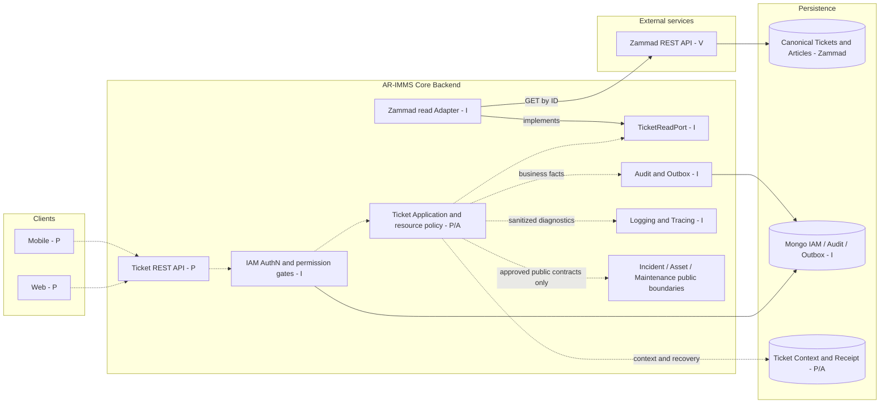

Mongo không ghi trực tiếp Zammad database. Core không đọc private collection của Incident/Asset/Maintenance. Client không nhận PAT hoặc gọi Zammad bằng service-account credential. Sự tồn tại của generic IAM/Audit không có nghĩa Ticket đã tích hợp chúng.

## C. Kiến trúc module Backend

Tuân theo [MODULE_ARCHITECTURE_GUIDELINES.md](../../../MODULE_ARCHITECTURE_GUIDELINES.md): presentation gọi application; application dùng port; infrastructure implement port; domain thuần TypeScript. Chỉ tạo abstraction khi có boundary thực tế.

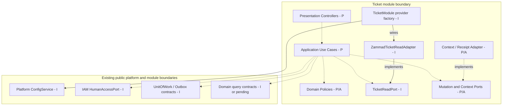

Mũi tên trong sơ đồ này là **dependency**, không phải trình tự network. Domain không import infrastructure/framework. `src/app` compose module; `platform` không sở hữu Ticket policy. Không dùng `forwardRef()` hoặc private repository imports để giải quyết vòng phụ thuộc.

### C.1. Những gì đang có trong working tree

| Đường dẫn thật                                                    | Nội dung đã kiểm tra                                                      |
| ----------------------------------------------------------------- | ------------------------------------------------------------------------- |
| `src/modules/ticket/application/ticket-read.port.ts`              | `TicketReadPort`, `ExternalTicket`, `TICKET_READ_PORT`, `TicketReadError` |
| `src/modules/ticket/infrastructure/zammad-ticket-read.adapter.ts` | GET bằng native fetch, strict parsing, group isolation, sanitized errors  |
| `src/modules/ticket/infrastructure/zammad-read.config.ts`         | Validator cấu hình riêng của integration                                  |
| `src/modules/ticket/ticket.module.ts`                             | Nest provider factory; không controllers/exports                          |
| `test/ticket-zammad-read.real.ts`                                 | Runner opt-in đọc thật qua Nest application context                       |

`getTicket(id: number): Promise<ExternalTicket | null>` là **outbound application port nội bộ**, không phải public API cho module khác hoặc client. P1-A không có Ticket domain aggregate, business use case, Mongo store, mutation, IAM policy hoặc scheduled reconciliation. `CoreModule` hiện không import `TicketModule`.

### C.2. Public interfaces và các boundary còn thiếu

- **I:** IAM public entrypoint cung cấp `HumanAccessPort.getPrincipal()` và `hasAllPermissions()`, decorators/guards liên quan. Ticket vẫn phải kiểm tra quyền trên tài nguyên cụ thể.
- **I:** Platform cung cấp UnitOfWork/outbox và Audit Fact contract. Ticket không gọi Audit repository trực tiếp. Không tạo event contract mới chỉ bằng sơ đồ này.
- **I có giới hạn:** Asset query port đã có provider; `AssetTopologyModule` hiện chỉ export maintenance-command token, chưa export asset-query token cho Ticket. Cần thay đổi public export được duyệt ở phase liên quan.
- **P/A:** Public Ticket query/context contract cho Maintenance; Incident draft handoff và validation contract của owning module. Chỉ định nghĩa method/DTO chính xác khi có consumer và review; chưa có file/interface implemented để trích dẫn.
- **P:** Sau P1-A, presentation, use cases, domain policies và mutation/context adapters được bổ sung theo capability. Không scaffold sẵn các lớp rỗng hoặc các collection dự kiến.

## D. Thiết kế tích hợp Zammad

### D.1. Cấu hình và giao tiếp đã triển khai

| Cấu hình                   | Behavior P1-A                                                                                           |
| -------------------------- | ------------------------------------------------------------------------------------------------------- |
| `ZAMMAD_BASE_URL`          | Một exact HTTPS origin; HTTP chỉ cho loopback local. Không user-info, path prefix, query hoặc fragment. |
| `ZAMMAD_API_TOKEN`         | PAT của integration account, gửi trong Authorization header; không log, hardcode hoặc commit.           |
| `ZAMMAD_EXPECTED_GROUP_ID` | Positive safe integer bắt buộc khi compose provider; không default `2`.                                 |
| `ZAMMAD_READ_TIMEOUT_MS`   | Default 5000 ms, giới hạn 1–60000; bao gồm thời gian nhận headers và body.                              |

Platform giữ các setting tùy chọn, provider Ticket kiểm tra cấu hình đầy đủ khi khởi tạo. Integration chưa compose không làm các module cũ bắt buộc có Zammad. Native fetch chỉ GET `/api/v1/tickets/{id}`, không follow redirect, không application retry/cache. ID đầu vào phải là positive safe integer; response ID phải trùng ID yêu cầu.

### D.2. Ticket và Article mapping

| Zammad Ticket              | Read DTO P1-A                         | Ý nghĩa                                                  |
| -------------------------- | ------------------------------------- | -------------------------------------------------------- |
| `id`, `number`, `title`    | `externalTicketId`, `number`, `title` | Canonical reference, display number và title             |
| `group_id`                 | `groupId`                             | Phải trùng scope cấu hình                                |
| `owner_id`                 | `nativeOwnerId`                       | Native assignment; không là Business Owner theo mặc định |
| `customer_id`              | `customerId`                          | Zammad identity; không là Core actor ID                  |
| `state_id`, `priority_id`  | `stateId`, `priorityId`               | Giữ raw ID, không suy diễn business name                 |
| `created_at`, `updated_at` | `createdAt`, `updatedAt`              | ISO datetime có timezone; không là concurrency token     |

Tất cả field chọn để trả về được validate không coercion. ID là positive safe integer; number/title là nonempty string. Field dư bị loại bỏ. P1-A không trả custom fields, Business Owner, Article, attachments, organization, tags hoặc SLA fields. Unknown positive state ID được giữ nguyên; chưa có lifecycle mapping nghiệp vụ trong adapter.

Article mapping là **P/A**: giữ canonical Article ID/Ticket ID, `created_by_id`/`created_by`, `origin_by_id`, `sender`, type, visibility và timestamps theo contract sẽ duyệt. Article body vẫn lấy từ Zammad; không tạo conversation store trong Core. Chưa có Article read/mutation method trong P1-A.

### D.3. Bằng chứng P0 và giới hạn

Nguồn: [P0 verification report](../integration/flow04-p0-zammad-verification.md), thực hiện 2026-11-12; không chạy lại probe trong nhiệm vụ tài liệu này.

| Quan sát V                                                                                                                            | Hệ quả kiến trúc                                                                      |
| ------------------------------------------------------------------------------------------------------------------------------------- | ------------------------------------------------------------------------------------- |
| Version `7.2.2-45de44f1.docker`, group `AR-IMMS-P0` ID `2`, base local port 8081                                                      | Là thông tin fixture, không phải cấu hình production cố định                          |
| Đọc Ticket 3 và Articles; REST create Ticket 4, reassign native owner sang Technician                                                 | Có evidence API nhưng không chứng minh Core authorization hay distinct Business Owner |
| Năm baseline transitions thành công trên Ticket thử nghiệm                                                                            | Core vẫn phải áp dụng business preconditions và permission                            |
| Delegated Article giữ integration account ở `created_by`; `origin_by_id` của Operator/Technician đổi effective sender sang `Customer` | Cần duyệt attribution; không tự xem `origin_by_id` là giải pháp hoàn chỉnh            |
| Hai POST đã xác nhận với cùng `Idempotency-Key` tạo hai Ticket                                                                        | Header không cung cấp native deduplication trong probe                                |
| Stale `If-Match` vẫn cho phép update                                                                                                  | Không có bảo đảm optimistic concurrency từ header đã thử                              |
| Zammad đã tạo Ticket 8, proxy làm mất response; search đầu trả rỗng, lần sau tìm thấy đúng tag                                        | Empty search không chứng minh non-creation; không blind retry                         |

Đây không phải khẳng định mọi version Zammad đều có cùng behavior. Một lần tìm được tag không chứng minh uniqueness, atomic durability hoặc thời gian index tối đa. P0 test accounts có full group access; chưa thiết lập mô hình chỉ Core được ghi.

### D.4. Identity và trách nhiệm nghiệp vụ

Zammad fixture IDs Integration/Operator/Technician/Customer lần lượt là 6/4/5/7. **Core IAM mapping chưa được duyệt hoặc xác minh.** Đề xuất mapping explicit `(instance, immutable Core user ID) → Zammad user ID`, với kiểm tra active/group eligibility; không lấy email/role name làm bằng chứng identity.

Business Owner chịu trách nhiệm kết quả; Assignee thực hiện công việc. Baseline §10 hiện đặt owner/assignee truth ở Zammad. Hai phương án còn chờ duyệt: Zammad giữ cả hai trách nhiệm qua representation được kiểm chứng; hoặc phân loại Business Owner là Core business context với thay đổi ownership boundary được phê duyệt rõ. Không dùng `customer_id`, Article origin hoặc service account để lấp chỗ trống.

Default Owner, custom attribute/type, quyền đổi Owner và imported Ticket handling đều chưa quyết định. Nếu chọn Core-owned Business Owner, minimum context phải có từ **P1-C/P1-D**, không đợi P5. Nếu chọn Zammad-owned, Core không thêm authoritative Owner mirror.

## E. Ticket lifecycle

Năm mũi tên giữa các trạng thái là baseline transitions đã thử thành công qua REST (**V**); authorization và implementation Core tương ứng còn **P/A**. Dấu khởi đầu chỉ biểu diễn tạo Ticket, không được đếm thành transition test thứ sáu.

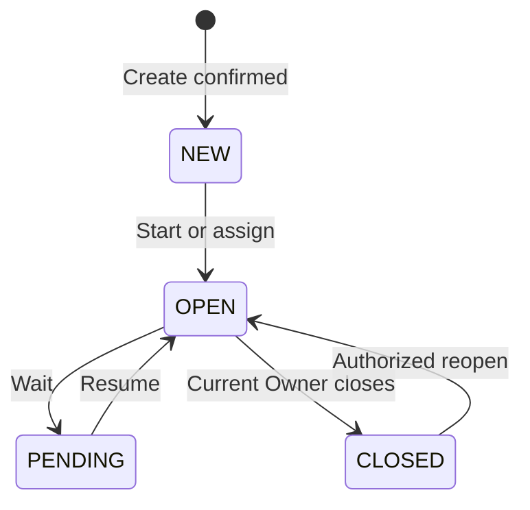

| Business state    | ID quan sát ở P0      | Giới hạn                                                                  |
| ----------------- | --------------------- | ------------------------------------------------------------------------- |
| NEW               | 1, `new`              | ID chỉ thuộc instance thử nghiệm                                          |
| OPEN              | 2, `open`             | Chưa cho phép client đặt state tùy ý                                      |
| PENDING candidate | 3, `pending reminder` | Probe có `pending_time` trong tương lai; semantics và scheduler cần duyệt |
| CLOSED            | 4, `closed`           | Close chỉ bởi current Business Owner qua Core                             |

Không chọn `pending close` thay cho PENDING: P0 có state loại này tự hướng tới closed. Direct NEW/PENDING → CLOSED là tùy chọn ngoài baseline, chưa triển khai. Đóng/mở Ticket không tự thay lifecycle Incident/Asset/Maintenance. Source of Truth vẫn là Zammad; domain policy của Core kiểm soát chuyển trạng thái được phép, không lưu state machine song song.

## F. Các workflow chính

**Toàn bộ sáu sequence là kiến trúc P/A.** Tên use case là tên capability mô tả, không khẳng định class đã tồn tại. Để dễ đọc, Zammad participant gộp REST API với lời gọi qua Adapter mutation tương lai; không dùng read adapter P1-A để gửi POST/PUT. Audit/receipt/context chỉ sử dụng sau khi contract và schema tối thiểu được duyệt.

### F.1. Manual Ticket Creation

BR-02/08/10; TC-WF04-01/03/11/12/20. Không cần Incident. Client không nhận success trước khi có xác nhận canonical ID và context bắt buộc được hoàn tất.

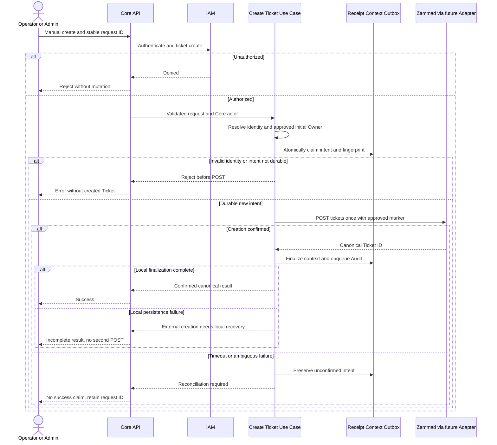

Receipt claim phân biệt request mới, replay cùng payload và key trùng nhưng payload khác. Replay đi vào lookup/recovery, không đi vào nhánh POST mới. Không thực hiện network call trong Mongo transaction callback có thể được retry.

### F.2. Assignment / Reassignment

BR-04; TC-WF04-04/06/20. Đổi Assignee không được ngầm chuyển accountability của Business Owner.

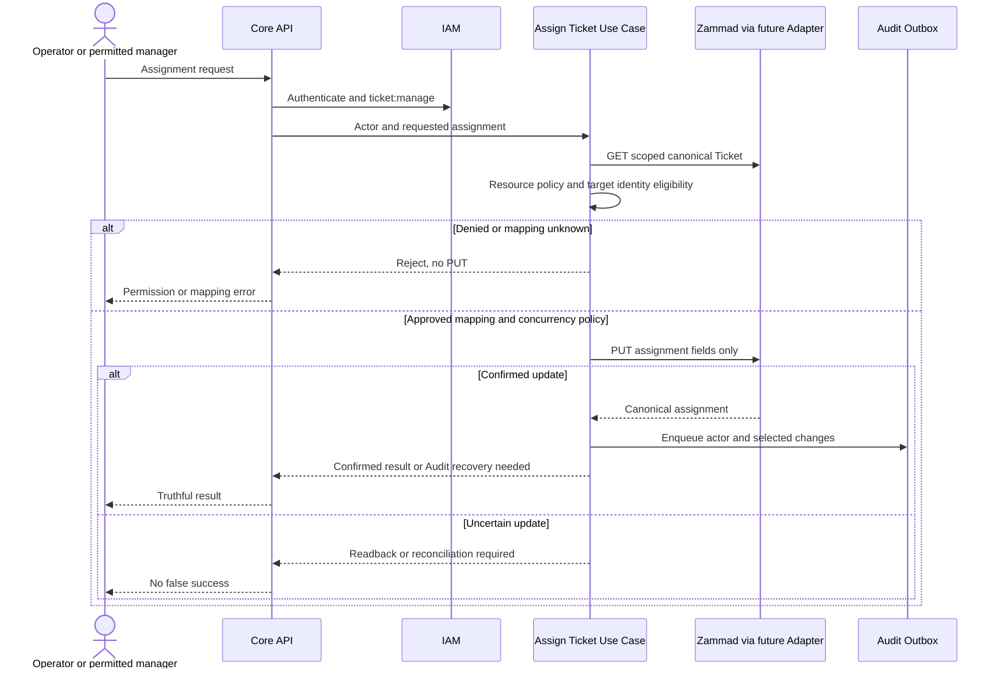

IAM denial ở bước gate kết thúc request trước use case; sequence rút gọn phần này ở F.2–F.5. Chưa chọn field mapping cho hai trách nhiệm; `PUT owner_id` tại P0 chỉ là quan sát native assignment.

### F.3. Technician progress và Articles

BR-04/09; TC-WF04-05/22. `ticket:work` chưa có trong IAM catalog và vẫn là đề xuất. Không cấp `ticket:manage` để vượt qua gate này.

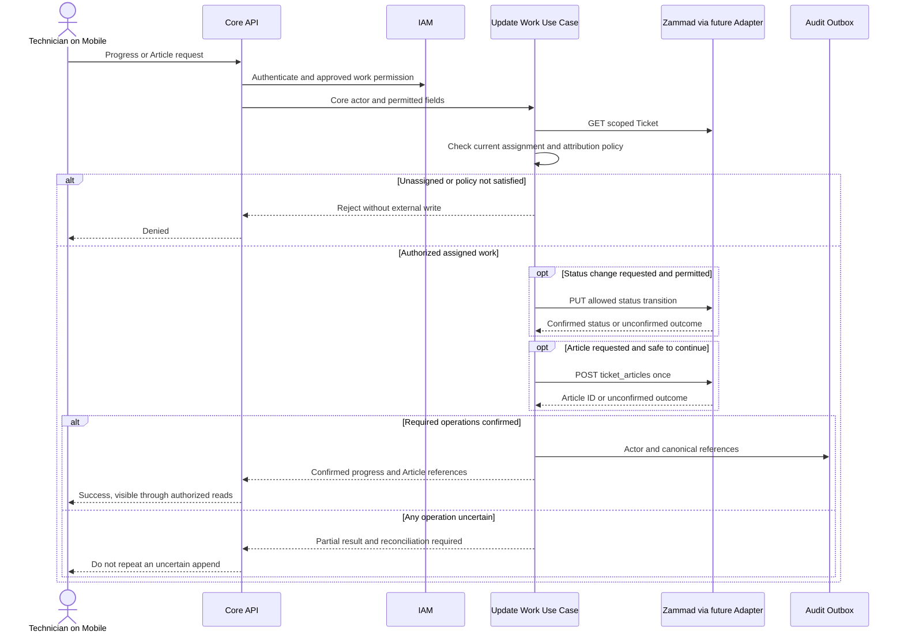

Status update và Article append không được giả định atomic. Nếu hỗ trợ request gộp sau này phải trình bày partial outcome rõ; ban đầu có thể giữ hai endpoint riêng. Không thay `created_by` bằng user client tự gửi; attribution lấy từ Core actor và approved mapping.

### F.4. Current Ticket Owner đóng Ticket

BR-05/11; TC-WF04-07/16/21. `ticket:close` không override ownership. Business Owner chưa resolve được thì reject; Admin không tự vượt qua kiểm tra này.

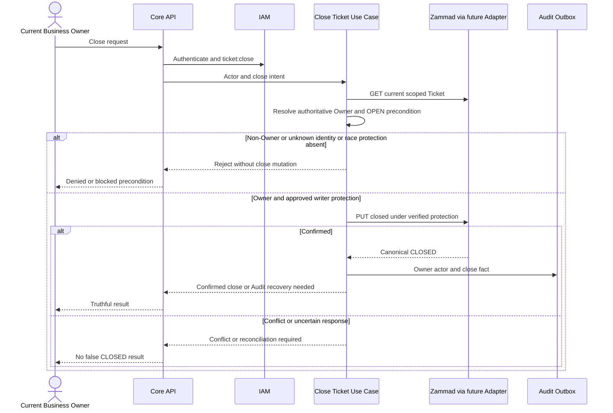

“Verified protection” là gate chưa giải quyết, không phải cam kết Zammad hỗ trợ CAS. Đọc lại Owner ngay trước PUT vẫn có TOCTOU. Core-side ETag không chặn người dùng hoặc trigger sửa trực tiếp ở Zammad.

### F.5. Reopen Ticket

BR-06/11; TC-WF04-08/09/17. Current Owner **hoặc** Operator có ticket-management permission theo baseline; cách biểu diễn nhánh Owner trong IAM cần được chốt. Guard hiện tại là all-of, không thể dùng hai permission để ngầm diễn đạt OR.

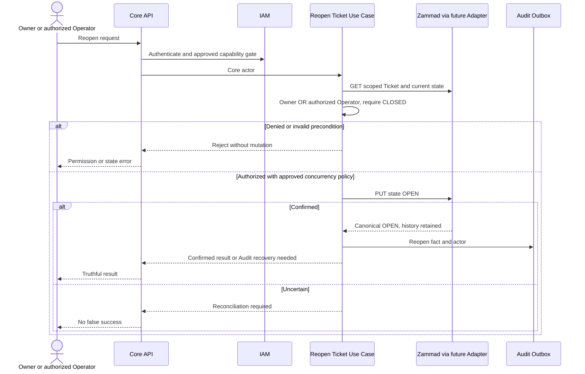

Không tự reopen Incident, restart Maintenance hoặc thay Asset state. Zammad history/Articles tiếp tục canonical; Core chỉ giữ domain links/context đã được duyệt.

### F.6. Timeout và ambiguous creation recovery

BR-10; TC-WF04-11/12. Đây là nhánh riêng sau POST chưa xác nhận. Chỉ gửi query; không tự đổi request ID để tạo lại.

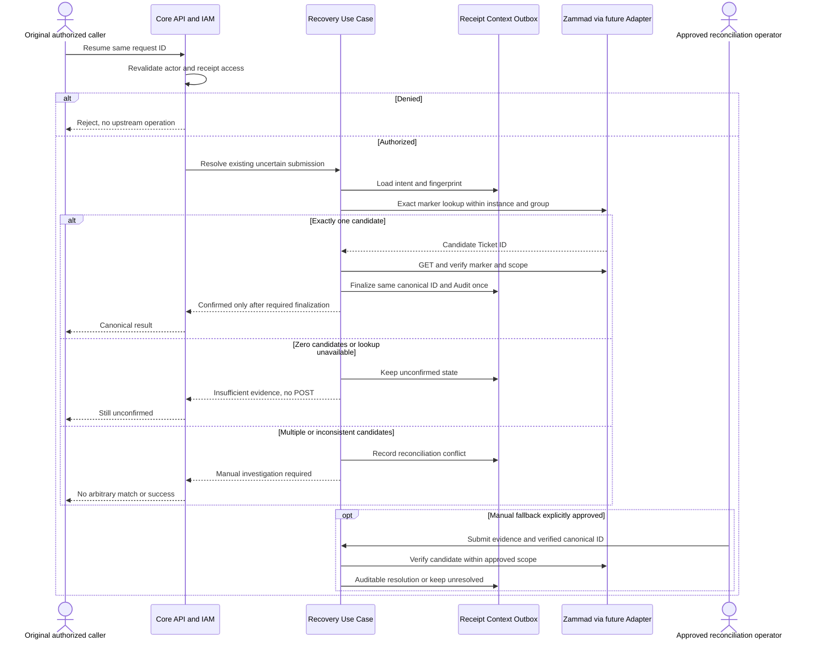

Manual fallback chưa được phê duyệt. Nó cần người chịu trách nhiệm, access policy, evidence và quy trình khôi phục local context. Title/thời điểm gần nhau hoặc một lần search rỗng không đủ kết luận. Nếu không xác minh được thì giữ unresolved; không hứa exactly-once. Khi đã có external ID, sửa local context bằng ID đó, không tạo Ticket khác.

## G. Data ownership và mô hình khái niệm

| Dữ liệu                                                     | Source of Truth                               | Trạng thái / quy tắc                                              |
| ----------------------------------------------------------- | --------------------------------------------- | ----------------------------------------------------------------- |
| Canonical Ticket, state, native assignment, priority, title | Zammad                                        | Core đọc/ghi qua integration; không canonical mirror              |
| Article body/history, attachment                            | Zammad                                        | Không conversation collection thứ hai                             |
| Business Owner / Assignee semantics                         | Baseline giao owner/assignee truth cho Zammad | Representation và khả năng đổi boundary còn A; không tự chọn Core |
| Core user, session, effective permissions                   | IAM                                           | I; role không phải native Zammad identity                         |
| Identity mapping                                            | P/A, trách nhiệm provisioning chưa duyệt      | Mapping explicit theo instance, không runtime email matching      |
| Ticket Business Context/domain links                        | Core Ticket Management khi được triển khai    | P/A; không title/state/Article mirror                             |
| Receipt/recovery intent                                     | Core integration coordination                 | P/A; trạng thái request khác lifecycle Ticket                     |
| Incident/Asset/Maintenance                                  | Owning domain tương ứng                       | Chỉ giữ reference; không mutate lifecycle ngầm                    |
| Audit facts và delivery state                               | Core Audit/platform outbox                    | I generic; Ticket-specific emission P                             |

### G.1. ER conceptual — chưa là Mongo schema

Entity dưới đây là conceptual references, không phải tên collection đã tồn tại. `ZAMMAD_TICKET_REF` chỉ đại diện khóa ngoài `(instance, id)`, không local Ticket aggregate. Quan hệ qua hệ thống/domain không là database foreign key vật lý.

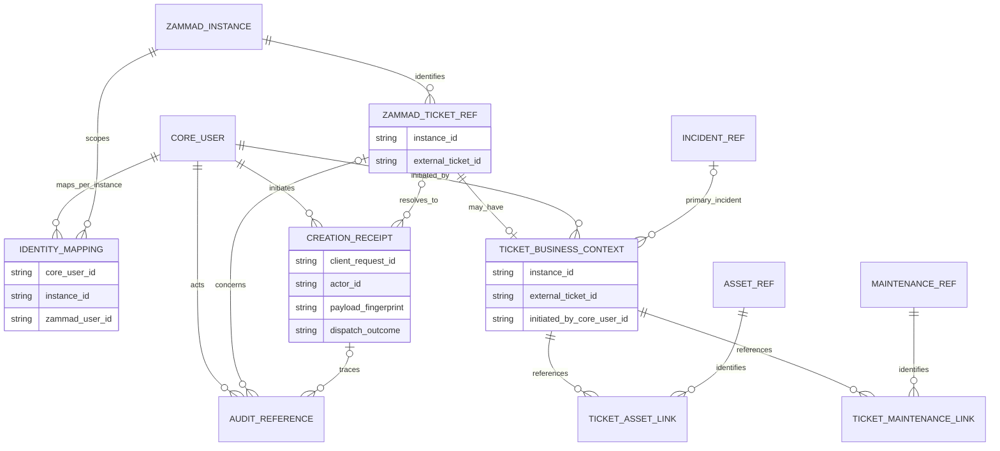

Các field là mô tả khái niệm, không quyết định datatype Mongo; ID numeric của adapter chưa thay đổi. Một Ticket có tối đa một primary Incident, nhiều Asset/Maintenance links; một Incident có thể liên quan nhiều Ticket. Receipt có thể chưa biết external ID khi unconfirmed. Audit có thể tham chiếu request chưa có Ticket.

**Business Owner storage cố ý không chọn trong ER.** `initiated_by_core_user_id` chỉ là người khởi tạo, không phải Owner. Nếu được duyệt lưu Owner ở Core thì bổ sung minimum field và recovery từ P1-C/P1-D; nếu giữ ở Zammad thì resolve theo representation upstream đã duyệt. Không đồng thời có hai authoritative Owner stores.

### G.2. Transaction boundary

Mongo transaction có thể atomic cho receipt/context/outbox local khi implementation được duyệt. Nó không bao gồm Zammad POST/PUT. [MongoUnitOfWork](../../../src/platform/events/infrastructure/mongodb/mongo-unit-of-work.ts) dùng transaction callback; đặt external mutation trong callback có thể dẫn tới lặp side effect khi transaction retry. Không compensation-delete Ticket để che local persistence failure. Audit chỉ ghi fact đã xác nhận; attempted/uncertain outcome nếu ghi phải có semantics riêng rõ ràng.

## H. Tổng quan API đề xuất

**Không endpoint nào trong bảng đã được triển khai.** Tất cả route bên dưới có prefix `/api/v1`. P1-A outbound GET không tương đương public GET. Tên use case là mô tả dự kiến, không tên class/file đã chốt.

| Phase / trạng thái | Method và route                | Actor / IAM gate                                                  | Backend dự kiến                                                     | Zammad operation                        | Dependency / blocker                                                    |
| ------------------ | ------------------------------ | ----------------------------------------------------------------- | ------------------------------------------------------------------- | --------------------------------------- | ----------------------------------------------------------------------- |
| P1-D · P/A         | `POST /tickets`                | Operator/Admin + `ticket:create`                                  | Create use case, identity/policy, receipt/context, mutation adapter | `POST /tickets` với initial Article     | Initial Owner, attribution, recovery; read access cho creation response |
| P1-B · P/A         | `GET /tickets/{id}`            | `ticket:read` + resource policy chưa duyệt                        | Read use case + P1-A read port                                      | `GET /tickets/{id}`                     | Identity và restricted Technician visibility                            |
| P2 · P/A           | `GET /tickets`                 | `ticket:read` + scope/resource policy                             | List use case + query adapter                                       | Scoped list/search sau verification     | Pagination/count không leak; query contract chưa có                     |
| P2 · P/A           | `PUT /tickets/{id}/assignment` | Manager + `ticket:manage`                                         | Assignment policy/use case, mutation adapter, Audit                 | `PUT /tickets/{id}` với approved fields | Distinct Owner/Assignee, eligible identity, concurrency                 |
| P3 · P/A           | `PATCH /tickets/{id}`          | Management: `ticket:manage`; Technician field subset còn A        | Update use case, field allowlist                                    | `PUT /tickets/{id}`                     | Không cho bypass assignment/closure bằng field tùy ý                    |
| P3 · P/A           | `POST /tickets/{id}/status`    | Management/work policy còn A; `ticket:work` chỉ là đề xuất        | Work/transition policy + adapter                                    | `PUT /tickets/{id}`                     | Assigned-work permission; PENDING semantics; close qua endpoint riêng   |
| P3 · P/A           | `GET /tickets/{id}/articles`   | `ticket:read` + Ticket/Article visibility                         | Article read use case + adapter                                     | `GET /ticket_articles/by_ticket/{id}`   | Article visibility chưa kiểm chứng đầy đủ                               |
| P3 · P/A           | `POST /tickets/{id}/articles`  | Approved work/management policy                                   | Add Article use case, attribution, recovery, Audit                  | `POST /ticket_articles`                 | `created_by`/origin/sender; uncertain append                            |
| P4 · P/A           | `POST /tickets/{id}/close`     | `ticket:close` AND current Owner                                  | Close policy/use case + adapter + Audit                             | `PUT /tickets/{id}` state closed        | Owner resolution và race protection                                     |
| P4 · P/A           | `POST /tickets/{id}/reopen`    | Owner OR Operator có `ticket:manage`; Owner capability gate còn A | Reopen policy/use case + adapter + Audit                            | `PUT /tickets/{id}` state open          | OR policy, concurrency, giữ lifecycle độc lập                           |
| P5 · P/A           | `GET /tickets/{id}/context`    | `ticket:read` + resource policy                                   | Context query + scoped canonical check                              | Có thể GET Ticket để scope/authorize    | Context contract; owning-domain references                              |
| P5 · P/A           | `PUT /tickets/{id}/context`    | Proposed `ticket:manage` + domain-link authorization              | Context update + public domain queries + local UoW                  | Không mutate canonical fields           | Approved references/schema, missing Incident/Maintenance contracts      |

Zammad routes trong cột operation cũng có prefix `/api/v1` tại external origin. Không chuyển tiếp arbitrary path/body từ client. Incident draft endpoint chưa được đặt tên hoặc expose khi owning contract chưa tồn tại.

HTTP conventions phải theo [baseline](../../../api/baseline.yaml), [response envelope](../../../src/platform/http/api/api-response.ts), [ProblemDetails mapper](../../../src/platform/http/errors/problem-details.mapper.ts): success dùng `data`, metadata request/trace theo pipeline, list có pagination; lỗi có `type/title/status/detail/instance/code/request_id/errors` theo contract. Chưa chốt HTTP status/code cho uncertain mutation. Không tự trả `201` hoặc “success” khi upstream chưa xác nhận. Mỗi public endpoint PR sau này phải cập nhật OpenAPI cùng thay đổi; tài liệu này không sửa OpenAPI hiện hữu.

## I. Security, reliability và xử lý lỗi

| Mối quan tâm                | Yêu cầu / behavior                                                                                                     | Trạng thái                                                                          |
| --------------------------- | ---------------------------------------------------------------------------------------------------------------------- | ----------------------------------------------------------------------------------- |
| Core IAM vs service account | IAM xác thực actor và capabilities; Ticket kiểm tra resource. Zammad service privilege không chuyển thành quyền client | Yêu cầu baseline; P1-A chưa có Core-user policy                                     |
| Read visibility             | Technician chỉ xem Ticket đang own/assigned; authorized manager xem group theo policy explicit                         | A trước public retrieval/list; không coi role `ticket:read` là quyền xem mọi Ticket |
| Assigned work               | Kiểm tra current assignment và field allowlist; không cấp manage thay cho work permission                              | A; `ticket:work` chưa tồn tại                                                       |
| Close                       | Permission và current authoritative Owner; unknown identity/ownership phải fail closed                                 | BR-05; representation/concurrency A                                                 |
| Group isolation             | Một configured instance/group; không trả dữ liệu ngoài scope                                                           | I cho adapter GET; client resource authorization vẫn thiếu                          |
| Secret                      | PAT chỉ trong server environment/header; không log token, request headers, response lỗi hoặc raw cause                 | I cho read adapter; áp dụng tương tự mutation tương lai                             |
| Article attribution         | Giữ Core actor traceable; không giả mạo Zammad creator; không tin author ID từ client                                  | A, do behavior origin/sender P0                                                     |
| Ambiguous create/append     | Không blind retry, không false success; giữ identity của request và reconcile                                          | BR-10; mechanism P/A                                                                |
| Correlation                 | Marker phải có approved representation, write/read/search validation; zero matches không là proof of absence           | Tag lookup V nhưng reliability contract A                                           |
| Concurrent Owner update     | Fresh read không atomic; stale If-Match không bảo vệ probe; Core ETag không bảo vệ external writes                     | A; cần verified upstream guard hoặc enforced writer model                           |
| Audit                       | Actor/reference và selected changes; không raw Article body hoặc full Ticket snapshot                                  | Generic contract I; Ticket emission P                                               |

### I.1. Error behavior đã có ở P1-A

`null` cho 404 hoặc valid Ticket khác group. Invalid request ID bị chặn trước network. 401/403 là `UPSTREAM_ACCESS_DENIED` của integration account, không phải kết luận Core actor bị cấm. 429/5xx/network failure → `UPSTREAM_UNAVAILABLE`; timeout → `UPSTREAM_TIMEOUT`; malformed JSON/media type/selected fields/mismatched ID → `INVALID_UPSTREAM_RESPONSE`; redirect/status khác → `UNEXPECTED_UPSTREAM_STATUS`. Error chứa fixed code, không upstream body/credential/cause.

### I.2. Recovery safeguards đề xuất

Receipt unique theo instance/actor/request ID và fingerprint giúp single dispatch claim trong Core; **không tạo exactly-once bên Zammad**. Persist intent trước POST; khi có external ID thì finalize context/Audit local. Crash sau dispatch intent nhưng trước network cũng có thể phải giữ unconfirmed nếu không chứng minh được chưa gửi.

Marker exact-match một candidate vẫn cần fetch và kiểm tra scope/identity; zero matches cần giữ unresolved hoặc query lại có kiểm soát; nhiều matches cần điều tra. Không default marker field/custom field khi chưa duyệt. Controlled manual reconciliation là phương án PoC **A**, không có automatic acceptance chỉ vì automation khó.

Không bắt buộc `Idempotency-Key`, `If-Match`, ETag hoặc Operation Journal cho mọi endpoint. Article append cần recovery riêng: marker của Ticket không deduplicate Article. Direct Zammad UI, trigger và scheduler đều là external writers cần đưa vào concurrency model; không được tuyên bố Core-only writer khi P0 accounts vẫn có full group access.

### I.3. Audit và observability

Dùng public platform event/outbox contracts; selected actor/action/resource references, request_id/trace_id, thay đổi scalar/flat string-array theo [Audit Fact v2](../../../src/platform/events/contracts/audit-fact.v2.ts), payload tối đa 16 KiB. Không thêm dữ liệu ngoài contract hoặc gọi Audit store trực tiếp. Outbox delivery/idempotent consumption không giải quyết external POST deduplication. Khi Zammad xác nhận nhưng Audit/context local lỗi, ghi nhận partial outcome trung thực và khôi phục local; không phát một business fact “thành công toàn bộ” nếu preconditions bắt buộc chưa hoàn tất.

## J. Roadmap và kiểm thử

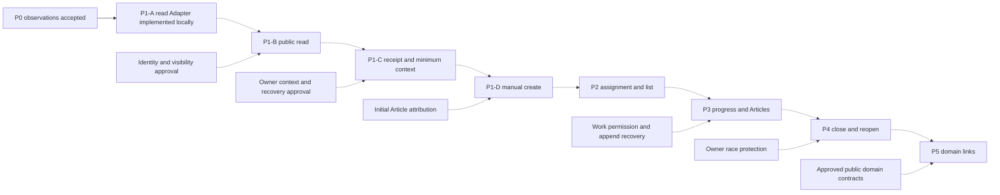

Nét đứt là phase chưa được phép triển khai. Trình tự là các PR nhỏ để review, không thay thế dependency gate. Initial context không bị dời sang P5 chỉ vì P5 phát triển domain links.

| Phase | Trạng thái tại ngày rà soát                    | Deliverable / gate                                                           |
| ----- | ---------------------------------------------- | ---------------------------------------------------------------------------- |
| P0    | V, findings đã được người dùng chấp nhận       | Report và test contract observations; các policy vẫn A                       |
| P1-A  | I trong working tree, đã có execution evidence | Scoped read adapter, unit/fake tests, real read; chưa public compose         |
| P1-B  | P/A, chưa được authorize                       | Read use case/controller, identity và resource visibility                    |
| P1-C  | P/A                                            | Minimum receipt/context, approved Owner allocation và recovery               |
| P1-D  | P/A                                            | Manual create/retrieve vertical slice, initial attribution, no false success |
| P2    | P/A                                            | Assignment/list, identity và phân biệt trách nhiệm                           |
| P3    | P/A                                            | Work updates/Articles, field allowlists, pending semantics, append recovery  |
| P4    | P/A                                            | Owner-only closure/reopen, independent lifecycles và race protection         |
| P5    | P/A, domain-dependent                          | Asset links rồi Incident/Maintenance contracts; không fake success           |

### J.1. Test layers và evidence

| Loại                                   | Chứng minh gì                                                             | Tình trạng Flow 04                                                       |
| -------------------------------------- | ------------------------------------------------------------------------- | ------------------------------------------------------------------------ |
| Unit                                   | Parsing/configuration/policy/orchestration ở seam nhỏ, không network thật | P1-A đã chạy 42 case mới + 5 env regression                              |
| HTTP integration                       | Nest controller/guard/validation/envelope và resource authorization       | Chưa có public Ticket controller; chưa chạy Ticket HTTP integration      |
| Fake-Zammad HTTP contract              | Native HTTP tới fake server: request, response, error/timeout/redirect    | P1-A 21 case đã chạy                                                     |
| Real-Zammad contract/read verification | Behavior thực của selected version/account/group                          | P0 probes; P1-A một GET qua Nest provider, không mutation                |
| Web/Mobile E2E                         | Client thật → Core → Zammad → cùng Ticket trên hai client                 | Chưa chạy; phụ thuộc client harness, approved policies và seeded staging |

[P1-A report](../integration/flow04-p1a-zammad-read.md) ghi exact commands và kết quả 2026-11-12: unit 47 PASS, fake HTTP 21 PASS, real GET Ticket 3 PASS, TypeScript/lint/build PASS, full repository 551 tests/104 suites PASS. Changed TypeScript formatting PASS; repository-wide formatting FAIL trên 335 file không thay đổi. Đây là evidence lịch sử đã ghi, **không phải lần chạy mới ngày 2026-11-13** và không phải CI execution.

Không nhân số business cases theo test layer, client hoặc rerun. [22-case matrix](../testing/flow04-test-matrix.md) giữ TC-WF04-01..22 và mapping F4-01..04; 63 technical P1-A cases không cộng thành 63 business commitments. BM04 có tối thiểu 12 feature, 5 transitions, 1 main E2E, tổng 18 unique; với inventory 22 thì CI floor ≥11 (≥50%), dự kiến 17, **chưa có completed Flow 04 CI evidence**. Main paths phải pass, WF-04 exceptions/overall ≥90%, zero open Critical/High, seeded staging E2E. Formal BM04 approval/version vẫn pending.

## K. Quyết định mở và rủi ro

| ID   | Quyết định / owner review cần có                                 | Tác động kiến trúc                                                                                          | Phase bị chặn                                                        |
| ---- | ---------------------------------------------------------------- | ----------------------------------------------------------------------------------------------------------- | -------------------------------------------------------------------- |
| OD-A | Business Owner vs Assignee; business/technical owner             | Chọn authoritative representation, initial/default Owner, owner-change semantics; không tự sửa baseline §10 | P1-B nếu cần Owner để đọc; P1-C/D, P2, P4                            |
| OD-B | Core IAM ↔ Zammad identity; IAM/integration owner                | Immutable mapping, provisioning/lifecycle, active/group eligibility; không email guessing                   | P1-B và mọi use case có human authorization                          |
| OD-C | Technician read/work; IAM/business owner                         | Restricted reads, manager policy, work capability/field allowlist; chưa implement `ticket:work`             | P1-B/list và P3                                                      |
| OD-D | Article attribution/visibility; business/integration owner       | `created_by`, origin, effective sender và Core actor trace; thực tế UI/customer visibility chưa xác minh    | Initial Article P1-D, P3                                             |
| OD-E | Safe create recovery; integration/operations owner               | Marker reliability, receipt schema, manual fallback và support process; zero search không cho resend        | P1-C/D; append recovery P3                                           |
| OD-F | Concurrent ownership; technical/integration owner                | Chặn stale Owner mutation trước external write; verify upstream guard hoặc enforced writer model            | P2 mutation policy, P4 đặc biệt TC-WF04-21                           |
| OD-G | PENDING semantics; business/Zammad owner                         | `pending_time`, scheduler, timezone và tránh implicit auto-close                                            | State-changing P3/P4 acceptance                                      |
| OD-H | BM04 approval/version; workflow owner/reviewer                   | Numbers đã biết nhưng chưa thể tuyên bố formal approval; evidence và final inventory cần xác nhận           | Workflow release/acceptance claim, không phủ nhận P1-A authorization |
| OD-I | Incident/Asset/Maintenance public contracts; module owners       | Không private DB access, không giả lập module thành công; Asset export cần review                           | P5, TC-WF04-02/09/10 đầy đủ                                          |
| OD-J | Public HTTP outcomes và configuration lifecycle; technical owner | HTTP mapping cho unconfirmed/partial outcomes, imported Ticket, multi-instance nếu có nhu cầu               | Public endpoint PR tương ứng                                         |

Mọi giải pháp trong cột kiến trúc vẫn là đề xuất trừ phần đã ghi I/V. Tài liệu không chấp nhận thay đổi IAM, custom field, database schema, public API hoặc ownership boundary thay cho người có trách nhiệm.

## Nguồn bằng chứng và giới hạn xác minh

| Nguồn                                                                                                                                                                                                    | Dùng để kiểm tra                                                                 |
| -------------------------------------------------------------------------------------------------------------------------------------------------------------------------------------------------------- | -------------------------------------------------------------------------------- |
| [Accepted Flow 04 pinned baseline](https://github.com/AR-IMMS/shared-docs/blob/294001cd9f1359bc03ced3925328454cabb3c0ea/business/04-ticket-management.md)                                                | BR-01..12, F4-REQ-01..10, source-of-truth allocation                             |
| [AGENTS.md](../../../AGENTS.md), [module guidelines](../../../MODULE_ARCHITECTURE_GUIDELINES.md)                                                                                                         | Dependency direction, public boundaries, evidence discipline                     |
| [P0 report](../integration/flow04-p0-zammad-verification.md)                                                                                                                                             | Real version, identity/group IDs, state/Article/recovery/header observations     |
| [P1-A report](../integration/flow04-p1a-zammad-read.md), [Ticket README](../../../src/modules/ticket/README.md)                                                                                          | Working-tree read adapter, supported mapping, actual prior executions            |
| [Test matrix](../testing/flow04-test-matrix.md)                                                                                                                                                          | 22 unique IDs, BM04 provenance and numerical commitments                         |
| [CoreModule](../../../src/app/core.module.ts)                                                                                                                                                            | Ticket chưa được compose vào application                                         |
| [IAM public entrypoint](../../../src/modules/iam/index.ts), [role baselines](../../../src/modules/iam/domain/role-permissions.ts), [IAM spec](../specs/spec-002--epic-iam-module.md)                     | Existing gates, permission capabilities; `ticket:close` không override ownership |
| [Asset module](../../../src/modules/asset-topology/asset-topology.module.ts), [public contract](../../../src/modules/asset-topology/contracts/asset-topology.contract.ts)                                | Export limitation và owning-domain boundary                                      |
| [Audit v2](../../../src/platform/events/contracts/audit-fact.v2.ts), [Mongo UoW](../../../src/platform/events/infrastructure/mongodb/mongo-unit-of-work.ts), [HTTP baseline](../../../api/baseline.yaml) | Audit shape, local transaction boundary và HTTP conventions                      |

Shared-docs gitlink vẫn là `5e50f66edbb207eb16a41be31d22557404405397`, chưa init/update; tài liệu nghiệp vụ được đọc bằng pinned revision `294001cd9f1359bc03ced3925328454cabb3c0ea` qua GitHub. Không thay submodule để làm tài liệu trông đồng bộ.

Chưa xác minh: approved Core identity mapping, authoritative Business Owner representation, full client implementation, actual Web/Mobile E2E, customer visibility của delegated API Articles, scheduler behavior dài hạn, recovery dưới mọi crash window/concurrency, hoặc formally approved BM04 version. Không có claim integration-ready cho toàn workflow.

Validation của bản tài liệu này kiểm tra Markdown, parse cả 11 Mermaid blocks, local anchors/relative links và không chứa credential thật. Không chạy lại backend tests hoặc mutate Zammad cho thay đổi documentation-only. Kết quả kiểm tra cụ thể được báo cùng commit tài liệu.
