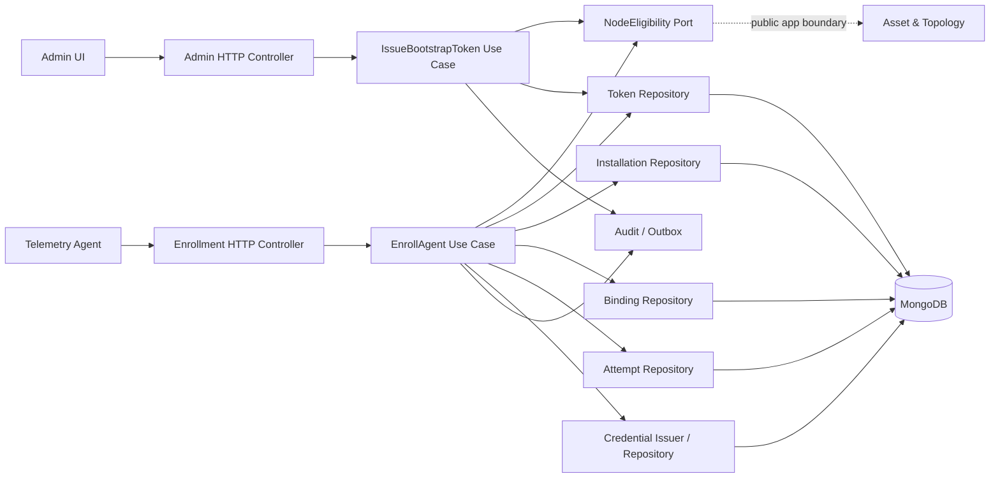
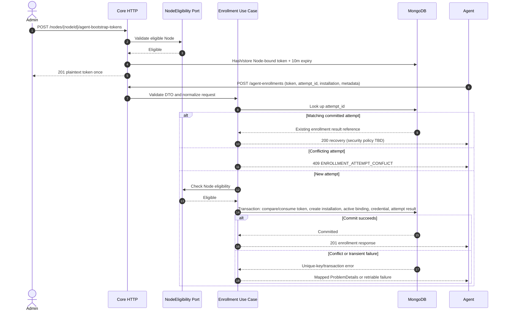

# Flow 02 — Core Backend Agent Enrollment Design

> **Document type:** Core Backend technical design (`docs/local`)  
> **Status:** Incremental design baseline · 2026-10-30  
> **Owner:** Core Backend / Agent Management  
> **Related:** `docs/shared/flow-02-agent-registration-business.md`; `docs/shared/contracts/openapi/agent-enrollment.openapi.yaml` (OpenAPI 3.1, v0.1.0)

## 1. Goal and scope

Implement the server side of Agent enrollment so that Agent developers can independently submit the frozen v1 payload and receive a Node binding plus credential. Deliver as **small, testable increments** in the existing NestJS 11 modular monolith with MongoDB and existing IAM, HTTP/ProblemDetails, audit/outbox and Asset & Topology boundaries.

**In scope for M1:** admin bootstrap token issuance, installation registration, Node binding, credential issuance/validation foundations, enrollment idempotency and bounded recovery, HTTP contract tests and observability.

**Out of scope for M1:** Collector startup, OTLP Gateway authentication, configuration revisions/activation, heartbeat, resource discovery, VM-specific flows, user-facing unlink/uninstall endpoints. Control Plane response fields in enrollment are informational for future integration.

## 2. Contract-first boundary

| Consumer | Endpoint | Responsibility | Increment |
| --- | --- | --- | --- |
| Admin Dashboard | `POST /api/v1/nodes/{nodeId}/agent-bootstrap-tokens` | Issue one-time Node-bound bootstrap token | I1 |
| Telemetry Agent | `POST /api/v1/agent-enrollments` | Validate attempt, create binding, issue credential | I2–I3 |

The authoritative request/response schema, status codes and naming live in the shared **OpenAPI YAML**, not duplicate NestJS-only DTO documentation. All client-facing JSON uses `snake_case`; reuse the existing API response envelope and `application/problem+json` policy.

Enrollment request fields: `bootstrap_token`, `enrollment_attempt_id`, `installation.id`, `agent.version`, `environment.os`, `environment.architecture`, optional `environment.hostname`, optional `metadata` (max 4 KiB). No `node_id` in the request. All deployments (Host, VM) use exactly the same protocol.

First-time response `201`: `enrollment_id`, `installation_id`, `binding{id,node_id,status}`, `credential{type,access_token}`, `control_plane{base_url,poll_interval_seconds}`, `meta.request_id`. A matching retry returns the original result with `200` for 24 hours; see §7.

## 3. Responsibilities and module boundaries



- **Agent Management** owns installation, bootstrap token, enrollment attempt, binding and credential lifecycle.
- **Asset & Topology** owns Node existence, retirement and placement; expose a narrow `NodeEligibilityPort` rather than querying its collection directly.
- **IAM** owns Admin authentication/permissions. New permission IDs are proposals and must match the existing fixed permission catalog (no ad-hoc roles).
- **Platform HTTP** owns ProblemDetails mapping, request correlation and API envelope.
- **Audit / Events** should use existing infrastructure, but must never include token/credential plaintext.
- **Credential authorization** checks active binding rather than trusting `installation_id` or hostname.

## 4. Model and invariants

| Aggregate / record | Core attributes | Persistence rule |
| --- | --- | --- |
| BootstrapToken | `token_id`, `node_id`, `token_hash`, `expires_at`, `consumed_at`, `invalidated_at`, `created_by` | TTL index on `expires_at`, but enforce expiration in queries; one successful consumption. |
| AgentInstallation | `installation_id`, `agent_version`, OS/architecture/hostname, untrusted `metadata`, timestamps | Unique ID; durable registration history. |
| AgentBinding | `binding_id`, `installation_id`, `node_id`, `status`, `created_at`, `revoked_at` | Partial unique indexes on `node_id` and `installation_id` where `status=active`. |
| AgentCredential | `credential_id`, `binding_id`, `secret_hash`, state, timestamps | High-entropy opaque secret; never retain plaintext in standard collection. |
| EnrollmentAttempt | `attempt_id`, `request_fingerprint`, `installation_id`, `result_ref`, `status`, `cleanup_at`, recovery payload/reference (if adopted) | Unique attempt ID; TTL only for finite recovery records; durable binding remains. |

**Required invariants**
1. At most one active binding per Node and per installation, enforced in MongoDB, not only in application pre-checks.
2. Token consumption and successful enrollment records are committed atomically.
3. A consumed token cannot bootstrap a second operation; same committed attempt is handled through explicit idempotency policy.
4. Attempts with equal `attempt_id` but different canonical request fingerprints are rejected.
5. Credential is authorized only while its binding is active; revoke is terminal for that binding.
6. Metadata is untrusted; never use `hostname`, `metadata` or `installation_id` alone as authentication.
7. Enrollment does not imply configuration activation or Node telemetry health.

## 5. Server flow and transaction



**Implementation notes:**
- Use MongoDB multi-document transactions (requires replica set, including local single-node replica set).
- Single-use consumption requires a conditional update on token state and `expires_at > server_now`, inside the transaction. On write conflicts, resolve/lookup the committed attempt before deciding error.
- Avoid writing irreversible external effects within a retryable DB transaction callback. Ensure transaction-safe generation or deterministic storage of credential-related artifacts.
- TTL deletion is asynchronous; absence of expired cleanup is never permission to accept the token.
- For I1, decide the exact reissue policy; proposed: issuing a new token invalidates previous unused token for that Node. Protect issuance from race conditions.
- Configure `Cache-Control: no-store` for responses carrying secrets; redact request bodies, response bodies, traces and audit events.

## 6. Increment plan (Epic)

| Increment | Requirement focus | Concrete deliverable | Exit gate |
| --- | --- | --- | --- |
| **I1 — Bootstrap Issuance** | Authorized Admin, eligible Node, TTL, single-use model | Admin endpoint; token hashing, Mongo schema/index; NodeEligibility port | Invalid/retired/bound Node rejected; real TTL and expiry validation tests; no secret logging. |
| **I2 — Enrollment Happy Path** | Request schema v1; installation; binding; credential | Agent endpoint + DTO, atomic registration transaction, initial response | Real Mongo integration test: token → 201 → correct binding and secret; concurrent uniqueness constraints exist. |
| **I3 — Reliability & Recovery** | Idempotency, lost response, restart/retry, races | Persisted attempt, recovery security mechanism and stable 200 behavior | Same request recognized, conflicting request rejected, race and transaction rollback covered. Must freeze recovery mechanism before claiming complete. |
| **I4 — Authentication & Revocation** | Credential validation bound to active binding; Admin revoke | Agent auth guard, idempotent revoke API, indexes, migration and contracts | Invalid/revoked credentials rejected; revoke is atomic and audited once; history and stable installation identity retained. |
| **I5 — Integration Readiness** | Admin visibility, audit, contract tests | OpenAPI conformance, Mock Agent tests, query endpoints as specified, audit instrumentation | Agent can enroll and invoke a protected test route; implementation matches contract. |

Keep issues as five vertical increments, not dozens of file-based tasks. A PR can be smaller than an increment, but no increment is “done” without its negative tests and API contract alignment. I2 is a **development-only happy path** until I3 recovery is closed.

## 7. Error, idempotency and credential recovery

Baseline error codes: `INVALID_ENROLLMENT_PAYLOAD`, `INVALID_BOOTSTRAP_TOKEN`, `BOOTSTRAP_TOKEN_EXPIRED`, `BOOTSTRAP_TOKEN_CONSUMED`, `NODE_ALREADY_BOUND`, `INSTALLATION_ALREADY_BOUND`, `ENROLLMENT_ATTEMPT_CONFLICT`, `RATE_LIMIT_EXCEEDED`, `ENROLLMENT_UNAVAILABLE`. Return standardized `application/problem+json` and request correlation; use `Retry-After` for 429.

**Retry rule:** same attempt ID and immutable request for network timeouts / transient 5xx. Never mint a different attempt ID merely because response was lost. Request fingerprint must not expose bootstrap token in logs.

**Approved I3 recovery:** Persist the complete result encrypted with AES-256-GCM in a separate recovery collection. The request fingerprint covers the bootstrap-token hash and canonical request payload. Recover only when attempt ID and fingerprint match; the attempt ID alone never authorizes recovery. The escrow expires after 24 hours, enforced by an explicit expiry check and MongoDB TTL cleanup. Keep durable attempt records after escrow cleanup so expired and legacy I2 attempts cannot silently start a second enrollment. Return `410 ENROLLMENT_RECOVERY_EXPIRED` when the matching attempt has no escrow or its escrow has expired. Return `503 ENROLLMENT_UNAVAILABLE` for corrupt escrow or decryption failure.

After I4, recovery also verifies that the attempt's binding and credential remain active and associated with the same installation. Return `410 ENROLLMENT_RECOVERY_REVOKED` if either has been revoked; never return the escrowed credential after that point.

Configure a base64-encoded 32-byte `AGENT_ENROLLMENT_RECOVERY_KEY` from the deployment secret manager. All Core instances must share the same key, which must remain stable until active escrow has expired. Do not rotate early or log key material, decrypted results, tokens or credentials. Existing I2 attempt records have no escrow; they are recognized by fingerprint and safely return recovery-expired without issuing a replacement credential.

**Auth security:** Define credential validity/rotation later, and ensure Gateway ingress credential handling is explicitly separate from Core Control Plane credential handling. Do not silently treat enrollment credential as an OTLP Gateway credential.

## 8. Test matrix and evidence

| Case | Expected outcome |
| --- | --- |
| Authorized Admin + eligible Node | Issue token once; only hash persisted, expiration stored. |
| Missing permission / invalid Node / retired Node / existing active binding | No valid token or binding created. |
| Expired token before TTL monitor deletes it | Enrollment rejected based on `expires_at`. |
| Valid enrollment | Exactly one binding, one credential record and committed attempt; 201 response. |
| Same token reused for a different attempt | Rejected as consumed. |
| Same attempt with modified payload | 409 conflict. |
| Two Agents competing for same Node | Only one active binding survives. |
| Same installation attempting two Node bindings | Only one active binding survives. |
| DB transaction rollback or commit uncertainty | No half-created durable enrollment; retry resolves committed attempt safely. |
| Response lost after commit | Same attempt recovered under approved secure recovery protocol (I3 gate). |
| Matching retry after recovery TTL / legacy I2 attempt | `410 ENROLLMENT_RECOVERY_EXPIRED`; no second binding or credential is created. |
| Matching retry after binding revocation | `410 ENROLLMENT_RECOVERY_REVOKED`; escrowed credential is not returned. |
| Re-enroll a revoked stable installation | Existing installation row is updated; historical binding remains revoked and one new binding is active. |
| Credential authentication | Only active credential + active consistent binding + existing installation resolves to a trusted Agent principal. |
| Repeated Admin revocation | `204 No Content`; only the first call emits the audit fact. |
| Secret leakage checks | No token or bearer credential in logs, audit, error details or persisted plaintext. |
| Revoke binding (I4) | Credential fails authorization even if installation ID is known. |

**Test levels:** unit tests for domain policies; MongoDB integration tests against a replica set and real indexes; HTTP contract tests against OpenAPI; end-to-end Mock Agent path. Keep telemetry/Collector tests outside the enrollment increment.

## 9. Proposed NestJS structure (adapt to existing repository)

```text
src/modules/agent-management/
  domain/
    installation/
    binding/
    bootstrap-token/
    credential/
    enrollment-attempt/
  application/
    issue-bootstrap-token/
    enroll-agent/
    ports/
  infrastructure/
    mongodb/
    security/
    asset-topology-adapter/
  presentation/
    admin-http/
    agent-http/
```

This is a **logical grouping, not a required refactor**. Preserve the repository's actual Clean Architecture conventions, existing Unit of Work/outbox, IAM guard, logging and ProblemDetails infrastructure. Enforce module boundaries through public application ports.

## 10. Open decisions and implementation checklist

| Decision | Owner / timing |
| --- | --- |
| Exact Node eligibility API and assigned-location requirement | Core + Asset & Topology, before I1 |
| Bootstrap reissue policy and concurrent issuance constraints | Core, before I1 merge |
| IAM permission catalog entry and Dashboard auth semantics | Core IAM, I1 |
| Credential recovery on lost response / replay window | Approved for I3: AES-256-GCM escrow, 24-hour TTL, matching attempt and fingerprint; expired recovery returns 410. |
| Credential expiry, rotation and renewal | Out of I4; credentials have no expiry in this increment. |
| Agent authentication / binding revocation contract | Approved for I4: opaque Core-only bearer scheme, human `agent:manage` revoke API, idempotent 204. |
| Trusted Core origin and generated Control Plane URL | Core + Agent, before real integration |
| Agent control snapshot, heartbeat, uninstall reporting | Separate contract / later flow increments |

**Definition of done for M1:** OpenAPI matches code; issue bootstrap; enroll from v1 payload; receive valid Node binding and credential; prevent duplicates; recover transient/lost responses under a documented security policy; secure storage/logging; pass real MongoDB contract + integration tests.

## 11. I4 authentication and revocation

- Agent-facing protected handlers opt in through `@AgentAuthenticated()`, which pairs the Agent credential guard with the route policy that bypasses Human IAM. Human/Admin handlers continue to require Human IAM and their declared permissions.
- The Agent guard hashes the opaque bearer credential and resolves the trusted `installationId`, `bindingId`, and `nodeId` through Agent Management persistence. Authorization requires an active credential, active binding, and matching existing installation. It does not query Asset & Topology on each request.
- Bootstrap tokens remain enrollment-only. Agent credentials do not authorize Human/Admin APIs and are not OTLP Gateway credentials. I4 adds no expiry or rotation behavior.
- `POST /api/v1/agent-bindings/{bindingId}/revoke` requires `agent:manage`. In one MongoDB transaction, Core conditionally marks the binding and active credentials revoked and appends a secret-free audit fact. First and repeated calls return `204`; only the winning transition emits the fact.
- Revocation preserves the installation record, revoked binding, Node and Asset placement. A new authorized enrollment may reuse the stable installation ID, update Agent version/environment/metadata, and create a separate active binding. Recovered I3 credentials are returned only while their associated binding and credential remain active; after revocation return `410 ENROLLMENT_RECOVERY_REVOKED`.
- An authentication decision is based on persisted Core records. Requests authorized before a revocation commit may finish; later requests fail. An offline Agent and an independently authenticated OTLP Gateway are not immediately controlled by this API.
