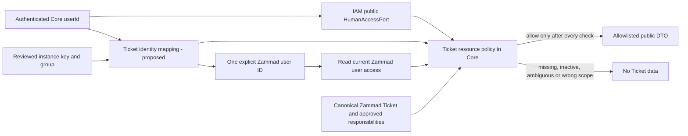
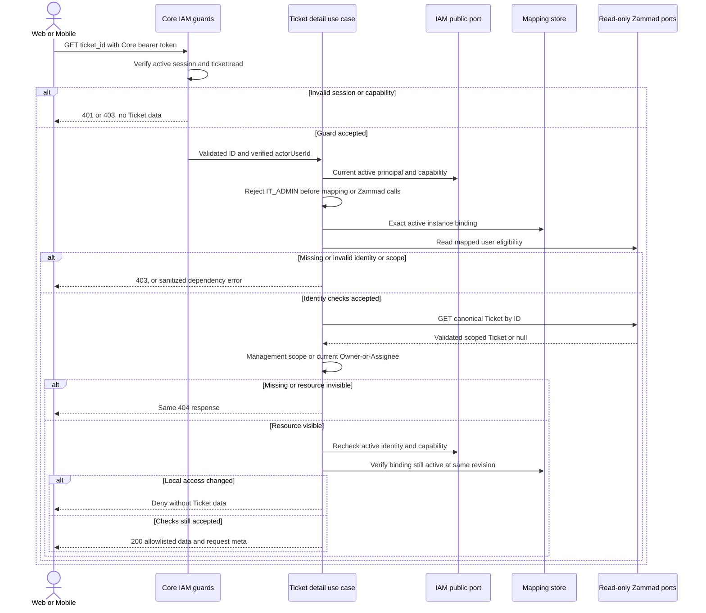

# Flow 04 — P1-B identity mapping and Ticket authorization proposal

Review date: **2026-11-19, Asia/Bangkok**. Status: **design for review, no P1-B implementation authorized**.

P0 observations are accepted. P1-A scope completion is accepted **subject to final code review**. This proposal does not approve IAM permissions, a custom Zammad field, Business Owner storage, or public Ticket visibility. Zammad remains the canonical Ticket system; Core owns IAM authorization, business context and integration coordination.

Repository inspected: `feat/ticket-management`, HEAD `69ddcffa1c478cc2a8516ee8c4c5fcac7c982bb7`. P1-A source is still in the working tree rather than that documentation commit. Source paths for those files below therefore use inline code. No code, IAM permission, submodule, dependency, or existing test-matrix change is part of this task.

**Business scope correction accepted (2026-11-19):** only OPERATOR and TECHNICIAN participate in Ticket operations. IT_ADMIN has no Ticket business access or override, even with inherited permissions. Admin1 remains IAM administration/explicit local integration provisioning only. The two human pairs are approved but remain uninserted. [Required negative cases and shared-document change request](flow04-ticket-role-scope-correction.md) supersede earlier manager/Admin wording. Owner-only closure and Owner-or-authorized-Operator reopening are preserved.

## 1. Recommendation and approval boundary

Recommend one small, Ticket-owned Mongo integration identity collection, using immutable Core `userId` and an explicitly provisioned Zammad numeric user ID. Scope each binding to a configured logical Zammad instance and the one approved PoC group. Resolve current IAM access through its public port, validate the mapped Zammad user through a new read-only integration port, and evaluate Ticket visibility inside the Ticket application/domain boundary before producing any public response.

For responsibilities, investigate the preferred candidate first: **native `owner_id` = Assignee; a separate approved Zammad attribute = accountable Business Owner**. That preserves the accepted baseline's Zammad ownership boundary. It is feasible as a candidate, not demonstrated or adopted. Do not substitute customer, creator, last updater, or service-account identity for Business Owner.

The recommended P1-B release contains one detail query only. It must wait for the identity, scope, responsibility and visibility decisions in section 9. An earlier manager-only release is possible only as an explicitly approved scope change. Do not quietly implement an Assignee-only Technician rule and describe it as the proposed Owner-or-Assignee rule.

## 2. P1-A review and current evidence

### 2.1 Architecture and integration boundary

| Reviewed component                                                                                          | Observation and consequence                                                                                                                                                                                                                                        |
| ----------------------------------------------------------------------------------------------------------- | ------------------------------------------------------------------------------------------------------------------------------------------------------------------------------------------------------------------------------------------------------------------ |
| `src/modules/ticket/application/ticket-read.port.ts`                                                        | Framework-free outbound `getTicket(id: number): Promise<ExternalTicket \| null>`. Does not accept a Core actor or make an authorization decision. Fixed internal error codes contain no original exception.                                                        |
| `src/modules/ticket/infrastructure/zammad-ticket-read.adapter.ts`                                           | Implements the port using one GET, configured origin/group, bounded timeout covering response body, no redirects/retries/cache/storage. Validates selected fields without coercion and strips unknown fields. Missing or valid out-of-group Ticket returns `null`. |
| `src/modules/ticket/infrastructure/zammad-read.config.ts`                                                   | Exact root origin, HTTPS or loopback HTTP, no URL credentials/path/query/fragment; positive safe group ID and bounded timeout. Credential stays in the outbound authorization header. Group ID is configuration, never business constant `2`.                      |
| `src/modules/ticket/ticket.module.ts`                                                                       | Nest provider factory composes configuration and adapter. No controllers or public provider exports. Not imported into [CoreModule](../../../src/app/core.module.ts).                                                                                              |
| [Platform configuration](../../../src/platform/config/env.schema.ts), [.env.example](../../../.env.example) | Optional settings preserve existing application startup. Complete adapter validation happens when its provider is constructed. No actual credential in example configuration.                                                                                      |
| Three adjacent `*.spec.ts` files and `test/ticket-zammad-read.real.ts`                                      | Unit tests use mocked fetch; fake contract tests use a local HTTP server and native fetch; opt-in real runner resolves the actual Nest provider without an HTTP listener.                                                                                          |

This dependency direction follows [MODULE_ARCHITECTURE_GUIDELINES.md](../../../MODULE_ARCHITECTURE_GUIDELINES.md): application owns the external boundary, infrastructure implements it, and the module composes it. A read query does not require a synthetic Ticket aggregate or parallel Mongo Ticket store. No IAM deep import or public privilege delegation exists in P1-A. Calling the internal port with a service credential is **not** permission for a human to read the result.

Supported internal fields are exactly `externalTicketId`, `number`, `title`, `groupId`, `nativeOwnerId`, `customerId`, `stateId`, `priorityId`, `createdAt`, `updatedAt`. IDs are positive safe integers; timestamps must parse as ISO date-time strings. Native owner and state IDs remain uninterpreted. Owner `1` and state `999` are deliberately preserved by tests rather than assigned invented business meaning.

Unsupported: Business Owner, Core identity binding, effective Zammad user access, state labels/business transition mapping, Articles, attachments, history, custom fields, list/search, domain context and all mutations. In particular, P1-A cannot prove that an external user is active or currently eligible for a group.

Final review considerations, without code changes:

- Configuration validation is intentionally deferred until module activation. P1-B composition must fail startup safely when required configuration is absent.
- The body is time-bounded but not byte-bounded. Review a modest response-size limit before exposing a public route; this is a hardening proposal, not an implemented guarantee.
- The current parser validates the complete selected shape before checking group. A malformed foreign-group response can produce an integration error rather than `null`, but never returns Ticket data. Do not promise indistinguishable timing/status for every malformed upstream case.
- There is no pinned logical database identity beyond configured origin/group. A restored instance at the same URL may reuse numeric IDs. The proposed instance key and reprovisioning procedure address that operational risk; they do not cryptographically identify the Zammad database.
- P1-A has no logging of raw errors or headers. P1-B must test the composed HTTP/observability stack as well: inbound log redaction alone does not prove all outbound instrumentation is safe.

### 2.2 Executions on 2026-11-19

| Execution                                                                    | Actual result                                                             | What it establishes                                                                             |
| ---------------------------------------------------------------------------- | ------------------------------------------------------------------------- | ----------------------------------------------------------------------------------------------- |
| Unit/configuration regression, three suites                                  | **PASS, 47/47**, 6.211 s                                                  | 42 P1-A unit cases plus 5 existing platform environment cases                                   |
| Fake-Zammad HTTP contract, one suite                                         | **PASS, 21/21**, 0.916 s                                                  | Actual HTTP request/response behavior against local fake server                                 |
| Real GET through Nest provider, existing Ticket `3`, configured P0 group `2` | **FAIL**, exit 1, `UPSTREAM_UNAVAILABLE`                                  | No successful fresh real read claimed                                                           |
| Independent TCP check of `127.0.0.1:8081`                                    | **FAIL**, `ECONNREFUSED`                                                  | Local instance was not reachable from this execution environment                                |
| Docker read-only inspection                                                  | **Unavailable**: Docker engine pipe absent and local config access denied | Does not establish the host daemon's complete state; no restart or environment change attempted |
| Full TypeScript Prettier check                                               | **FAIL**, 335 files                                                       | Existing checkout formatting issue, investigated below                                          |

Historical evidence remains separate: [P1-A report](flow04-p1a-zammad-read.md) records the successful 2026-11-12 real read of Ticket `3`, number `11003`, group `2`, native owner `5`, customer `7`, state `2`, priority `2`, plus TypeScript/lint/build PASS and 551 tests in 104 suites PASS. Those broad checks were not rerun for this documentation-only task. The new failed environment read neither erases that observation nor proves current integration readiness. [P0](flow04-p0-zammad-verification.md) records the selected Zammad version `7.2.2-45de44f1.docker` and image `7.2.2-0048`; neither was freshly verified today.

### 2.3 Formatting investigation: all 335 files

Checked all **344** TypeScript files under `src` and `test` using the installed Prettier API with each file's resolved configuration. **335 failed; all 335 contain CRLF; all 335 pass after replacing CRLF with LF in memory; all 335 equal HEAD after that normalization.** Byte hashes of inspected source files were unchanged by the check. The remaining nine files passed without normalization.

`git config --show-origin --get core.autocrlf` returned `true` from `C:/Program Files/Git/etc/gitconfig`. `git ls-files --eol` shows `i/lf w/crlf` for the sampled tracked files; `git check-attr text eol` reports unspecified attributes. [.prettierrc](../../../.prettierrc) does not override Prettier's LF default. These observations establish that all current failures are checkout line-ending differences, not 335 unrelated source edits.

No bulk format, Git configuration change, renormalization or checkout was performed. A repository-level LF policy or a clean LF checkout should be handled separately with owner approval. Do not turn this known failure into a green formatting claim or include a 335-file patch in P1-B.

## 3. Existing IAM contract and mapping alternatives

### 3.1 Facts from the repository

- [IAM user schema](../../../src/modules/iam/infrastructure/mongodb/iam-user.schema.ts) has a unique string `userId` separate from Mongo `_id`; username/email are mutable profile attributes. It has no approved Zammad identity attribute. Bind to `userId`, not `_id`, email, display name or username. Do not require a UUID shape that the public IAM contract does not guarantee.
- [HumanAccessPort](../../../src/modules/iam/application/ports/human-access.port.ts), exported through [IAM's public entrypoint](../../../src/modules/iam/index.ts), provides `getPrincipal(userId)` and `hasAllPermissions(userId, required)`. `getPrincipal` can return an inactive principal; the caller must test `status === 'ACTIVE'`. [HumanAccessService](../../../src/modules/iam/application/human-access.service.ts) rejects missing/inactive identities and empty/unknown permission lists in capability checks.
- [HumanAccessGuard](../../../src/modules/iam/presentation/human-access.guard.ts) verifies the bearer token, revalidates the user/session, and restricts forced-password-change accounts. [HumanPermissionGuard](../../../src/modules/iam/presentation/human-permission.guard.ts) requires explicit route policy and every declared permission. Neither performs Ticket resource checks.
- [Role catalog](../../../src/modules/iam/domain/role-permissions.ts): IT Admin has the catalog but is explicitly excluded from Ticket business authorization; Operator has `ticket:read/create/manage/close`; Technician has `ticket:read` but no baseline Ticket manage/close/work capability. Additive grants exist. There is no `ticket:work`. A Technician with an additive management capability must not silently become a management-scope reader.
- IAM exposes no public Zammad binding, group-scope query or external-user directory. Ticket must not query `iam_users` directly, import its store, or infer mapping from `/auth/me` email.

### 3.2 Alternatives

| Approach                                                                      | Advantages                                                                                                                                | Costs / security limitations                                                                                                                                  | Recommendation                                                                                     |
| ----------------------------------------------------------------------------- | ----------------------------------------------------------------------------------------------------------------------------------------- | ------------------------------------------------------------------------------------------------------------------------------------------------------------- | -------------------------------------------------------------------------------------------------- |
| Approved external ID attribute in Core IAM                                    | One identity administration record; IAM can govern lifecycle                                                                              | Requires IAM domain/schema/admin DTO/public port changes, instance uniqueness, external provisioning ownership; none exists today                             | Valid future option if IAM owner adopts external identities, unnecessary coupling for this slice   |
| Dedicated Ticket integration mapping collection                               | Uses existing Mongo infrastructure; durable explicit binding/revocation; no IAM schema change; unique constraints protect both directions | One small persistence boundary and controlled provisioning workflow; live IAM/Zammad validation still required                                                | **Preferred PoC proposal**                                                                         |
| Reviewed deployment configuration containing explicit ID pairs                | Smallest storage footprint; no Mongo mapping schema                                                                                       | Revoke/rebind through deployment; harder concurrent administration/audit; must reject duplicate pairs at startup; configuration needs equivalent scope review | Acceptable for a frozen short demo if explicitly chosen, less suitable for the requested lifecycle |
| Shared IdP subject / federation / Zammad custom user attribute                | Could reduce manual provisioning across several services                                                                                  | No approved shared-subject contract or attribute demonstrated; increases integration scope                                                                    | Defer                                                                                              |
| Runtime email matching, just-in-time account creation, per-user Zammad tokens | Superficially convenient                                                                                                                  | Mutable/reused email, ambiguity, credential lifecycle or unintended external writes                                                                           | Reject for P1-B                                                                                    |

Email may help a human identify an account during provisioning, but approval must bind the exact immutable Core ID and exact external numeric ID. A later email change must neither break nor redirect the binding. No opportunistic mapping during a Ticket GET.

## 4. Proposed identity binding contract

### 4.1 Minimal data structure

Proposed collection name: `ticket_zammad_identity_mappings`. This is **identity configuration, not a Ticket collection**. Ticket owns it while it is the only consumer; do not create a general platform identity subsystem prematurely.

```typescript
// Design only. Field names are internal, not a public administration API.
type ZammadIdentityMapping = {
  instanceKey: string; // operator-managed logical deployment generation
  coreUserId: string; // exact IAM userId, immutable within this binding
  zammadUserId: number; // positive safe integer, immutable within this binding
  approvedGroupId: number; // exactly the configured PoC group
  status: 'ACTIVE' | 'REVOKED';
  revision: number; // local administrative concurrency only
  approvedByCoreUserId: string;
  approvalReference: string; // reviewed provisioning/change record
  validatedAt: Date; // provisioning evidence, never a runtime access grant
  createdAt: Date;
  updatedAt: Date;
};
```

Unique indexes: `(instanceKey, coreUserId)` and `(instanceKey, zammadUserId)`, both across **all statuses**, not partial active-only indexes. No email, credential, cloned IAM role/permissions or Ticket title/state is stored. `approvedGroupId` is an explicit local scope grant, not an assertion that the user's external group membership remains current.

PoC policy is one-to-one per instance. No many-users-to-one external account or service-account sharing. Validate bounded nonempty instance keys and Core IDs (compatible with IAM's current 128-character input bound), positive safe external/group IDs, supported status, revision and approval metadata. Use existing Mongo migration/index conventions and verify uniqueness before activation; do not rely on an unverified `unique: true` declaration alone.

Bindings are immutable as pairs. Revoke/reactivate the same pair with review and revision checking; no ordinary reassignment of a retired external ID to another Core user. If a genuine rebind is needed, quarantine/review affected Ticket references and perform a separately approved migration retaining audit evidence. Do not add an automatic rebind or delete-and-recreate escape hatch in P1-B.

### 4.2 Instance and external access validation

Add a proposed `ZAMMAD_INSTANCE_KEY` alongside existing origin/group configuration. This is a deployment registry value, not client input and not a version string. Keep a reviewed association of instance key, exact origin, expected group and service-account ID. A database reset/restore that changes identity meaning requires disabling bindings and provisioning a new generation; URL equality alone cannot detect reset. No client may select an origin, instance, group or Zammad user ID.

P1-B needs a new narrow read-only application boundary, for example `ZammadUserAccessPort.getUserAccess(zammadUserId)`, returning only validated external ID, active flag and effective allowed group access. P1-A's Ticket port cannot supply this. The adapter must use the same selected origin and sanitized failure behavior. Resolve service identity with `/api/v1/users/me` during configuration verification; disallow its ID, system/unassigned sentinel IDs, and customer-only accounts as human bindings.

[Zammad's User API documentation](https://docs.zammad.org/en/latest/api/user.html) describes GET user/me and user-by-ID responses, while warning that available fields depend on permissions. P0 observed `id`, `active`, `role_ids` and `group_ids` for the selected accounts. The runtime contract for **effective** access, including role-derived groups, is still pending real verification. Do not assume role ID `2`, a display name such as “Agent”, or a nonempty `role_ids` array proves eligibility.

For the initial PoC, validate the configured accounts' direct group access explicitly. Candidate read eligibility is `read` or `full` for the approved group plus verified agent permission. Zammad's [group permission documentation](https://admin-docs.zammad.org/en/7.1/manage/groups/group-permissions.html) distinguishes read from overview and allows native assignment with full access. This is documentation guidance, not proof of effective-access serialization on the selected 7.2.2 instance. Unknown or role-only access that cannot be resolved by the demonstrated contract must fail closed until verified. If an additional read-only role lookup is necessary, approve and test that specific port extension; never grant `admin.user` to the service account merely to make this design convenient.

At runtime, fetch current external access on each request in the initial PoC. No positive authorization cache and no fallback to `validatedAt`, old group membership, email or service privileges if the external check fails. This adds an upstream read and makes Zammad availability a dependency of authorization, but gives a simple, reviewable revocation model. No distributed atomicity or instantaneous cross-system revocation is claimed.

### 4.3 Provisioning and lifecycle

1. An approved maintainer prepares an explicit pair and one-group scope from the actual Core and Zammad accounts. Record the approval reference; do not treat a typed actor ID as proof of operator identity.
2. A future restricted provisioning command verifies the maintainer's authorized operational context, current Core principal via the public port, selected instance/service identity, and target external active/agent/group eligibility. The operational authorization/runbook needs IAM/integration-owner approval; no new public admin endpoint or permission is proposed here.
3. Validate all candidate rows and both unique indexes. A dry run makes no changes. Any unknown identity, duplicate or unsupported scope rejects the proposed provisioning batch; never resolve a duplicate by selecting the first row.
4. Apply an approved binding and its audit fact atomically using existing Mongo unit-of-work/outbox conventions. Perform external reads **before** the retriable local transaction, then recheck local revision/uniqueness inside it. A local retry must not create external users or change Zammad groups. Outbox failure rolls back the local administrative change.
5. GET requests only read mappings. Core deactivation/session revocation, revoked mapping, external deactivation or lost group eligibility denies the next request that observes it. Do not delete the identity mapping or auto-transfer Ticket responsibility. Reactivation needs an explicit binding review if the binding was revoked.
6. Scope changes, token rotation, external user replacement and instance rebuild trigger revalidation. Token rotation does not change the human binding when the same reviewed service identity/instance remains. Secret storage stays in environment/secret management, outside mappings and audit payloads.

Proposed runtime mapping read port: `findBinding(instanceKey, coreUserId)` with typed missing/revoked/integrity-failure outcomes. Normal operation is one indexed lookup. Duplicate/conflicting records in a broken or unmigrated database are an integrity failure, never an arbitrary winner. Do not expose mapping administration or raw external IDs to clients through this port.



## 5. Resource-level authorization proposal

### 5.1 Decision rule

In this document, a Ticket manager means an eligible OPERATOR, never IT_ADMIN. Administrative integration support is outside the business workflow.

Only OPERATOR and TECHNICIAN are eligible human Ticket business roles. IT_ADMIN is rejected even with ticket:read, any other Ticket capability, an accidental mapping, or a claimed Owner/Assignee relationship. Provisioning authority grants no business access. All readers must have a valid current Core session, active Core account, `ticket:read`, one active unambiguous binding for the configured instance/group, and a currently active eligible external user. The returned Ticket must belong to the configured group **and** the binding's approved scope. Integration-account access grants none of these human privileges.

| Actor / condition                                                                         | Proposed result                                                                                                                       |
| ----------------------------------------------------------------------------------------- | ------------------------------------------------------------------------------------------------------------------------------------- |
| Operator meeting all common checks                                                        | Read any Ticket inside that explicitly approved management group                                                                      |
| Technician meeting all common checks                                                      | Read only when authoritative current Business Owner **or** authoritative current Assignee equals that user's mapped external identity |
| Technician with additional `ticket:manage` or `ticket:close`                              | Still Technician read rule; extra capabilities alone do not create a scope grant or change role                                       |
| Unmapped/revoked/inactive/wrong-instance/wrong-group caller                               | Deny; no fallback to broad Zammad access                                                                                              |
| Technician who is customer, creator, Article author, former Owner or former Assignee only | Deny; these are not current responsibility grants                                                                                     |
| IT Admin in any scope, with any inherited Ticket permissions                              | Deny all Ticket business operations; IAM administration is separate                                                                   |
| Missing/ambiguous responsibility representation                                           | Do not infer Owner; affected Technician read path stays blocked/fails closed                                                          |

The business-role allowlist is mandatory and independent of the unchanged IAM catalog. For this detail read, recommend **no additional `ticket:manage` requirement**: `ticket:read` plus OPERATOR role and approved scope is sufficient under the proposed policy. Management mutations remain separate capabilities. This makes the existing catalog sufficient without creating `ticket:work` or changing role baselines. The user has approved this role-based scope distinction and restricted Technician visibility, with IT_ADMIN excluded. Responsibility representation and enforcement mechanisms remain gated.

Only the requesting human must have a valid active mapping for their own read grant. A manager need not fail merely because a Ticket references an unmapped former Assignee; P1-B does not return an enriched user directory. Invalid caller mapping, corrupted required responsibility data, or uncertain external access must never grant Technician visibility. Business Owner lifecycle and what an intentionally unset Owner means need an explicit contract before enabling that branch.

### 5.2 Responsibilities and source of truth

| Candidate                                       | Canonical representation                                                                                         | Benefits                                                                                                             | Required validation / trade-off                                                                                                                                                                                                         |
| ----------------------------------------------- | ---------------------------------------------------------------------------------------------------------------- | -------------------------------------------------------------------------------------------------------------------- | --------------------------------------------------------------------------------------------------------------------------------------------------------------------------------------------------------------------------------------- |
| **Preferred for investigation: both in Zammad** | Native `owner_id` is Assignee; approved separate Ticket attribute holds Business Owner's Zammad user ID          | Same canonical Ticket read can contain both, aligns with baseline §10, reassignment need not transfer accountability | No approved field exists. Must verify field type/range, REST visibility/round-trip, initial value, migration of existing Tickets, history, allowed writers and integrity under direct UI/API changes                                    |
| Core owns Business Owner context                | Zammad native assignment; Core context keyed by `(instanceKey, externalTicketId)` with `businessOwnerCoreUserId` | Stable Core identity, no custom Zammad field, Core can control Owner mutations                                       | Changes accepted data-ownership boundary and needs explicit approval; creates cross-system context/recovery/race obligations; context must exist from initial creation, not postponed to P5; missing context cannot imply default Owner |

In the preferred candidate, use one reviewed scalar external ID, not an email/name or unsynchronized duplicate of a Core Owner record. Attribute name and physical type are **TBD**. [Object attribute types](https://admin-docs.zammad.org/en/latest/system/objects/types.html) include integer and selection types; they do not establish a validated relational user-reference field for this project. A plain integer requires explicit existence/identity validation. Do not install a field, hardcode a speculative name, or assume automatic referential integrity.

[Attribute screen permissions](https://admin-docs.zammad.org/en/latest/system/objects/permissions.html) are not sufficient evidence of an API write authorization boundary. Test actual REST and UI writer behavior before using an editable Owner field to grant read access. If a Technician can set Business Owner to themselves on any Ticket, that field becomes an escalation path. The approved writer model must prevent such self-grants or explicitly accept trusted external administrators as responsibility authorities. P0's agents had full group access, so Core restrictions do not restrict what those users can read or change directly in Zammad. Direct Zammad access must be reviewed separately before claiming system-wide restricted visibility.

P1-A returns native `owner_id` only and strips custom fields. After approval, extend its allowlist narrowly to retrieve the authoritative Owner field in the **same Ticket response** if possible; do not split two Zammad responsibility reads unnecessarily. If Core ownership is chosen, add only approved context persistence and exact reference lookup; never store a canonical copy of Ticket state/title/Articles. There is no P1-B responsibility adapter to an invented custom field today.

Until representation and semantics are approved, “native owner equals requester” can establish only the candidate Assignee branch. It cannot establish Business Owner or satisfy the complete Owner-or-Assignee acceptance rule. Recommendation: gate public P1-B until both branches are defined and demonstrated. A reduced manager-only or Assignee-only delivery needs a separate explicit product decision, documented client behavior and revised phase acceptance, without rewriting the 22-case business inventory.

### 5.3 Freshness and concurrency limits

Read canonical Ticket data on every request and make the visibility decision from that same snapshot. Never authorize from a locally cached Ticket and then return a newer unfiltered payload. Recheck Core active/capability and mapping revision immediately before returning, so changes observed during upstream I/O deny the response. A revoked or changed binding aborts the request; it does not trigger automatic rebinding.

These checks reduce stale authorization but cannot atomically freeze IAM, Mongo mappings and Zammad. Assignment/Owner changes immediately after the last read remain a race. P1-B proposes per-request snapshot semantics for reads, requiring owner approval; strict instantaneous revocation requires a stronger integration/writer contract. No Core ETag, `If-Match`, lock or local revision prevents direct Zammad writes. Mutation concurrency remains a later gate. No Idempotency-Key, creation receipt or Operation Journal is required for this GET.

## 6. Proposed P1-B HTTP and application contract

### 6.1 Route, DTO and external mapping

`GET /api/v1/tickets/{ticket_id}`. Nest controller path `tickets`, method `@Get(':ticket_id')`; the existing global prefix supplies `/api/v1`. Use `@RequirePermissions('ticket:read')`, `@CurrentHumanPrincipal()` from IAM's public entrypoint, and `@ApiBearerAuth('HumanAccessToken')`. Both Web and Mobile use the current Core access-token flow. No Zammad PAT, external user ID, caller role, group override, credentials or identity headers are accepted from the client.

Proposed request DTO: `{ ticket_id: string }`, matching `^[1-9][0-9]*$`, at most 16 digits and safely representable as a positive integer. Reject signs, decimals, exponent notation, whitespace, leading zeroes and overflow before outbound calls. Use a strict empty query DTO to reject unsupported filters/expansions. No request body is defined. Follow existing Zod/createZodDto validation conventions; metadata must cooperate with the global strict validation pipe.

Minimal public data DTO, with existing snake_case HTTP naming:

```typescript
type TicketDetailResponseDto = {
  ticket_id: number; // canonical Zammad ID, not a new local ID
  number: string; // display Ticket number, distinct from ID
  title: string;
  state_id: number; // external ID, no invented lifecycle label
  priority_id: number;
  created_at: string;
  updated_at: string;
};
```

| ExternalTicket field                  | Public field / use                                                                   |
| ------------------------------------- | ------------------------------------------------------------------------------------ |
| `externalTicketId`, `number`, `title` | `ticket_id`, `number`, `title`                                                       |
| `stateId`, `priorityId`               | `state_id`, `priority_id`; no hardcoded state `2 = OPEN` business mapping            |
| `createdAt`, `updatedAt`              | `created_at`, `updated_at`; timestamps are not concurrency tokens                    |
| `groupId`                             | Internal scope check only                                                            |
| `nativeOwnerId`                       | Internal candidate Assignee comparison after approval, not public Business Owner     |
| `customerId`                          | Retained internally by P1-A, omitted from public detail                              |
| Future approved Business Owner field  | Authorization input only in this minimal DTO; shape requires responsibility approval |

Do not return raw Zammad objects, user profiles, raw group/customer/owner IDs, Articles, attachments, unknown custom fields, context, or service-origin URLs. Owner/Assignee display enrichment can be a separately reviewed additive DTO change. This minimal detail endpoint is not the full WF-04 read/history feature. Title is plain data; clients must render it safely, not as trusted HTML.

Controller returns the plain DTO. [ApiResponseInterceptor](../../../src/platform/http/api/api-response.interceptor.ts) wraps it once as `{ data, meta: { request_id, trace_id? } }`. Use `Cache-Control: no-store`; no shared response cache, conditional GET/304 or P1-B ETag. Proposed OpenAPI file `api/v1/ticket.yaml` and controller Swagger decorators must be added together in the implementation PR, following [IAM OpenAPI](../../../api/v1/iam.yaml) and [current-user controller](../../../src/modules/iam/presentation/current-user.controller.ts), with explicit schema, bearer security and all error responses. No API contract file is changed by this proposal.

### 6.2 Application use case and sequence

Proposed `GetTicketDetailUseCase.execute({ actorUserId, externalTicketId })`; actor ID comes only from verified HTTP context, never from request parameters. Keep application errors framework-free. One small pure Ticket read policy can receive current principal/capability, validated binding/access and authoritative responsibility facts. It must not know Nest, fetch, Mongoose or credentials.

1. Existing global IAM guards validate session/account/password state and `ticket:read`. Invalid requests never call Zammad.
2. Validate route/query and invoke the use case. Re-resolve current principal and permission through `HumanAccessPort`, including for future non-HTTP callers; no reliance on a caller-supplied role.
3. Load the one active mapping, verify configured instance and approved group, and obtain current external-user eligibility. Missing permission/binding rejects before fetching a Ticket.
4. Call the P1-A Ticket port. `null` becomes a non-disclosing not-found result. Verify that Ticket scope and local approved scope agree.
5. First reject every role except OPERATOR and TECHNICIAN, regardless of permissions or mappings. For Operator apply approved management scope. For Technician, evaluate the complete approved Owner-or-Assignee rule against that Ticket snapshot; deny unrelated or invalid responsibility data. No service-role fallback.
6. Recheck local mapping revision and current IAM access before returning. Map only authorized Ticket fields into the DTO and let presentation produce the standard envelope. Emit sanitized correlation/error diagnostics without credentials, raw payloads, or customer data.



No atomic cross-system authorization snapshot is implied by the diagram. Upstream/dependency failures at any call stop processing; there is no stale result fallback.

### 6.3 Error behavior

Use [ProblemDetails mapper/filter](../../../src/platform/http/errors/problem-details.mapper.ts): `type`, `title`, `status`, `detail`, `instance`, `code`, `request_id`, plus safe validation errors where applicable. Proposed domain-specific codes are new Ticket contract choices for review; existing guard codes stay unchanged.

| Condition                                                                                     | Proposed status/code             | Privacy and behavior                                                              |
| --------------------------------------------------------------------------------------------- | -------------------------------- | --------------------------------------------------------------------------------- |
| Invalid/expired/revoked Core session or inactive account at authentication                    | `401 / UNAUTHORIZED`             | Existing IAM behavior, no upstream Ticket request                                 |
| Forced password change or missing `ticket:read`                                               | `403 / FORBIDDEN`                | Existing IAM behavior                                                             |
| Invalid Ticket ID/query                                                                       | `400 / VALIDATION_ERROR`         | Use the existing Zod validation pipe for route/query DTOs; no outbound request    |
| No active unambiguous eligible caller binding, inactive external human, wrong caller scope    | `403 / TICKET_ACCESS_DENIED`     | Same generic message across these caller conditions, no external identity details |
| Ticket absent, valid foreign-group Ticket, unrelated Technician                               | `404 / TICKET_NOT_FOUND`         | Identical response shape/code/detail, no existence disclosure through body        |
| Mapping integrity violation, mapping DB unavailable, unresolved required policy configuration | `503 / TICKET_READ_UNAVAILABLE`  | Fail closed, operator diagnostic only; never pick a duplicate row                 |
| Upstream 401/403, malformed/mismatched JSON, unexpected redirect/status                       | `502 / TICKET_INTEGRATION_ERROR` | Service integration failure, never misrepresented as client's missing permission  |
| Upstream 429/5xx, connection failure                                                          | `503 / TICKET_READ_UNAVAILABLE`  | No fabricated Ticket or retry loop                                                |
| Upstream timeout                                                                              | `504 / TICKET_READ_TIMEOUT`      | No result fallback                                                                |
| Unexpected internal defect                                                                    | `500 / INTERNAL_SERVER_ERROR`    | Standard sanitized response                                                       |

A detected ambiguous caller mapping is denied; structurally duplicate records additionally require the 503 integrity path. A valid mapping whose target user no longer exists is denied as ineligible. If the integration lacks permission to validate that user, use the upstream integration-error path rather than claiming the human is absent.

The existing mapper uses title `Internal Server Error` for otherwise unmapped 5xx statuses and accepts a supplied safe `code`. Keep that actual convention in P1-B documentation/tests unless a separate HTTP contract improvement is approved. Do not claim custom 502/503/504 titles are already implemented. All Ticket-specific exception messages must be fixed and safe even in development mode, where the existing mapper may expose `Error.message`.

### 6.4 Module registration

Keep `TicketReadPort` internal. Add only the mapping read/persistence boundary, external-user access boundary, domain read policy, detail use case and presentation DTO/controller actually needed. Wire with factory providers in `TicketModule`; no generic service/facade chain, shared integration platform, background synchronizer, `forwardRef`, or exports of the credential-bearing adapter.

[IamModule](../../../src/modules/iam/iam.module.ts) already exports `IAM_HUMAN_ACCESS_PORT` but its [index](../../../src/modules/iam/index.ts) does not export the module class. Prefer adding only the `IamModule` class export to that public entrypoint in an approved P1-B composition PR, allowing `TicketModule` to import it without deep business-module imports. This is a public composition-surface adjustment for review, **not** an IAM permission change. Reuse the existing global guards rather than registering duplicates. Verify Nest composition and guards with the actual host.

Register the approved mapping schema through existing Mongo facilities; use public IAM and platform event/transaction contracts only. Export `TicketModule` as a narrow module entrypoint for the composition root if needed. Import it into `CoreModule` **only** in the reviewed public-endpoint PR after required configuration, migrations and policy gates are met. Do not introduce a Ticket HTTP route by merely re-exporting `getTicket`.

## 7. Tests and acceptance for the proposed implementation

The [22-case matrix](../testing/flow04-test-matrix.md) remains byte-for-byte unchanged. Its business IDs are authoritative for counting. P1-B technical checks below are subordinate checks, not new BM04 cases or completed workflow acceptance. The matrix's historical note about no real runner predates P1-A; the existing explicit P1-A runner is documented in section 8 and does not replace Web/Mobile E2E.

| Layer                         | Required P1-B checks                                                                                                                                                                                                                                                                                                                                       | Existing business traceability                                                              |
| ----------------------------- | ---------------------------------------------------------------------------------------------------------------------------------------------------------------------------------------------------------------------------------------------------------------------------------------------------------------------------------------------------------- | ------------------------------------------------------------------------------------------- |
| Unit                          | Exact-ID binding, both uniqueness directions, revoked/missing/ambiguous/inactive/wrong-instance/group; mutable email has no effect; no service/sentinel binding; manager scope; Technician Owner only, Assignee only, both and neither; additive permission cannot broaden role; mapping/IAM changes during I/O; sanitized error mapping and DTO allowlist | Primarily TC-WF04-20; visibility prerequisites for 01/04/05/18; no closure claims for 07/16 |
| Mongo persistence integration | Real unique-index rejection including revoked rows, atomic provisioning/audit, revision conflict, lookup isolation, rollback, no email lookup and no writes during GET                                                                                                                                                                                     | Supporting evidence for 20; not a new unique BM04 case                                      |
| HTTP integration              | Real Nest IAM guards, current session/account/password behavior, validated IDs/query, anti-IDOR for unrelated/foreign Ticket, uniform 404, status/envelope/request ID/cache headers, no raw external identities or secret leakage, correct root-module registration                                                                                        | Supporting 20 and retrieval portions of 01/04/05/18                                         |
| Fake-Zammad HTTP contract     | Preserve all P1-A cases; add user active/group/permission parsing, absent/malformed/role-derived eligibility, denied user lookup, service ID mismatch, and approved responsibility attribute validation. Assert only GETs and expected call order, no automatic provisioning/mutation/retry                                                                | Deterministic negative evidence for 20, prerequisites of 04/05                              |
| Real-Zammad contract          | Actual configured instance, service identity, human Core-to-Zammad seed pairs, effective access representation and approved Owner/Assignee data; positive managers/Owner/Assignee and unrelated/foreign denials through Core; verify zero writes                                                                                                           | Environment-dependent, partial evidence toward 20/04/05, not completed end-to-end cases     |
| Web/Mobile E2E                | Both actual clients access same canonical Ticket through Core; unrelated Technician sees no detail. Full create/assign/progress/close requires later phases                                                                                                                                                                                                | TC-WF04-18 remains blocked until complete DS-04a; P1-B alone cannot pass it                 |

For real negative tests, have an authorized environment maintainer prepare fixtures in advance. Do not change external account status/group/fields or mutate Tickets merely because a read-only test is authorized. Missing seeded Owner-only/Assignee-only fixtures or unavailable Zammad is **BLOCKED/NOT RUN**, not a pass. Real HTTP authorization tests also need seeded Core IAM/Mongo, not just a PAT. No test may bypass the use case with direct service-account reads and claim client authorization succeeded.

Use existing `*.spec.ts` Jest convention and Nest/Supertest patterns, with a dedicated guarded Mongo test database where needed. The known Nest config/Jest ESM bootstrap issue recorded in P1-A must be resolved or isolated using actual repository test patterns for the P1-B HTTP harness; mocking away guards is not acceptance evidence. Keep real-service runners opt-in and outside ordinary fake/unit PR execution. Backend `test:e2e` is not a Web/Mobile harness.

P1-B acceptance requires approved decisions, all relevant deterministic checks executed successfully, real identity/responsibility contract evidence on the selected environment, and no leaking/bypass path in final review. CI completion requires an actual run link/artifact; planned CI placement is not execution.

BM04 targets remain known: at least 12 feature cases (3 each F4-01..04 with Web/Mobile coverage), 5 lifecycle transitions, 1 main E2E and 18 unique total. Inventory remains **22**, so at least **11** unique automated cases are required by the 50% floor, even though the original minimum is 9. Planned 17 CI cases are still planned. Mandatory main paths must pass; WF-04 exceptions and overall pass rates must reach 90%; zero open Critical/High defects; seeded staging must run end-to-end. Transitions TC-WF04-13..17 remain NEW→OPEN, OPEN→PENDING, PENDING→OPEN, OPEN→CLOSED, CLOSED→OPEN. None is executed by a read adapter. Formal BM04 approval/version remains pending.

## 8. Exact commands and evidence boundaries

Run from the repository in PowerShell with Node `22.22.3` and installed locked dependencies. Direct executable paths below avoid a global pnpm shim selecting a different Node. Commands in the first two blocks were executed during this review.

```powershell
Set-Location 'C:\Users\Admin\AR-IMMS backend\core-backend'
node --version

# PASS: unit + existing environment tests, 47 cases
node node_modules/jest/bin/jest.js --runInBand --runTestsByPath src/modules/ticket/infrastructure/zammad-read.config.spec.ts src/modules/ticket/infrastructure/zammad-ticket-read.adapter.spec.ts src/platform/config/env.schema.spec.ts

# PASS: fake-Zammad HTTP, 21 cases
node node_modules/jest/bin/jest.js --runInBand --runTestsByPath src/modules/ticket/infrastructure/zammad-ticket-read.http-contract.spec.ts

# FAIL: 335 unchanged CRLF files. Check only, never --write for this scope.
node node_modules/prettier/bin/prettier.cjs --check "src/**/*.ts" "test/**/*.ts"
git config --show-origin --get core.autocrlf
git ls-files --eol src/app/core.module.ts src/platform/config/env.schema.spec.ts
git check-attr text eol -- src/app/core.module.ts
```

Read verification loads the configured credential using the existing ignored environment file; do not print it. The group ID below is the previously verified **test deployment setting**, not a production default or implementation constant. No external mutation is made.

```powershell
$env:ZAMMAD_EXPECTED_GROUP_ID = '2'
$env:ZAMMAD_READ_TEST_TICKET_ID = '3'
$env:ZAMMAD_READ_TEST_EXPECTED_BASE_URL = 'http://localhost:8081'
node -r ts-node/register -r tsconfig-paths/register test/ticket-zammad-read.real.ts
# Actual 2026-11-19 result: FAIL real Zammad read verification UPSTREAM_UNAVAILABLE
```

The all-file line-ending investigation used a temporary, ignored helper `.tmp/flow04-doc-validation/p1b-format.mjs`; it read each file, applied `text.replaceAll('\r\n', '\n')` in memory, checked both forms with installed Prettier, compared normalized contents with `git show HEAD:<path>`, and checked source hashes. The command was `node .tmp/flow04-doc-validation/p1b-format.mjs`. This local evidence helper is not an application change or a new portable repository test command. Results: 344 checked, 335 failed, every failure normalized successfully and matched HEAD.

Existing broader verification commands for a future approved code PR follow. They were **not rerun** in this documentation review; historical results are in the P1-A report.

```powershell
pnpm.cmd typecheck
pnpm.cmd check:all
pnpm.cmd exec eslint "{src,apps,libs,test}/**/*.ts"
pnpm.cmd test:cov --runInBand
pnpm.cmd format:check
pnpm.cmd build
```

No P1-B test files or commands exist yet. Add exact new test paths/commands with their implementation PR, rather than running a nonexistent pattern with `--passWithNoTests`. The existing real runner verifies the P1-A Ticket read only; it cannot validate an unimplemented mapping or authorization policy.

Documentation verification executed during this task: **PASS** for local links, Unicode, code fences and all **13 Mermaid diagrams** (2 here, 11 in the architecture document); no configured credential found in either document. **348 protected file hashes** (all source/test TypeScript, selected configuration/dependencies and the 22-case matrix) remained unchanged. The new proposal's Prettier check and `git diff --check` passed. These are document/preservation checks, not business tests or CI executions.

```powershell
node .tmp/flow04-doc-validation/p1b-validate.mjs
node node_modules/prettier/bin/prettier.cjs --check docs/local/integration/flow04-p1b-identity-authorization-design.md
git diff --check
```

The first command uses the ignored local evidence helper and existing isolated Mermaid tooling; it is not a newly committed package script. This task added no dependency.

## 9. Decisions, small PR scope and stop conditions

| Decision                                            | Recommendation / outstanding evidence                                                                                                                                                    | Approver / effect                                                                    |
| --------------------------------------------------- | ---------------------------------------------------------------------------------------------------------------------------------------------------------------------------------------- | ------------------------------------------------------------------------------------ |
| D1: mapping storage and lifecycle                   | Ticket-owned collection, immutable one-to-one ID pairs, one approved group, controlled provisioning and audited revocation; no runtime email                                             | IAM/integration owner, blocks mapping implementation                                 |
| D2: instance/user access contract                   | Reviewed instance generation and service identity; demonstrate active human/agent/effective group access with least necessary API privileges                                             | Integration owner; selected test environment must be available                       |
| D3: management and Technician visibility            | `ticket:read` plus role/scope for Operator; current Business Owner OR Assignee for Technician; no admin/group bypass                                                                     | IAM/business owner, blocks public detail exposure                                    |
| D4: authoritative responsibilities and writer trust | Investigate both responsibilities in Zammad first; approve field, semantics, existing-Ticket migration and who may change it; Core-owned alternative requires baseline-boundary approval | Business/integration owner, blocks full Technician policy; no default Owner inferred |
| D5: public response, errors and read consistency    | Minimal seven-field DTO, no raw external human IDs, uniform resource 404, snapshot semantics and sanitized integration failures                                                          | API/security owner, blocks public contract PR                                        |
| D6: composition/provisioning surface                | Small public IamModule export, approved operational provisioning authority, reuse existing audit/outbox contracts                                                                        | Architecture/IAM owner; no permissions edited                                        |
| D7: external environment and tooling                | Restore/reach disposable instance, seed reviewed Core identity pairs; demonstrate HTTP test harness and real checks                                                                      | Environment/test owner; current real read failed                                     |

Once explicitly approved, split P1-B into reviewable PRs:

1. **Identity foundation:** collection/index migration, narrow mapping read contract, restricted dry-run/provision/revoke tooling and audit integration, external-user read adapter with unit/Mongo/fake tests. Keep Ticket module absent from the public host. Safest first coding task is the approved schema/index and mapping validation tests; no email discovery or external account writes.
2. **Authorization query:** approved responsibility field parsing (only after separate field verification), pure read policy, use case, race/error handling and deterministic tests. Still no controller. If D4 is unresolved, stop rather than create a placeholder Owner implementation.
3. **HTTP detail and composition:** one controller/DTO, public OpenAPI, narrow module exports and Core registration, real guards/HTTP integration, seeded real-contract execution and review. No merge/release claim without the required environment evidence.

Expected future files are confined to Ticket's domain/application/infrastructure/presentation and module, its scoped provisioning/test runner and Mongo migration under existing conventions, relevant configuration/example settings, a minimal IAM module-class export, Core composition, `api/v1/ticket.yaml`, and supporting docs/tests. No changes to IAM permission catalog, shared business rules or Git submodule are proposed. No Ticket create/list/search/assign/Article/close/reopen, creation receipt, Operation Journal, or canonical Ticket collection is included.

P1-C/D still require initial/default Owner, minimum creation-time context if Core ownership is selected, explicit create-response-loss recovery and approved manual fallback when reliable automated reconciliation is unavailable. Never blindly retry an uncertain create or claim exactly-once from a local key. Delegated Article attribution, `ticket:work`, mutation concurrency and Incident/Maintenance public contracts remain later independent gates.

## 10. Sources and traceability

- [AGENTS.md](../../../AGENTS.md), [module architecture](../../../MODULE_ARCHITECTURE_GUIDELINES.md), [repository README](../../../README.md).
- [Accepted Flow 04 baseline](https://github.com/AR-IMMS/shared-docs/blob/294001cd9f1359bc03ced3925328454cabb3c0ea/business/04-ticket-management.md): BR-01/§10 canonical ownership, BR-04 distinct responsibilities, BR-05 current Owner closure, BR-06 reopening, BR-08 context, BR-09 Articles, BR-10 failure/recovery, BR-11 independent lifecycles. This proposal changes none of them.
- [Overall architecture](../architecture/flow04-ticket-zammad-backend-design.md), [P0 findings](flow04-p0-zammad-verification.md), [P1-A implementation evidence](flow04-p1a-zammad-read.md), [22-case matrix and BM04 provenance](../testing/flow04-test-matrix.md).
- [IAM HTTP authorization specification](../../superpowers/specs/2026-10-16-iam-http-authorization-design.md), [IAM OpenAPI](../../../api/v1/iam.yaml), [Jest configuration](../../../jest.config.ts), [package scripts](../../../package.json), [Mongo test guard](../../../test/mongodb-test-config.ts).
- Official Zammad references linked at their claims above were consulted on 2026-11-19. Documentation supports candidate designs; it does not replace selected-instance tests or project approval. No new custom field or identity mapping has been installed or verified by this task.

This task ends with the proposal. **Wait for explicit P1-B approval before changing implementation.**
