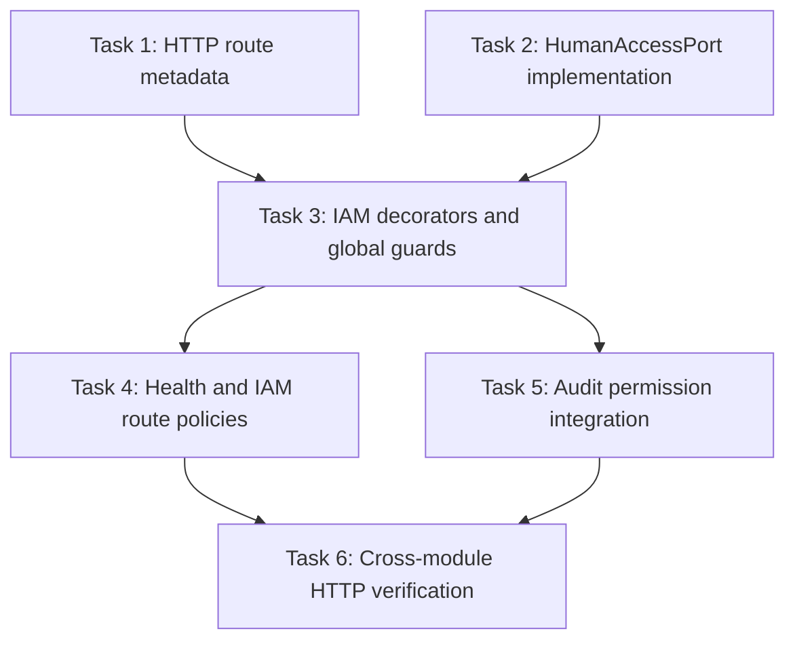

# IAM HTTP Authorization Implementation Plan

> **For agentic workers:** REQUIRED SUB-SKILL: Use superpowers:subagent-driven-development (recommended) or superpowers:executing-plans to implement this plan task-by-task. Steps use checkbox (`- [x]`) syntax for tracking.

**Goal:** Enforce explicit, protected-by-default authentication and permission policies on HTTP routes, expose a narrow IAM principal contract to consuming modules, and migrate Audit to the public IAM authorization boundary.
**Architecture:** `platform/http` owns generic route-policy metadata and public-route marking. IAM owns principal context, permission decorators, the ordered authentication and permission guards, and its public access contract. IAM publishes only documented contracts through its module barrel; consuming modules apply IAM capability metadata while retaining ownership of resource-specific rules. The application composition registers IAM's guards globally in authentication-then-authorization order.
**Tech Stack:** NestJS 11 guards, metadata decorators and `Reflector`; TypeScript; Jest; Nest Swagger/OpenAPI; existing IAM domain catalogs, active-session ports, and `src/platform/http` error/response handling.
**Spec:** `docs/superpowers/specs/2026-10-16-iam-http-authorization-design.md`; SPEC-002 §11; IAM-004 issue #20.

## Global Constraints

- Preserve Modular Clean Architecture. `platform/http` must not import IAM; Audit may depend on IAM only through its public module exports; no module may reach into another module's repositories, domain models, or infrastructure.
- Resolve identity and permissions from current server-side IAM state. Never authorize from JWT permission claims.
- The two global guards must run in order: authenticate and attach verified principal, then authorize explicit route policy.
- A missing policy or invalid policy fails closed. `@RequirePermissions` requires at least one catalog permission and uses all-of semantics. No wildcard and no `agent:*` permission are introduced.
- `@PublicRoute()` is reserved for health and authentication entry routes. Browser logout is public only at the bearer-token layer; its existing cookie, CSRF and Origin checks remain mandatory.
- Keep resource ownership, assignment, workflow and record-level decisions in the business module that owns each resource.
- Keep IAM-003 authentication transport behavior and IAM-005 administration behavior intact; this issue integrates their routes with authorization policy.
- Preserve platform HTTP success envelopes and Problem Details errors. Update OpenAPI with every route-policy change.
- Each new or changed test has a short behavior-focused doc comment, consistent with repository preference.
- Do not change Audit Fact v2, add dependencies, alter unrelated dirty files, or implement IAM-005 user-management capabilities.

## Code Map

- Generic HTTP metadata and public exports: `src/platform/http/api/`, `src/platform/http/api/index.ts`, `src/platform/http/index.ts`.
- IAM current principal/access contracts: `src/modules/iam/application/ports/human-access.port.ts`, `src/modules/iam/application/ports/human-session-access.port.ts`, `src/modules/iam/index.ts`.
- IAM global guard composition and route controllers: `src/modules/iam/iam.module.ts`, `src/modules/iam/presentation/human-access.guard.ts`, `src/modules/iam/presentation/auth.controller.ts`, `src/modules/iam/presentation/browser-auth.controller.ts`, `src/modules/iam/presentation/current-user.controller.ts`, `src/modules/iam/presentation/users.controller.ts`.
- Existing IAM data adapters and permission catalog: `src/modules/iam/infrastructure/`, `src/modules/iam/domain/role-permissions.ts`.
- Health policy: `src/modules/health/presentation/health.controller.ts`.
- Audit integration: `src/modules/audit/presentation/audit.controller.ts`, `src/modules/audit/presentation/audit-read.guard.ts`, `src/modules/audit/audit.module.ts`.
- HTTP contracts: `api/v1/iam.yaml`, `api/v1/audit.yaml`.
- Relevant guidance: `src/platform/http/README.md`, `src/modules/iam/README.md`, `docs/local/specs/spec-002--epic-iam-module.md`, `docs/local/adr/adr-001--platform-event-bus-for-core-modular-monolith.md`.

## Review Focus

- Generic route metadata remains IAM-agnostic, and the effective policy is handler-first over controller metadata even when policy kinds differ.
- Every application route has exactly one effective policy; public endpoints are explicit, and absent/unknown policy cannot accidentally allow access.
- Authentication checks the bearer token, active account and live session before permission evaluation; first-password-change restrictions still apply.
- Permission checks use current `effectivePermissions`, validate codes against the fixed catalog, and require every listed permission.
- The exported principal is minimal and contains no credentials, session token, or unnecessary personal data.
- IAM owns the implementation of `HumanAccessPort`; Audit uses only the public `@RequirePermissions('audit:read')` boundary.
- OpenAPI security declarations and required-permission extensions match runtime route policies.
- Guard errors continue through the existing HTTP envelope and Problem Details handling.

---

## Task 1: Add generic route-policy metadata to the HTTP platform

**Files:** `src/platform/http/api/http-route-policy.ts` (new), `src/platform/http/api/public-route.decorator.ts` (new), `src/platform/http/api/index.ts`, `src/platform/http/index.ts`, corresponding focused specs.

- [x] Add a generic policy metadata type and shared metadata key owned by `platform/http`. It should represent public, authenticated-only, and permission-code policy labels without importing IAM or interpreting permissions.
- [x] Add `@PublicRoute()` as a platform decorator. Enforce the design rule that applying a second route policy decorator on the same class or method is a configuration error; handler metadata may override controller metadata.
- [x] Export the metadata contract and public decorator from the intended HTTP public barrels.
- [x] Add doc-commented tests for class and handler metadata, duplicate policy declarations on one target, and handler-over-controller precedence.
- [x] Run the focused platform HTTP Jest spec and targeted ESLint for changed platform files.

**Commit:** `feat(http): add generic route policy metadata`

## Task 2: Implement and export the IAM human access contract

**Files:** `src/modules/iam/application/ports/human-access.port.ts`, new IAM application access service and read port/token as needed, new IAM infrastructure adapter, focused specs, `src/modules/iam/iam.module.ts`, `src/modules/iam/index.ts`.

- [x] Trace existing user/session persistence adapters and permission resolution before choosing the narrowest IAM-internal read port; reuse current domain and persistence capabilities without exposing internal models.
- [x] Implement `HumanAccessPort.getPrincipal(userId)` using current IAM state, returning only `userId`, role and status or `null` when absent.
- [x] Implement `hasAllPermissions(userId, required)` from current effective permissions. Return `false` for missing/inactive users, empty requirements, or unknown catalog codes; require every requested code.
- [x] Wire the implementation through `IamModule` and export the existing public port/types intentionally from `src/modules/iam/index.ts`.
- [x] Add doc-commented tests for missing and inactive accounts, empty and unknown requirements, all-of behavior, and effective permissions derived from current role/grants.
- [x] Run focused IAM application/adapter specs and targeted ESLint.

**Commit:** `feat(iam): implement public human access contract`

## Task 3: Add IAM principal decorators and ordered global guards

**Files:** `src/modules/iam/presentation/authenticated-only.decorator.ts` (new), `require-permissions.decorator.ts` (new), `current-human-principal.decorator.ts` (new), update `human-access.guard.ts`, new permission guard and specs, `src/modules/iam/iam.module.ts`, `src/modules/iam/index.ts`.

- [x] Add IAM-owned `@AuthenticatedOnly()` and non-empty `@RequirePermissions(...codes)` decorators that write the generic platform policy metadata and reject duplicate same-target policies.
- [x] Add a safe `AuthenticatedHumanContext` (`userId`, `role`, `status`, current `effectivePermissions`) and `@CurrentHumanPrincipal()`; keep the existing richer principal internal to IAM-owned flows.
- [x] Adapt authentication guard policy lookup to allow only explicit public policy, otherwise verify bearer authentication, current active user and valid session; retain forced password-change restrictions. Missing policy must not cause an unauthenticated allow.
- [x] Add the permission guard: skip public routes; require authenticated-only or non-empty known permission metadata on protected routes; enforce all-of against the attached current principal; fail closed with 403 for missing/unknown policy or permission.
- [x] Register both guards as global `APP_GUARD` providers in `IamModule`, authentication first. Remove any local registration that would duplicate execution. Keep generic platform code independent of IAM.
- [x] Export only the intended IAM decorators and principal types through the IAM barrel.
- [x] Add doc-commented unit tests for missing/malformed/expired/revoked credentials, inactive users, password-change restrictions, missing/duplicate policy, unknown permission, all-of checks, and cross-kind handler-over-controller precedence.
- [x] Add a module composition test proving global guard order and provider wiring; run focused IAM and platform HTTP tests plus targeted ESLint.

**Commit:** `feat(iam): enforce global authentication and permission policies`

## Task 4: Apply explicit policies to health and IAM endpoints

**Files:** `src/modules/health/presentation/health.controller.ts` and tests, IAM auth/browser/current-user/users controllers and tests, `api/v1/iam.yaml`.

- [x] Mark health liveness/readiness, native login/refresh, and browser login/refresh/logout as `@PublicRoute()`. Preserve browser logout's independent cookie, CSRF and Origin validation.
- [x] Apply `@AuthenticatedOnly()` to native logout, password change and current-user/presence endpoints. Apply catalogued `@RequirePermissions(...)` to user administration and access-catalog endpoints according to the approved design and existing `x-required-permissions` values.
- [x] Replace controller-local `HumanAccessGuard` bindings and duplicated inline permission checks where the global policy guard now owns that decision. Keep handlers' actor context available through the IAM principal accessor and preserve business-level checks/errors.
- [x] Confirm route-level policy precedence where a controller has a default policy and a handler must be public or require a different capability.
- [x] Update IAM OpenAPI security declarations, public-route declarations and `x-required-permissions` to match runtime policy; preserve request/response schemas and IAM-003 transport details.
- [x] Add/update doc-commented HTTP tests for public health/auth entry routes, protected current-user/password routes, each permission class, unknown policy denial, and standard success/error response formatting.
- [x] Run focused IAM/health Jest specs, OpenAPI validation available in the repository, and targeted ESLint.

**Commit:** `feat(iam): apply explicit policies to IAM HTTP routes`

## Task 5: Migrate Audit reads to the IAM public policy boundary

**Files:** `src/modules/audit/presentation/audit.controller.ts`, `src/modules/audit/presentation/audit-read.guard.ts` and its specs, `src/modules/audit/audit.module.ts`, `api/v1/audit.yaml`, Audit integration specs.

- [x] Annotate Audit read endpoints with `@RequirePermissions('audit:read')` imported from the IAM public barrel.
- [x] Remove `AuditReadGuard` and its provider/module dependencies after equivalent authorization coverage is in place; do not read `request.user.permissions` or import IAM internals.
- [x] Ensure unauthenticated Audit reads return 401, authenticated principals lacking `audit:read` return 403, and authorized principals reach the existing read use cases.
- [x] Update Audit OpenAPI security and `x-required-permissions` to describe the enforced policy while preserving the existing response contract.
- [x] Add doc-commented module-level tests proving the public IAM boundary is used and 401/403/200 behavior follows platform response conventions.
- [x] Run focused Audit and IAM guard specs plus targeted ESLint.

**Commit:** `feat(audit): use IAM permission policy for audit reads`

## Task 6: Verify cross-module HTTP authorization integration

**Files:** focused HTTP integration/composition specs under `src/modules/iam/` and `src/modules/audit/` or the existing `test/` integration structure; `src/platform/http/README.md`; `src/modules/iam/README.md`.

- [x] Add or complete an HTTP integration test using the real ordered global guards and controlled test providers. Cover public health/auth entry behavior, protected current-user behavior, Audit 401/403/200, and platform response/error envelopes without requiring MongoDB when adapter overrides suffice.
- [x] Verify the Audit consumer imports only IAM public exports and that no `agent:*` permission or resource-level policy moved into IAM.
- [x] Document the generic HTTP policy metadata and IAM public authorization boundary in the owning module READMEs.
- [x] Run focused integration and unit specs, `pnpm typecheck`, `pnpm exec eslint "{src,apps,libs,test}/**/*.ts"` (or the focused equivalent if baseline lint issues prevent the full command), and `pnpm build`.
- [x] Report any environment-dependent checks that cannot run; do not claim transaction or database integration verification from unit tests alone.
- [x] Review `git diff --check`, the final route-policy/OpenAPI matrix, and all touched files before marking IAM-004 implementation complete.

**Commit:** `test(iam): verify HTTP authorization integration`

## Dependencies and Execution Notes

- Task 1 defines the generic metadata contract required by Tasks 3–5.
- Task 2 may proceed alongside Task 1 if separate workers are used, but Task 3 depends on both contracts. Tasks 4 and 5 depend on the global guards from Task 3 and can be developed in parallel once their ownership boundaries are agreed.
- Task 6 depends on Tasks 1–5 and validates their composed behavior.
- Existing dependencies: `@nestjs/core` global guard registration and `Reflector`; IAM's permission catalog, active-session verification, account/session repositories; `src/platform/http` Problem Details and response envelope; public IAM barrel exports.
- No extra package or external service is required. Test integrations should override persistence where possible; a Mongo replica-set is required only if the selected existing integration path exercises transaction-backed persistence.

## Dependency Graph

## Self-Review

- Covers every approved design area: generic metadata, IAM-owned public contract, principal context, ordered guards, IAM and health route policies, Audit migration, OpenAPI, tests and documentation.
- Keeps user administration behavior in IAM and resource-level policy in owning business modules; does not add Agent Management scope.
- Uses incremental checkpoints with focused tests and reviewable commits; tasks 4 and 5 are parallel candidates after task 3.
- Implementation details remain at capability and test-boundary level; adapters and ports are selected after tracing existing persistence rather than prescribing a speculative class layout.

